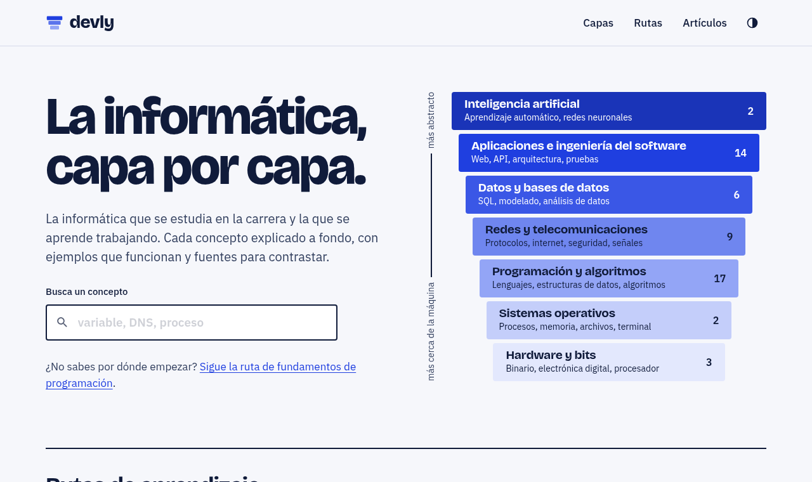

<div align="center">


# devly

**La informática, capa por capa.**

La informática que se estudia en la carrera y la que se aprende trabajando.<br>
Cada concepto explicado a fondo, con ejemplos que funcionan y fuentes para contrastar.

[**devly.nbfrodri.workers.dev**](https://devly.nbfrodri.workers.dev)

[](https://github.com/nbfrodri/devly/actions/workflows/ci.yml)

<a href="https://devly.nbfrodri.workers.dev">
	
</a>

</div>

## Qué es

devly es un sitio educativo en español. Cada artículo explica un solo concepto a fondo: por qué existe, cómo funciona paso a paso, qué errores se cometen al aprenderlo y dónde seguir leyendo. Todos citan sus fuentes y sus ejemplos de código se han ejecutado.

El contenido se ordena de tres maneras:

- **Capas**: siete áreas, de la más abstracta a la más cercana a la máquina. Es el mapa de la portada.
- **Artículos**: de concepto, de comparación ("diferencias entre X e Y") y definiciones cortas, cada uno con su nivel.
- **Rutas**: recorridos que ordenan artículos para que cada uno se apoye en el anterior.

| Capa | Qué cubre |
| --- | --- |
| Inteligencia artificial | Aprendizaje automático, redes neuronales, modelos de lenguaje |
| Aplicaciones e ingeniería del software | Web, API, arquitectura, seguridad de aplicaciones, control de versiones |
| Datos y bases de datos | SQL, NoSQL, modelado, estadística |
| Redes y telecomunicaciones | Protocolos, internet, criptografía y seguridad |
| Programación y algoritmos | Lenguajes, estructuras de datos, algoritmos, teoría de la computación |
| Sistemas operativos | Procesos, memoria, archivos |
| Hardware y bits | Representación de la información, procesador |

## Cómo está hecho

| | |
| --- | --- |
| Framework | [Astro](https://astro.build), con salida estática |
| Contenido | MDX y YAML en el repositorio, validados con esquemas al construir |
| Interactividad | Islas de React (las preguntas de comprobación) |
| Búsqueda | [Pagefind](https://pagefind.app), indexada tras el build |
| Estilos | Una hoja CSS con tokens y tema claro y oscuro |
| Calidad | TypeScript estricto, Biome, Vitest y `astro check` en cada push |
| Alojamiento | Cloudflare Workers, como sitio estático |

No hay base de datos ni panel de administración: publicar un artículo es añadir un archivo.

## Empezar

Hacen falta Node.js 22.12 o superior y pnpm 11.

```bash
pnpm install
pnpm dev        # servidor de desarrollo
pnpm check      # lint, tipos, tests y build: lo mismo que ejecuta el CI
pnpm build      # genera dist/ y el índice de búsqueda
pnpm preview    # sirve dist/ en local
```

La búsqueda solo funciona sobre el sitio construido: usa `pnpm build` y `pnpm preview` para probarla.

## Añadir un artículo

1. Crea `src/content/es/articles/<slug>.mdx` siguiendo la [guía de contenido](docs/content-guide.md). El esquema exige título, descripción, nivel, capa y al menos una fuente.
2. Míralo con `pnpm dev`.
3. Enlázalo desde los artículos que ya mencionan ese concepto y, si procede, añádelo a una ruta en `src/content/es/paths/`.
4. Ejecuta `pnpm check`. Lo que llega a `main` se publica.

El build falla si un artículo no cita fuentes, si una ruta apunta a un artículo que no existe o si un enlace interno está roto.

## Estructura

```
src/
  content/es/articles/   Artículos (MDX)
  content/es/paths/      Rutas (YAML)
  content.config.ts      Esquemas del contenido
  lib/                   Lógica con tests: capas, niveles, rutas
  components/            Componentes de Astro y de React
  pages/                 Portada, capas, rutas y artículos
  styles/global.css      Tokens de diseño y estilos
docs/                    Arquitectura, guía y plan de contenido
```

## Documentación

- [Arquitectura](docs/architecture.md): decisiones técnicas, modelo de contenido y sistema de diseño.
- [Guía de contenido](docs/content-guide.md): alcance, tipos de artículo, estructura, fuentes y estilo.
- [Plan de contenido](docs/plans/content-backlog.md): los próximos artículos.

## Despliegue

Cloudflare construye y publica cada push a `main` con `pnpm build` y `npx wrangler deploy`. [`wrangler.jsonc`](wrangler.jsonc) indica que solo se sirven los archivos estáticos de `dist/`.
