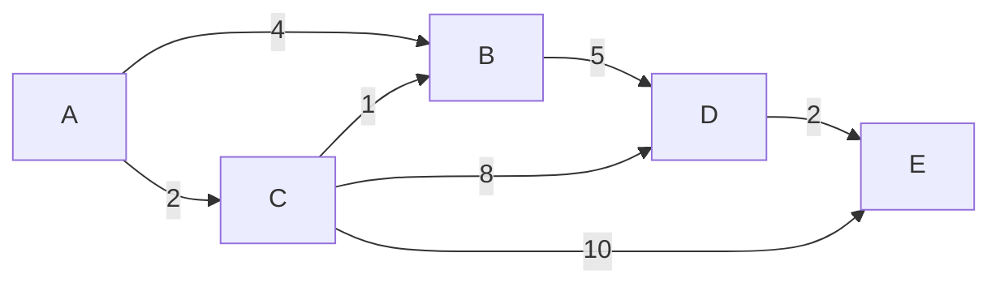

import { Quiz } from "@/components/quiz";

El **algoritmo de Dijkstra** calcula el camino de menor coste desde un nodo de un [grafo](/articulos/grafos/) hasta todos los demás, cuando las aristas tienen **pesos no negativos**: distancias, tiempos o costes. Lo ideó el informático neerlandés Edsger Dijkstra en 1956 y lo publicó en 1959.

Es el algoritmo que hay detrás de los navegadores de rutas y de parte del [enrutamiento](/articulos/enrutamiento/) en redes.

## Qué problema resuelve

La búsqueda en anchura encuentra el camino con **menos aristas**. Eso es el camino más corto solo si todas las aristas cuestan lo mismo.

Con pesos, deja de servir. Ir de A a B por una carretera directa de 100 kilómetros es una arista; ir pasando por C, con dos tramos de 20, son dos aristas y menos de la mitad de distancia.

Hace falta tener en cuenta el coste acumulado.

## La idea

El algoritmo mantiene, para cada nodo, la **mejor distancia conocida** desde el origen. Al principio es 0 para el origen e infinito para los demás.

Después repite:

1. De los nodos sin visitar, elige el que tiene la **menor distancia conocida**.
2. Lo marca como visitado. Su distancia ya es definitiva.
3. Para cada vecino, calcula la distancia pasando por este nodo. Si es mejor que la que tenía, la actualiza.

A ese último paso se le llama **relajar** una arista.

Es un algoritmo [voraz](/articulos/algoritmos-voraces/): en cada paso toma la mejor opción inmediata y no vuelve atrás.

### Por qué funciona

Cuando se elige el nodo sin visitar más cercano, ningún otro camino puede mejorar su distancia. Cualquier alternativa tendría que pasar por otro nodo sin visitar, que ya está igual de lejos o más, y a partir de ahí solo puede sumar.

Este razonamiento tiene una condición: que no haya pesos negativos.

## Paso a paso

Con este grafo, y saliendo de A:



| Paso | Se visita | A | B | C | D | E |
| --- | --- | --- | --- | --- | --- | --- |
| Inicio | | 0 | ∞ | ∞ | ∞ | ∞ |
| 1 | A | 0 | 4 | 2 | ∞ | ∞ |
| 2 | C | 0 | 3 | 2 | 10 | 12 |
| 3 | B | 0 | 3 | 2 | 8 | 12 |
| 4 | D | 0 | 3 | 2 | 8 | 10 |
| 5 | E | 0 | 3 | 2 | 8 | 10 |

En el paso 2, al visitar C, se descubre que a B se llega mejor por C, con coste 3, que directamente, con 4. La distancia se corrige. Lo mismo ocurre después con D y con E.

## El código

```js
const grafo = {
	A: { B: 4, C: 2 },
	B: { D: 5 },
	C: { B: 1, D: 8, E: 10 },
	D: { E: 2 },
	E: {},
};

function dijkstra(grafo, origen) {
	const distancias = {};
	const anterior = {};
	const pendientes = new Set(Object.keys(grafo));

	for (const nodo of pendientes) {
		distancias[nodo] = Infinity;
	}
	distancias[origen] = 0;

	while (pendientes.size > 0) {
		let actual = null;
		for (const nodo of pendientes) {
			if (actual === null || distancias[nodo] < distancias[actual]) {
				actual = nodo;
			}
		}

		if (distancias[actual] === Infinity) break;
		pendientes.delete(actual);

		for (const [vecino, peso] of Object.entries(grafo[actual])) {
			const nueva = distancias[actual] + peso;

			if (nueva < distancias[vecino]) {
				distancias[vecino] = nueva;
				anterior[vecino] = actual;
			}
		}
	}

	return { distancias, anterior };
}

function camino(anterior, distancias, destino) {
	if (!Number.isFinite(distancias[destino])) return null;
	const nodos = [destino];

	while (anterior[nodos[0]] !== undefined) {
		nodos.unshift(anterior[nodos[0]]);
	}

	return nodos;
}

const { distancias, anterior } = dijkstra(grafo, "A");

console.log(distancias.B); // 3
console.log(distancias.E); // 10
console.log(camino(anterior, distancias, "E").join(" ")); // "A C B D E"
```

Para reconstruir el camino, y no solo su coste, se anota de dónde se llegó a cada nodo. Al terminar, se sigue ese rastro hacia atrás desde el destino.

El `break` cubre el caso en que lo que queda sin visitar es inalcanzable. Su distancia permanece en `Infinity` y `camino` devuelve `null`, no una ruta de un solo nodo. El ejemplo supone un origen existente, todos los vecinos declarados y pesos finitos no negativos.

## Cuánto cuesta

La parte cara es el paso 1: encontrar el nodo pendiente más cercano. El código de arriba recorre todos cada vez.

| Cómo se busca el mínimo | Complejidad |
| --- | --- |
| Recorriendo todos los nodos | O(V²) |
| Con una cola de prioridad | O((V + E) log V) |

V es el número de nodos y E el de aristas, en la notación del artículo sobre [complejidad](/articulos/complejidad-algoritmica/).

Una [cola de prioridad](/articulos/monticulos-y-colas-de-prioridad/) entrega el mínimo sin recorrerlo todo. En un mapa de carreteras, con millones de nodos y pocas conexiones por nodo, la diferencia es entre algo inviable y algo instantáneo.

<Quiz
	client:visible
	question="En cada paso, ¿qué nodo elige visitar el algoritmo de Dijkstra?"
	options={[
		"El que tiene más vecinos",
		"El no visitado con menor distancia conocida desde el origen",
		"El más cercano al destino en línea recta",
	]}
	answer={1}
/>

## Su límite: los pesos negativos

Dijkstra da por definitiva la distancia de un nodo al visitarlo. Con una arista de peso negativo, un camino descubierto después podría mejorarla, y el resultado sería incorrecto.

Para grafos con pesos negativos se usa el algoritmo de **Bellman-Ford**, más lento, que además detecta si hay un ciclo de coste negativo, por el que se podría dar vueltas reduciendo el coste sin fin.

En casi todos los usos prácticos, distancias, tiempos, precios, los pesos no son negativos.

## Variantes

- **Parar al llegar.** Si solo interesa un destino, se detiene al visitarlo.
- **[A*](/articulos/algoritmo-a-estrella/).** Añade una estimación de lo que falta hasta el destino, para explorar primero en la dirección correcta. Es lo que se usa en mapas y videojuegos.
- **Búsqueda en anchura.** Es Dijkstra cuando todos los pesos valen 1.

## Dónde se usa

- **Rutas en mapas.** Las intersecciones son nodos; las calles, aristas con el tiempo de recorrido como peso.
- **Redes.** Protocolos de enrutamiento como OSPF hacen que cada router conozca el mapa de la red y calcule con Dijkstra el mejor camino a cada destino.
- **Planificación**, cuando los pasos tienen coste: el itinerario más barato con escalas.
- **Videojuegos y robótica**, para mover personajes o máquinas.

Los sistemas de mapas reales no ejecutan Dijkstra tal cual sobre un continente entero: precalculan atajos para responder en milisegundos. La base sigue siendo la misma.

## Lo esencial

- Dijkstra halla los caminos de menor coste desde un origen en un grafo con pesos.
- En cada paso visita el nodo pendiente más cercano y mejora las distancias de sus vecinos.
- La distancia de un nodo visitado es definitiva.
- Con una cola de prioridad es eficiente incluso en grafos enormes.
- No funciona con pesos negativos.
