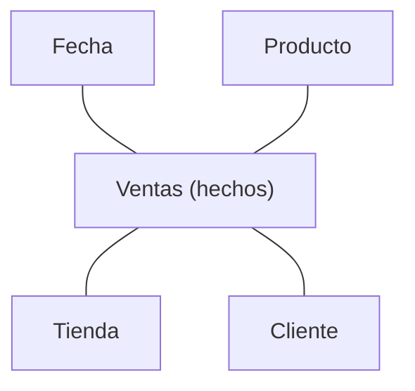

import { Quiz } from "@/components/quiz";

Un **almacén de datos**, en inglés *data warehouse*, es una base de datos diseñada para **analizar**: reúne información de muchas fuentes, organizada para consultas analíticas, para responder preguntas de negocio. Un **lago de datos**, en inglés *data lake*, es un almacenamiento donde se conservan datos de formatos diversos, a menudo con una zona de entradas originales y otras de datos transformados. No exige guardar todo ni conservarlo indefinidamente.

## Separar cargas cuando lo necesitan

La [base de datos](/articulos/que-es-una-base-de-datos/) de una aplicación está pensada para su funcionamiento diario: muchas operaciones pequeñas y rápidas, crear un pedido, actualizar un saldo. Se llama **procesamiento transaccional**, u OLTP.

Las consultas analíticas suelen leer y agregar muchas más filas que una operación individual. "Ventas por región y mes en los últimos cinco años, comparadas con el año anterior" puede requerir recorrer millones de filas si el negocio tiene ese volumen.

Lanzarlo contra la base de datos de producción puede competir por CPU, memoria y almacenamiento con las operaciones de los usuarios. Además, la información está repartida: las ventas en una base, los clientes en el sistema comercial, las visitas en la analítica web. Separar la carga y reunir los datos puede ayudar; no es obligatorio para cualquier volumen o consulta. Es el **procesamiento analítico**, u OLAP.

## Almacén de datos

Reúne datos de varias fuentes, los limpia, los unifica y los organiza para consultarlos. Llegan mediante [procesos ETL o ELT](/articulos/procesos-etl/), por lotes o de forma incremental. Cargarlos en un almacén no los valida automáticamente.

### Esquema en estrella

Una organización frecuente es el [esquema en estrella](/articulos/que-es-un-esquema-en-estrella/): agrupa atributos en dimensiones para simplificar consultas. Puede repetir algunos datos que un diseño más [normalizado](/articulos/normalizacion-de-bases-de-datos/) separaría en otras tablas.

- **Tabla de hechos**: los sucesos que se miden, con sus cifras. Cada venta: importe, unidades.
- **Tablas de dimensiones**: el contexto por el que se analiza. Cuándo, qué producto, qué cliente, qué tienda.

Las preguntas se responden uniendo los hechos con las dimensiones y agrupando: ventas por mes y por categoría de producto.

### Almacenamiento por columnas

Muchos motores analíticos utilizan almacenamiento **por columnas**. Para sumar los importes de mil millones de ventas, solo hay que leer la columna del importe, no todo lo demás. Y una columna de valores parecidos se [comprime](/articulos/compresion-de-datos/) muy bien.

Esa organización suele favorecer agregaciones de pocas columnas. Leer filas completas puede exigir reunir datos de varios bloques; el resultado depende del motor, la consulta, los índices y la compresión.

## Lago de datos

Un lago permite conservar entradas de distintos tipos: registros de servidores, eventos de la aplicación, [JSON](/articulos/formatos-de-datos-json-csv-xml/), imágenes, exportaciones de otras bases de datos. Suele apoyarse en almacenamiento de objetos, en [la nube](/articulos/computacion-en-la-nube/) o en infraestructura propia. Debes decidir qué recoger, quién accede y cuánto se conserva.

En una zona de datos originales, parte de la estructura puede interpretarse **al leer**. Se llama **esquema en lectura**, frente al **esquema en escritura** del almacén.

Las zonas preparadas pueden guardar tablas con esquemas explícitos y formatos por columnas, como Parquet, para facilitar consultas. Un lago puede contener tanto el JSON recibido como una tabla derivada; no se limita a datos sin tratar.

### El riesgo: un pantano

Guardar todo sin orden es fácil. Encontrar algo después, no. Un lago sin catálogo, sin dueños, sin saber qué significa cada archivo ni si está actualizado, se convierte en un **pantano de datos**: mucho volumen y poca utilidad.

## Comparación

| | Almacén de datos | Lago de datos |
| --- | --- | --- |
| Datos | Modelados para análisis; pueden incluir zonas de entrada | Originales y transformados, en varios formatos |
| Esquema | Habitualmente explícito en las tablas consultadas | Puede interpretarse al leer o fijarse en tablas preparadas |
| Coste | Almacenamiento, cómputo y operación del motor | Almacenamiento, motores de consulta, catálogo y operación |
| Usuarios | Analistas y equipos que consumen datos preparados | Ingenieros, analistas y científicos de datos |
| Calidad | Depende de validación, procedencia y mantenimiento | Depende de los mismos controles |
| Flexibilidad | Evolucionar modelos y consultas requiere trabajo | Conservar entradas permite otros usos si siguen disponibles |
| Uso típico | Cuadros de mando, informes | Exploración, [aprendizaje automático](/articulos/que-es-el-aprendizaje-automatico/) |

<Quiz
	client:visible
	question="¿Qué significa que un lago de datos aplica el esquema al leer?"
	options={[
		"Que los datos se guardan en bruto y su estructura se interpreta al consultarlos",
		"Que no se pueden leer datos sin un esquema previo",
		"Que los datos se borran después de leerlos",
	]}
	answer={0}
/>

## El mismo informe en ambos

Una tienda recibe pedidos JSON y quiere sumar ventas mensuales por región. En un almacén, carga ventas con fecha, región e importe ya definidos y ejecuta una agregación SQL. En un lago, puede conservar el JSON, producir una tabla Parquet con esas mismas columnas y consultarla con un motor analítico. Si usan los mismos registros, unidades y reglas, el total debe coincidir.

El almacén encaja cuando importa servir consultas repetidas sobre definiciones compartidas. El lago puede facilitar conservar imágenes, registros y tablas para usos distintos. Ninguno evita definir qué es una venta, tratar devoluciones o comprobar duplicados; esas decisiones determinan la calidad del informe.

## Juntos

Una arquitectura puede combinar los dos. Los datos llegan primero al lago, tal cual. Desde ahí, se procesan y se cargan en el almacén lo que se va a consultar a menudo.

Las arquitecturas llamadas **lakehouse** combinan almacenamiento del lago con formatos de tabla que añaden transacciones, esquemas y versiones. Estas capacidades coordinan lecturas y escrituras sobre tablas, pero no certifican que sus valores sean correctos ni eliminan todo movimiento de datos.

## Lo que cuesta

- **Calidad de datos.** Lo más difícil no es la tecnología, sino que los datos sean correctos y signifiquen lo mismo para todos. Que "cliente activo" se calcule igual en todos los informes.
- **Gobierno.** Saber quién puede ver qué, sobre todo con datos personales, sujetos al [RGPD](/articulos/rgpd-y-proteccion-de-datos/). Un lago con todo dentro es un riesgo si nadie controla el acceso.
- **Retraso.** La frescura depende de la ingesta y el procesamiento: desde lotes diarios hasta actualizaciones frecuentes mediante CDC. Debe medirse el retraso de extremo a extremo.

## Lo esencial

- Separar análisis y operaciones puede evitar competencia por recursos; depende de la carga.
- Un almacén organiza datos para consultas analíticas con definiciones compartidas.
- Un lago puede conservar entradas originales y zonas transformadas con esquema.
- Calidad y coste dependen del diseño, los procesos y la carga, no del nombre.
- Un lago sin orden ni catálogo se vuelve inútil.
