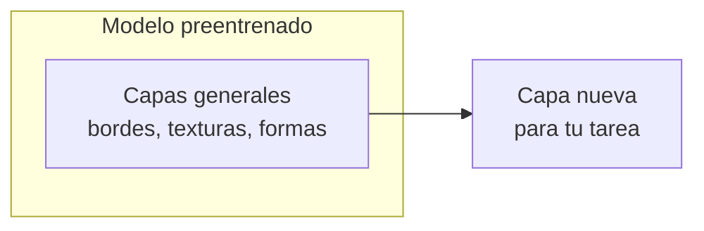

import { Quiz } from "@/components/quiz";

El **aprendizaje por transferencia** consiste en tomar lo que un modelo ha aprendido resolviendo un problema y **aprovecharlo para otro problema parecido**. En lugar de entrenar desde cero, se parte de un modelo ya entrenado con muchos datos y se adapta a la tarea nueva con pocos.

Es la razón por la que hoy casi nadie entrena un modelo de visión o de lenguaje desde cero.

## Por qué funciona

Una [red convolucional](/articulos/redes-convolucionales/) entrenada para reconocer mil categorías de objetos aprende, en sus primeras capas, cosas muy generales: bordes, texturas, formas. Solo las últimas capas se especializan en distinguir perros de coches. Esas capas generales sirven igual para reconocer radiografías, hojas enfermas o piezas defectuosas.

El curso CS231n de Stanford lo resume: en la práctica, pocas personas entrenan una red convolucional entera desde cero, porque es raro tener un conjunto de datos lo bastante grande. Lo habitual es partir de una red preentrenada con un conjunto enorme, como ImageNet, con 1,2 millones de imágenes de mil categorías.

## Dos formas de hacerlo



1. **Extractor de características**: se **congelan** las capas del modelo base, es decir, no se modifican al entrenar, y se quita la última capa. Se añade una capa nueva para la tarea y solo se entrena esa. Rápido y con muy pocos datos.
2. **Ajuste fino**: después, opcionalmente, se **descongela** todo o parte del modelo y se sigue entrenando con los datos nuevos, con una tasa de aprendizaje muy baja para no destruir lo aprendido. Es el [ajuste fino](/articulos/ajuste-fino/).

La guía de Keras describe exactamente ese flujo: congelar el modelo base para no destruir la información que contiene, entrenar la parte nueva y, como último paso opcional, ajustar todo con una tasa de aprendizaje muy pequeña.

## Cuánto se entrena

```js
const parametrosBase = 23_500_000;
const parametrosCabeza = 2049; // 2048 entradas y un sesgo

const entrenables = parametrosCabeza / (parametrosBase + parametrosCabeza);
console.log((entrenables * 100).toFixed(3)); // "0.009"
```

En la primera fase, se entrena menos de una diezmilésima parte del modelo. Por eso basta con unos cientos de ejemplos donde entrenar desde cero exigiría millones, y por eso el riesgo de [sobreajuste](/articulos/sobreajuste-y-subajuste/) es mucho menor.

## Cuándo funciona y cuándo no

- **Funciona** cuando la tarea nueva se parece a la original: imágenes con imágenes, texto con texto.
- **Funciona peor** cuando los datos son muy distintos: un modelo de fotos de la calle aporta poco a las imágenes de un microscopio electrónico, aunque algo siempre ayuda.
- **Hereda los defectos** del modelo base: sus [sesgos](/articulos/sesgos-en-los-algoritmos/), sus carencias y sus errores.

## En los modelos de lenguaje

Los [modelos de lenguaje](/articulos/modelos-de-lenguaje/) llevan la idea al extremo: un modelo se preentrena con enormes cantidades de texto y luego se adapta, con ajuste fino, a seguir instrucciones, a un dominio o a un estilo. Todo ello es aprendizaje por transferencia.

## Lo esencial

- El aprendizaje por transferencia reutiliza un modelo entrenado en una tarea grande para otra parecida.
- Las primeras capas aprenden rasgos generales que sirven para muchas tareas.
- Se congela el modelo base y se entrena una capa nueva; después, opcionalmente, se ajusta todo.
- Necesita muchos menos datos, pero hereda los sesgos y limitaciones del modelo de partida.
