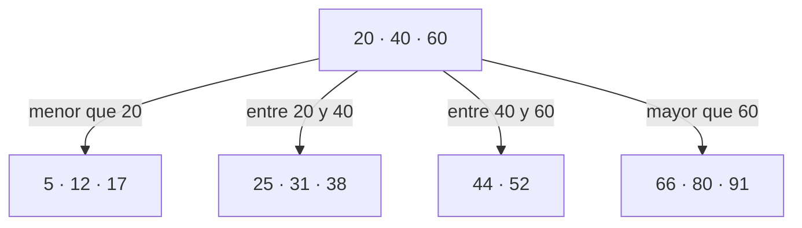

import { Quiz } from "@/components/quiz";

Un **árbol B** es un árbol de búsqueda equilibrado en el que cada nodo guarda **muchas claves** y tiene **muchos hijos**, no solo dos. Está diseñado para datos que viven en disco, donde lo caro es cada lectura. Es la estructura que hay detrás de casi todos los [índices de bases de datos](/articulos/indices-de-bases-de-datos/) y de muchos [sistemas de archivos](/articulos/sistema-de-archivos/).

## El problema: el disco

En memoria, un [árbol equilibrado](/articulos/arboles-equilibrados/) binario es excelente. Para mil millones de claves tiene unos 30 niveles: 30 comparaciones.

Si los nodos no están en caché y cada uno requiere acceder a una página distinta, cada nivel puede suponer una **lectura** de almacenamiento. Leer de un [disco o una SSD](/articulos/discos-duros-y-ssd/) es miles de veces más lento que comparar dos números en memoria. Treinta lecturas por búsqueda es demasiado.

Además, el disco no lee bytes sueltos, sino **bloques** de varios kilobytes. Leer un nodo binario, que ocupa unos pocos bytes, desperdicia casi todo el bloque.

## La idea: nodos anchos

Si de todos modos se lee un bloque entero, que el nodo **llene el bloque**. En lugar de una clave y dos hijos, cientos de claves y cientos de hijos.



Dentro de un nodo, las claves están ordenadas. Para buscar el 31, se mira el nodo raíz: está entre 20 y 40, así que se baja por el segundo hijo, y ahí se encuentra.

Con muchos hijos por nodo, el árbol es **muy bajo**:

```js
const niveles = (claves, hijosPorNodo) =>
	Math.ceil(Math.log(claves) / Math.log(hijosPorNodo));

console.log(niveles(1e9, 2)); // 30
console.log(niveles(1e9, 500)); // 4
```

El cálculo ilustra el orden de magnitud, suponiendo una ramificación efectiva cercana a 500; no calcula la altura exacta de cualquier árbol B. La ocupación, el tamaño de las claves y las divisiones modifican esa cifra. Mantener los niveles superiores en caché reduce las lecturas de almacenamiento, pero no garantiza una o dos en todos los casos.

## Cómo se mantiene equilibrado

Cada nodo tiene un mínimo y un máximo de claves. Todas las hojas están a la misma profundidad.

- **Al insertar**, la clave va a su hoja. Si la hoja se llena, se **divide** en dos y la clave del medio sube al padre. Si el padre se llena, también se divide. Cuando se divide la raíz, el árbol gana un nivel.
- **Al borrar**, si un nodo se queda con muy pocas claves, toma prestadas de un hermano o se **fusiona** con él.

El árbol crece hacia arriba, desde la raíz, y por eso siempre está perfectamente equilibrado.

## La variante B+

Las bases de datos suelen usar un **árbol B+**:

- Los nodos internos solo guardan claves para orientarse.
- Todos los datos están en las **hojas**.
- Las hojas están **enlazadas** entre sí, en orden.

La ventaja está en las consultas por rango: para "pedidos entre el 1 y el 31 de marzo", se busca el primero y se recorren las hojas enlazadas hacia la derecha, sin volver a subir por el árbol.

<Quiz
	client:visible
	question="¿Por qué los árboles B tienen tantos hijos por nodo?"
	options={[
		"Para ocupar menos memoria",
		"Para que el árbol sea muy bajo y cada búsqueda necesite pocas lecturas de disco",
		"Porque así no hace falta ordenarlos",
	]}
	answer={1}
/>

## Dónde está

- **Índices de bases de datos.** Es el tipo de índice por defecto de [PostgreSQL](/articulos/que-es-postgresql/). SQLite guarda las propias tablas en árboles B.
- **Sistemas de archivos**, para organizar los directorios y localizar los bloques de cada archivo.

Explica por qué un índice permite **buscar por igualdad, por rangos y ordenar**, pero no ayuda con búsquedas como "nombres que terminan en -ez": el árbol está ordenado por el principio de la clave, no por el final.

## Con qué no confundirlo

La B no significa "binario". Un árbol binario tiene dos hijos por nodo; un árbol B, muchos. El nombre no determina su capacidad: cada implementación fija cuántas claves caben por nodo y cómo mantiene la ocupación.

## Lo esencial

- Un árbol B guarda muchas claves y muchos hijos en cada nodo.
- Agrupar claves en páginas reduce la altura y las lecturas necesarias; la caché puede resolver parte de ellas.
- Con cientos de hijos por nodo, mil millones de claves caben en unos pocos niveles.
- Se mantiene equilibrado dividiendo y fusionando nodos.
- Es la estructura de los índices de casi todas las bases de datos.
