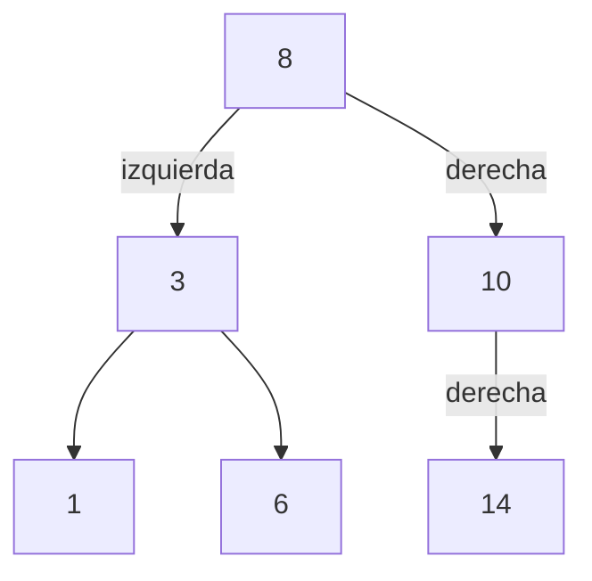
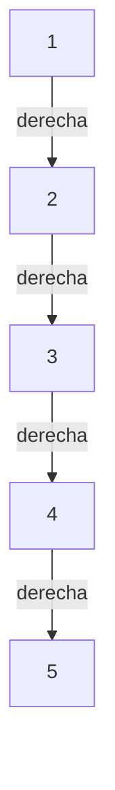

import { Quiz } from "@/components/quiz";

Un **árbol** es una estructura de datos en la que los elementos se organizan de forma jerárquica, cada uno con otros colgando de él. Un **árbol binario de búsqueda** (ABB) es un árbol con una regla de orden que permite encontrar un valor descartando una rama entera en cada paso.

## Qué es un árbol

Los árboles representan jerarquías: las carpetas de un disco, los elementos anidados de un documento [HTML](/articulos/que-es-html/), el organigrama de una empresa.

Se dibujan al revés que los de verdad, con la raíz arriba. Su vocabulario:

| Término | Significado |
| --- | --- |
| Nodo | Cada elemento del árbol |
| Raíz | El nodo de arriba, del que cuelgan todos |
| Hijo | Un nodo que cuelga directamente de otro |
| Padre | El nodo del que cuelga otro |
| Hoja | Un nodo sin hijos |
| Subárbol | Un nodo junto con todo lo que cuelga de él |
| Altura | El número de niveles desde la raíz hasta la hoja más lejana |

Un **árbol binario** es aquel en el que cada nodo tiene como mucho dos hijos: uno izquierdo y uno derecho.

## La regla del árbol binario de búsqueda

Un ABB es un árbol binario que cumple una condición en **todos** sus nodos:

- Todo lo que hay en su subárbol izquierdo es **menor** que él.
- Todo lo que hay en su subárbol derecho es **mayor** que él.

Este árbol la cumple:



A la izquierda del 8 están 3, 1 y 6, todos menores. A la derecha, 10 y 14, mayores. Y lo mismo se cumple dentro de cada subárbol.

## Buscar

La regla permite buscar igual que en la [búsqueda binaria](/articulos/busqueda-binaria/). Empiezas en la raíz y en cada nodo decides:

- Si es el valor buscado, has terminado.
- Si el buscado es menor, sigues por la izquierda.
- Si es mayor, por la derecha.
- Si llegas a un hueco, el valor no está.

Para buscar el 6: es menor que 8, izquierda; es mayor que 3, derecha; encontrado. Tres comparaciones, sin mirar el resto del árbol.

## Insertar

Insertar sigue el mismo recorrido que buscar. Se baja comparando hasta dar con un hueco, y el nuevo nodo se coloca ahí. Así la regla se sigue cumpliendo.

```js
class Nodo {
	constructor(valor) {
		this.valor = valor;
		this.izquierdo = null;
		this.derecho = null;
	}
}

function insertar(nodo, valor) {
	if (nodo === null) {
		return new Nodo(valor);
	}

	if (valor < nodo.valor) {
		nodo.izquierdo = insertar(nodo.izquierdo, valor);
	} else if (valor > nodo.valor) {
		nodo.derecho = insertar(nodo.derecho, valor);
	}

	return nodo;
}

function contiene(nodo, valor) {
	if (nodo === null) {
		return false;
	}

	if (valor === nodo.valor) {
		return true;
	}

	return valor < nodo.valor
		? contiene(nodo.izquierdo, valor)
		: contiene(nodo.derecho, valor);
}

let raiz = null;
for (const valor of [8, 3, 10, 1, 6, 14]) {
	raiz = insertar(raiz, valor);
}

console.log(contiene(raiz, 6)); // true
console.log(contiene(raiz, 7)); // false
```

Las dos funciones son [recursivas](/articulos/recursividad/): cada subárbol es a su vez un árbol, así que el mismo procedimiento sirve en cada nivel. El caso base es encontrar un hueco.

## Borrar sin romper el orden

El caso depende de los hijos del nodo localizado. En el árbol anterior:

| Nodo que se borra | Situación | Cambio |
| --- | --- | --- |
| 1 | Es una hoja | El enlace izquierdo de 3 pasa a `null` |
| 10 | Tiene un hijo, 14 | El enlace derecho de 8 pasa a 14 |
| 3 | Tiene dos hijos, 1 y 6 | Se sustituye su valor por 6, el menor de su subárbol derecho, y se elimina el antiguo nodo 6 |

Son tres operaciones independientes sobre el árbol original. En el tercer caso, el sucesor en orden no tiene hijo izquierdo: eliminarlo se reduce a uno de los dos casos sencillos. Reemplazar el nodo por cualquier descendiente podría dejar valores en el lado incorrecto. Buscar el nodo y localizar su sucesor cuesta O(h), donde `h` es la altura.

El código de inserción ignora los valores repetidos: representa un conjunto. Si necesitas duplicados, debes decidir si contar apariciones o añadir otro criterio de orden.

## Recorrer en orden

Si visitas primero el subárbol izquierdo, después el nodo y por último el derecho, obtienes los valores ordenados de menor a mayor. Se llama **recorrido en orden**.

```js
function enOrden(nodo, resultado = []) {
	if (nodo !== null) {
		enOrden(nodo.izquierdo, resultado);
		resultado.push(nodo.valor);
		enOrden(nodo.derecho, resultado);
	}

	return resultado;
}

const arbol = {
	valor: 8,
	izquierdo: {
		valor: 3,
		izquierdo: { valor: 1, izquierdo: null, derecho: null },
		derecho: { valor: 6, izquierdo: null, derecho: null },
	},
	derecho: { valor: 10, izquierdo: null, derecho: null },
};

console.log(enOrden(arbol).join(" ")); // "1 3 6 8 10"
```

Es la ventaja frente a una [tabla hash](/articulos/tablas-hash/): el árbol mantiene los datos ordenados. Permite obtener el mínimo, el máximo o todos los valores de un intervalo sin ordenar nada.

## El coste depende de la forma

Buscar e insertar recorren un camino desde la raíz hacia abajo, así que su coste es proporcional a la **altura** del árbol.

Si el árbol está **equilibrado**, con los nodos repartidos por igual a los dos lados, la altura crece muy despacio: con un millón de nodos ronda los veinte niveles. Las operaciones son O(log n).

Pero la forma depende del orden de inserción. Si insertas valores ya ordenados, como 1, 2, 3, 4 y 5, cada uno es mayor que el anterior y va siempre a la derecha:



El árbol degenera en una [lista enlazada](/articulos/listas-enlazadas/) y las operaciones pasan a costar O(n).

| | Árbol equilibrado | Árbol degenerado |
| --- | --- | --- |
| Buscar | O(log n) | O(n) |
| Insertar | O(log n) | O(n) |

<Quiz
	client:visible
	question="Insertas en un árbol binario de búsqueda vacío los valores 1, 2, 3, 4 y 5, en ese orden. ¿Qué forma toma?"
	options={[
		"Un árbol equilibrado",
		"Una cadena en la que cada nodo solo tiene hijo derecho",
		"Depende del lenguaje",
	]}
	answer={1}
/>

### Árboles que se equilibran solos

Para evitarlo existen los **árboles autoequilibrados**, como los AVL y los rojo-negro. Después de cada inserción o borrado reorganizan algunos nodos para mantener la altura baja, lo que garantiza O(log n) en todos los casos. Son los que se usan en la práctica.

Los índices de una [base de datos](/articulos/que-es-una-base-de-datos/) se apoyan en una variante con muchos hijos por nodo, el árbol B, pensada para minimizar las lecturas de disco.

## Para seguir

Para que el árbol no degenere en una lista, existen los [árboles equilibrados](/articulos/arboles-equilibrados/). Las bases de datos usan una variante con muchos hijos por nodo, el [árbol B](/articulos/arboles-b/). Para buscar por prefijos existe el [trie](/articulos/tries/).

## Errores comunes

- **Suponer que cada rama contiene la mitad de los nodos.** La regla de orden no garantiza equilibrio; el coste depende de la altura.
- **Borrar un nodo con dos hijos como si fuera una hoja.** Desconectar el nodo también perdería sus descendientes; hay que conservar los enlaces y el orden.

## Lo esencial

- Un árbol organiza los datos en jerarquía; uno binario tiene como mucho dos hijos por nodo.
- En un árbol binario de búsqueda, lo menor queda a la izquierda y lo mayor a la derecha.
- Buscar e insertar cuestan lo que mide la altura: O(log n) si está equilibrado, O(n) si degenera.
- Mantiene los datos ordenados, algo que una tabla hash no ofrece.
