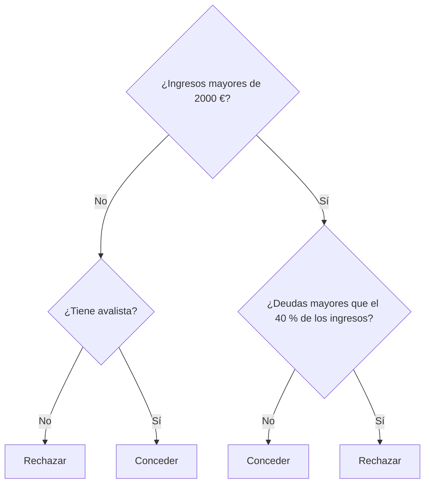

import { Quiz } from "@/components/quiz";

Un **árbol de decisión** es un modelo de [aprendizaje automático](/articulos/que-es-el-aprendizaje-automatico/) que hace predicciones mediante una serie de preguntas sobre los datos. Cada pregunta divide los casos en dos grupos, y cada grupo se sigue dividiendo hasta llegar a una respuesta. Sirve tanto para [clasificar como para predecir valores](/articulos/clasificacion-y-regresion/).

Su forma es la de un diagrama de flujo, y por eso es uno de los pocos modelos que una persona puede leer y entender.

## Cómo funciona

Para decidir si se concede un préstamo:



Para un caso nuevo, se empieza arriba y se baja respondiendo a cada pregunta hasta llegar a una **hoja**, que da la respuesta.

Las preguntas no las escribe nadie: el algoritmo las **aprende** de los datos.

## Cómo se construye

En cada paso, el algoritmo busca la pregunta que **mejor separa** los casos. Una buena pregunta deja grupos lo más puros posible: casi todos aprobados de un lado, casi todos suspensos del otro.

### Medir la pureza

Una medida habitual es la **impureza de Gini**: la probabilidad de equivocarse si se etiqueta un elemento al azar según las proporciones del grupo. Vale 0 si el grupo es puro, y 0,5 si está mezclado a partes iguales entre dos clases.

```js
function gini(etiquetas) {
	const total = etiquetas.length;
	const unos = etiquetas.filter((e) => e === 1).length / total;

	return 1 - (unos ** 2 + (1 - unos) ** 2);
}

const datos = [
	{ horas: 1, aprueba: 0 },
	{ horas: 2, aprueba: 0 },
	{ horas: 3, aprueba: 0 },
	{ horas: 4, aprueba: 1 },
	{ horas: 5, aprueba: 1 },
	{ horas: 6, aprueba: 1 },
];

function mejorUmbral(datos) {
	let mejor = null;

	for (let i = 1; i < datos.length; i++) {
		const umbral = (datos[i - 1].horas + datos[i].horas) / 2;
		const izquierda = datos.filter((d) => d.horas < umbral).map((d) => d.aprueba);
		const derecha = datos.filter((d) => d.horas >= umbral).map((d) => d.aprueba);
		const impureza =
			(izquierda.length * gini(izquierda) + derecha.length * gini(derecha)) /
			datos.length;

		if (mejor === null || impureza < mejor.impureza) {
			mejor = { umbral, impureza };
		}
	}

	return mejor;
}

console.log(gini(datos.map((d) => d.aprueba))); // 0.5
console.log(mejorUmbral(datos).umbral); // 3.5
console.log(mejorUmbral(datos).impureza); // 0
```

Antes de dividir, el grupo está mezclado al 50 %. El algoritmo prueba cada posible corte y encuentra que "¿ha estudiado más de 3,5 horas?" separa perfectamente a los que aprueban de los que no.

Con varias características, prueba todas y elige la mejor. Después repite el proceso en cada grupo resultante.

## Cuándo parar

Si se deja crecer sin límite, el árbol sigue dividiendo hasta que cada hoja contiene un solo caso. Acierta el 100 % en los datos de entrenamiento y se equivoca mucho con datos nuevos: ha memorizado, incluido el ruido. Es el [sobreajuste](/articulos/sobreajuste-y-subajuste/).

Para evitarlo:

- **Limitar la profundidad.**
- **Exigir un mínimo de casos** por hoja.
- **Podar**: construir el árbol completo y eliminar las ramas que no mejoran el resultado con datos de validación.

<Quiz
	client:visible
	question="¿Qué busca el algoritmo en cada división de un árbol de decisión?"
	options={[
		"La pregunta que deja grupos lo más homogéneos posible",
		"La característica con más valores distintos",
		"Dividir los datos en dos mitades iguales",
	]}
	answer={0}
/>

## Ventajas

- **Se puede leer.** Cualquiera puede seguir las preguntas y entender por qué se tomó una decisión. En un préstamo o un diagnóstico, poder explicarlo importa, como recoge [IA explicable](/articulos/ia-explicable/).
- **Pocos preparativos.** Funciona con números y categorías, y no necesita que los datos estén en la misma escala.
- **Capta relaciones no lineales** e interacciones entre variables.
- **Rápido** de entrenar y de usar.

## Inconvenientes

- **Inestable.** Un pequeño cambio en los datos puede producir un árbol completamente distinto.
- **Tiende a sobreajustar.**
- **Fronteras en escalera.** Divide con cortes rectos, uno por característica, y aproxima mal las relaciones suaves.
- **Un solo árbol suele ser poco preciso** comparado con otros modelos.

## Muchos árboles juntos

La solución a casi todos estos problemas es combinar muchos árboles. Es un **conjunto**, en inglés *ensemble*.

### [Bosques aleatorios](/articulos/bosques-aleatorios/)

Se entrenan cientos de árboles, cada uno con una muestra al azar de los datos y considerando en cada división solo una parte de las características. Para predecir, votan.

Cada árbol se equivoca a su manera, y al promediar, los errores se compensan. Es el mismo principio por el que la media de muchas estimaciones independientes suele acertar más que cualquiera de ellas.

### Potenciación del gradiente

Los árboles se construyen **uno tras otro**. Cada uno nuevo se entrena para corregir los errores que cometen los anteriores juntos.

Es, en la práctica, de las técnicas más precisas para **datos tabulares**: los que vienen en filas y columnas, como una hoja de cálculo o una [base de datos](/articulos/que-es-sql/). En ese tipo de datos, suele superar a las redes neuronales.

| | Un árbol | Bosque aleatorio | Potenciación del gradiente |
| --- | --- | --- | --- |
| Cómo combina | No combina | Árboles independientes que votan | Árboles que corrigen a los anteriores |
| Precisión | Baja | Alta | Muy alta |
| Se puede leer | Sí | No, en conjunto | No, en conjunto |
| Riesgo de sobreajuste | Alto | Bajo | Medio, requiere ajuste |

Al combinarlos se pierde la principal virtud del árbol solo: ya no se puede seguir el razonamiento. Hay técnicas para estimar qué características pesaron más en una predicción.

## Dónde se usan

- **Riesgo de crédito y detección de fraude.**
- **Diagnóstico**, cuando hace falta que un profesional entienda el criterio.
- **Predicción de bajas de clientes**, precios, demanda.
- **Clasificación de correo** y de transacciones.

En general, para cualquier problema con datos en tabla. Las redes neuronales dominan en imágenes, sonido y texto; los conjuntos de árboles, en tablas.

Los [bosques aleatorios](/articulos/bosques-aleatorios/) combinan árboles diversos para reducir la dependencia de uno solo.

El [gradient boosting](/articulos/gradient-boosting/) construye una secuencia de árboles que aportan correcciones a la predicción anterior.

## Lo esencial

- Un árbol de decisión predice con una serie de preguntas sobre los datos.
- Se construye eligiendo en cada paso la división que deja grupos más homogéneos.
- Es fácil de entender y explicar, pero inestable y propenso al sobreajuste.
- Los bosques aleatorios combinan muchos árboles independientes que votan.
- La potenciación del gradiente encadena árboles que corrigen errores, y destaca con datos tabulares.
