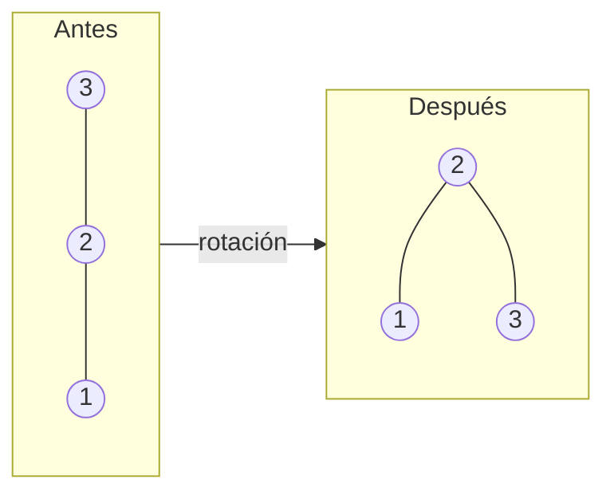

import { Quiz } from "@/components/quiz";

Un **árbol equilibrado** es un [árbol binario de búsqueda](/articulos/arboles-binarios-de-busqueda/) que se reorganiza automáticamente al insertar y borrar, para que su **altura** se mantenga pequeña. Así garantiza que buscar, insertar y borrar cuesten siempre O(log n), en el peor caso. Los dos tipos más conocidos son los **árboles AVL** y los **rojo-negro**.

## El problema

En un árbol de búsqueda, cada operación recorre un camino desde la raíz. Su coste depende de la altura del árbol.

Si los datos llegan desordenados, el árbol queda más o menos frondoso, con una altura cercana a log n. Pero si llegan **ordenados**, cada valor nuevo va a la derecha del anterior, y el árbol se convierte en una lista: altura n. Buscar deja de ser logarítmico y pasa a ser lineal.

Y los datos ordenados no son un caso raro: identificadores que crecen, fechas, nombres ya clasificados.

## La solución: rotaciones

Los árboles equilibrados vigilan su forma. Cuando una inserción desequilibra una zona, la corrigen con **rotaciones**: pequeños reajustes que suben un nodo y bajan otro, sin romper el orden del árbol.



Tres valores insertados en orden descendente forman una cadena. Una rotación los convierte en un árbol de altura 2. El orden se conserva: lo de la izquierda sigue siendo menor.

## Árboles AVL

El primero, de 1962, lleva las iniciales de sus inventores, Adelson-Velsky y Landis.

Su regla: en cada nodo, la altura de sus dos subárboles **no puede diferir en más de 1**. Si una inserción la incumple, se rota.

```js
const altura = (n) => (n ? n.altura : 0);
const nodo = (valor, izq = null, der = null) => ({
	valor,
	izq,
	der,
	altura: 1 + Math.max(altura(izq), altura(der)),
});

const rotarDerecha = (n) =>
	nodo(n.izq.valor, n.izq.izq, nodo(n.valor, n.izq.der, n.der));
const rotarIzquierda = (n) =>
	nodo(n.der.valor, nodo(n.valor, n.izq, n.der.izq), n.der.der);

function equilibrar(n) {
	const diferencia = altura(n.izq) - altura(n.der);

	if (diferencia > 1) {
		if (altura(n.izq.izq) < altura(n.izq.der)) {
			n = nodo(n.valor, rotarIzquierda(n.izq), n.der);
		}
		return rotarDerecha(n);
	}

	if (diferencia < -1) {
		if (altura(n.der.der) < altura(n.der.izq)) {
			n = nodo(n.valor, n.izq, rotarDerecha(n.der));
		}
		return rotarIzquierda(n);
	}

	return n;
}

function insertarAvl(n, v) {
	if (!n) return nodo(v);
	const nuevo =
		v < n.valor
			? nodo(n.valor, insertarAvl(n.izq, v), n.der)
			: nodo(n.valor, n.izq, insertarAvl(n.der, v));
	return equilibrar(nuevo);
}

function insertarSimple(n, v) {
	if (!n) return nodo(v);
	return v < n.valor
		? nodo(n.valor, insertarSimple(n.izq, v), n.der)
		: nodo(n.valor, n.izq, insertarSimple(n.der, v));
}

let simple = null;
let avl = null;
for (let i = 1; i <= 100; i++) {
	simple = insertarSimple(simple, i);
	avl = insertarAvl(avl, i);
}

console.log(simple.altura); // 100
console.log(avl.altura); // 7
```

Cien valores ordenados. El árbol simple acaba con altura 100: una lista. El AVL, con altura 7. Buscar en el primero puede costar 100 pasos; en el segundo, como mucho 7.

## Árboles rojo-negro

Usan una regla más relajada. Cada nodo se marca como **rojo** o **negro**, y se exige, entre otras cosas, que no haya dos rojos seguidos y que todos los caminos de la raíz a las hojas tengan el mismo número de nodos negros.

Eso garantiza que el camino más largo no mide más del doble que el más corto. El árbol está algo menos equilibrado que un AVL, pero necesita **menos rotaciones** al insertar y borrar.

| | AVL | Rojo-negro |
| --- | --- | --- |
| Regla | Subárboles con alturas que difieren en 1 como mucho | Colores y nodos negros por camino |
| Equilibrio | Más estricto | Más relajado |
| Búsquedas | Algo más rápidas | Algo más lentas |
| Inserciones y borrados | Más rotaciones | Menos rotaciones |
| Conviene cuando | Se busca mucho más de lo que se modifica | Hay muchas modificaciones |

Los dos garantizan O(log n) en todas las operaciones.

<Quiz
	client:visible
	question="¿Qué le ocurre a un árbol binario de búsqueda sin equilibrar si se insertan los datos ya ordenados?"
	options={[
		"Queda perfectamente equilibrado",
		"Degenera en una lista, y buscar pasa a costar O(n)",
		"Rechaza los datos repetidos",
	]}
	answer={1}
/>

## Dónde están

Rara vez se programan a mano: vienen en las bibliotecas.

- Los **mapas y conjuntos ordenados** de muchos lenguajes, como los de Java o C++, son árboles rojo-negro.
- El [planificador de procesos](/articulos/planificador-de-procesos/) de Linux ha usado un árbol rojo-negro para elegir qué tarea ejecutar.
- Los [índices de bases de datos](/articulos/indices-de-bases-de-datos/) usan un pariente con muchos hijos por nodo: el [árbol B](/articulos/arboles-b/).

Frente a una [tabla hash](/articulos/tablas-hash/), que busca en tiempo constante, un árbol equilibrado tiene una ventaja: mantiene los datos **ordenados**, y permite recorrerlos en orden o buscar rangos.

## Lo esencial

- Un árbol de búsqueda sin equilibrar puede degenerar en una lista.
- Los árboles equilibrados se reorganizan con rotaciones para mantener la altura en O(log n).
- Los AVL limitan a 1 la diferencia de altura entre subárboles.
- Los rojo-negro usan una regla de colores más relajada, con menos rotaciones.
- Mantienen los datos ordenados, a diferencia de una tabla hash.
