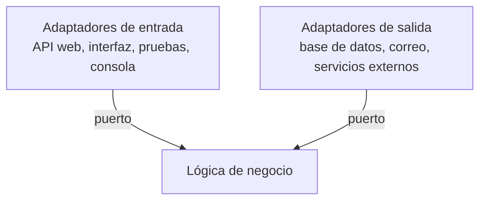

import { Quiz } from "@/components/quiz";

La **arquitectura hexagonal**, también llamada de **puertos y adaptadores**, es una forma de organizar una aplicación que pone la **lógica de negocio en el centro**, aislada de todo lo exterior: la base de datos, la interfaz, los servicios externos. La lógica se comunica con el exterior solo a través de **puertos**, y cada tecnología concreta se conecta mediante un **adaptador**.

La propuso Alistair Cockburn. El hexágono es solo un dibujo: no significa que haya seis de nada.

## El problema

En muchas aplicaciones, la lógica de negocio está mezclada con los detalles técnicos: cálculos de precios dentro de las consultas [SQL](/articulos/que-es-sql/), reglas de negocio dentro de los controladores web. Consecuencias:

- **Difícil de probar**: para comprobar una regla hay que levantar una base de datos.
- **Difícil de cambiar**: cambiar de base de datos o añadir una [API](/articulos/que-es-una-api/) toca el núcleo.

## La idea



- Los **puertos** son [interfaces](/articulos/que-es-una-interfaz/) que define la propia lógica: "necesito guardar un pedido", "necesito enviar un aviso".
- Los **adaptadores** implementan esos puertos con una tecnología concreta: PostgreSQL, un servicio de correo.

La lógica no sabe qué adaptador hay detrás. Depende de sus puertos, no de las tecnologías: es la inversión de dependencias de los [principios SOLID](/articulos/principios-solid/).

## Un ejemplo

```js
function crearServicioDePedidos(almacen) {
	return {
		confirmar(pedido) {
			if (pedido.lineas.length === 0) throw new Error("Pedido vacío");
			almacen.guardar({ ...pedido, estado: "confirmado" });
		},
	};
}

const guardados = [];
const almacenEnMemoria = { guardar: (p) => guardados.push(p) };

const servicio = crearServicioDePedidos(almacenEnMemoria);
servicio.confirmar({ id: 1, lineas: ["teclado"] });

console.log(guardados[0].estado); // "confirmado"
```

El servicio solo conoce el puerto `guardar`. En producción se le pasa un adaptador de base de datos; en las [pruebas](/articulos/pruebas-de-software/), uno en memoria, sin levantar nada.

## Lo que se gana

- **Pruebas rápidas** de la lógica, sin infraestructura.
- **Cambiar de tecnología** tocando solo un adaptador.
- **Varias entradas** a la misma lógica: una API, una interfaz de línea de órdenes, una [cola de mensajes](/articulos/colas-de-mensajes/).

## Lo que cuesta

Más piezas e indirecciones. Para una aplicación pequeña, que básicamente guarda y lee datos, suele ser más de lo necesario, como advierten [YAGNI](/articulos/principio-yagni/) y [KISS](/articulos/principio-kiss/). Compensa cuando la lógica de negocio es rica y va a vivir mucho tiempo. Encaja con el [diseño guiado por el dominio](/articulos/diseno-guiado-por-el-dominio/).

## Lo esencial

- La arquitectura hexagonal aísla la lógica de negocio del mundo exterior.
- La lógica define puertos; los adaptadores los implementan con tecnologías concretas.
- Permite probar la lógica sin infraestructura y cambiar de tecnología con facilidad.
- Añade complejidad, que compensa con lógica de negocio rica y duradera.
