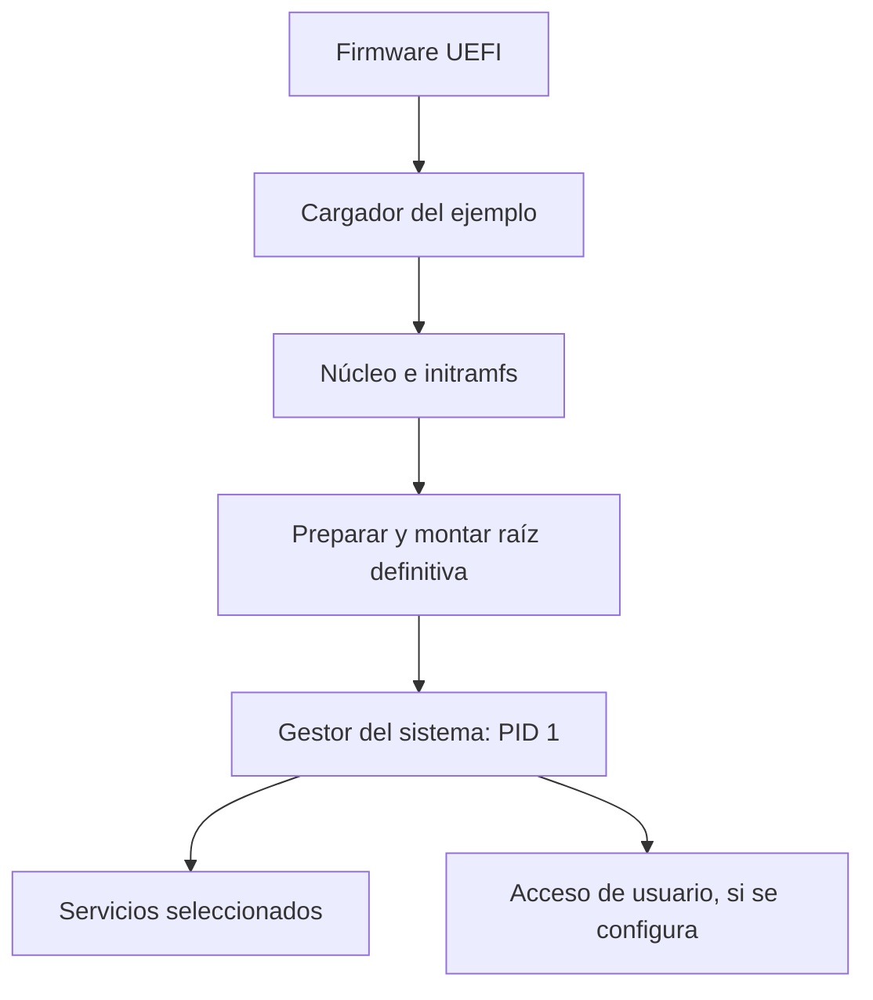

import { Quiz } from "@/components/quiz";

El **arranque** es el proceso que prepara el equipo y transfiere el control hasta poner en funcionamiento un sistema operativo. No empieza por abrir el escritorio: antes deben ejecutarse programas capaces de localizar y preparar los siguientes.

Seguiremos un PC con firmware UEFI y Linux, usando un cargador, un entorno inicial en memoria y systemd. Es un recorrido concreto, no una secuencia obligatoria para todo móvil, servidor o dispositivo.

## 1. Ejecutar el firmware

Tras el encendido y la puesta en condiciones del hardware, el procesador comienza por el mecanismo de inicio definido por la plataforma. Ejecuta **[firmware](/articulos/que-es-el-firmware/)**, software ligado al equipo que puede inicializar memoria, buses y dispositivos necesarios para continuar.

El firmware puede hacer comprobaciones y mostrar diagnósticos. No prueba exhaustivamente cada componente ni necesita inicializar todas las funciones que usará después el sistema operativo.

**UEFI** define interfaces entre el firmware y el software de arranque. Incluye mecanismos para localizar y ejecutar programas de inicio. La **BIOS** tradicional de los PC seguía otra organización, asociada al código de arranque en sectores del disco. Una pantalla de configuración con ratón no define por sí sola la diferencia.

## 2. Encontrar el siguiente programa

El firmware selecciona una opción de arranque configurada: por ejemplo, un programa situado en la **partición del sistema EFI**, una región del almacenamiento destinada a estos archivos. También existen arranques por red y mecanismos de recuperación.

Un **cargador de arranque**, como GRUB o systemd-boot, prepara el núcleo y le entrega el control. Puede ofrecer varias entradas, por ejemplo una versión actual y otra anterior del núcleo. Ese menú no significa que todos los sistemas se estén ejecutando a la vez.

No siempre hay un cargador separado: un núcleo Linux preparado con el **EFI boot stub**, código de entrada compatible con EFI, puede cargarse directamente por el firmware. Las etapas describen responsabilidades, no un número fijo de archivos.

### Qué comprueba el arranque seguro

**Secure Boot**, o arranque seguro, aplica una política de confianza a las imágenes de arranque. Puede aceptar firmantes o imágenes autorizadas y rechazar otras revocadas. Una firma válida identifica una relación de confianza; no demuestra que el programa carezca de errores.

Su alcance depende de la configuración y de cómo continúe la cadena de verificación. No equivale a cifrar el disco, comprobar todos los documentos ni garantizar la integridad de cualquier firmware del equipo.

## 3. Preparar el núcleo y la raíz

El **[núcleo](/articulos/que-es-el-kernel/)** configura sus estructuras de memoria, ejecución y acceso a dispositivos. Para continuar necesita encontrar los archivos del sistema instalado.

Aquí puede intervenir **initramfs**: un conjunto inicial de archivos que se prepara en memoria y contiene programas y controladores suficientes para llegar al almacenamiento definitivo. Por ejemplo, puede solicitar la clave de un volumen cifrado antes de poder abrirlo.

**Montar** un [sistema de archivos](/articulos/sistema-de-archivos/) significa incorporarlo a una ubicación accesible del árbol de directorios. La **raíz**, `/`, es el punto desde el que se organiza ese árbol. No debe confundirse con el usuario administrador que también se llama root.

En este recorrido, el núcleo inicia `/init` en ese entorno inicial como proceso con identificador **PID 1**. Ese programa prepara la raíz definitiva y entrega el control al sistema de inicio instalado. Sustituir el programa de PID 1 no exige crear otro proceso con otro número.

## 4. Iniciar los servicios

Usamos **systemd** como gestor del sistema. Organiza **unidades**, descripciones de [servicios](/articulos/servicios-y-demonios/), montajes y otras tareas, y activa lo necesario para el objetivo configurado. Hay otros sistemas de inicio; Linux no exige systemd.

Supón que un servicio necesita datos guardados en un volumen. Hay dos relaciones diferentes:

- Necesitar que se active el montaje.
- Esperar a que su activación termine antes de iniciar el servicio.

En systemd, relaciones como `Requires` y `After` expresan aspectos distintos. Decir solo «después de» no solicita por sí mismo iniciar la otra unidad. Las tareas sin una dependencia de orden pueden avanzar en paralelo.

No hay que arrancar cada servicio disponible. Un servidor sin escritorio puede llegar a su estado operativo sin abrir ninguna sesión gráfica.

<Quiz
	client:visible
	question="El núcleo ya funciona, pero el entorno inicial no puede abrir el volumen cifrado. ¿Dónde se ha detenido este recorrido?"
	options={["Antes de ejecutar el firmware", "Al preparar el acceso a la raíz definitiva", "Después de abrir necesariamente el escritorio"]}
	answer={1}
/>

## Localizar una interrupción del arranque

La última etapa confirmada acota la búsqueda; un síntoma no identifica una única causa:

| Evidencia | Qué conviene comprobar |
| --- | --- |
| No aparece ninguna opción de arranque | Selección, presencia del dispositivo y configuración del firmware |
| El cargador muestra un error | Entrada elegida, archivos y parámetros del núcleo |
| Aparece el entorno inicial, pero no continúa | Controladores, dispositivo raíz, cifrado y mensajes de esa etapa |
| Hay acceso por terminal, pero no escritorio | Servicios gráficos y sus registros, sin asumir que falló todo el núcleo |

Una pantalla negra también puede proceder de la salida de vídeo. Los pitidos dependen del fabricante. El diagnóstico combina la etapa, los mensajes y la documentación del equipo.

## Errores comunes

- **Llamar arranque a cualquier apertura de un programa.** El sistema ya iniciado sigue otro recorrido: [del ejecutable al proceso](/articulos/del-ejecutable-al-proceso/).
- **Confundir orden con requisito.** Iniciar A después de B y exigir B son relaciones diferentes.
- **Suponer que la firma garantiza ausencia de fallos.** Autorizar una imagen y demostrar su comportamiento son comprobaciones distintas.

## Lo esencial

- El arranque transfiere control entre componentes que preparan el siguiente paso.
- Firmware, cargador y núcleo tienen responsabilidades distintas y variantes de integración.
- El entorno inicial puede preparar el almacenamiento antes del sistema instalado.
- Los servicios se activan según configuración y dependencias; el escritorio es opcional.
