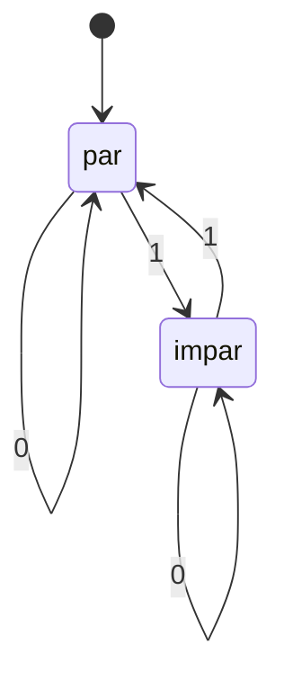

import { Quiz } from "@/components/quiz";

Un **autómata finito** es un modelo de cálculo que lee una secuencia de símbolos y cambia de estado según unas reglas. Tiene una cantidad fija de estados: puede recibir entradas larguísimas, pero su memoria de trabajo no crece con ellas.

## Qué problema resuelve

Imagina que recibes una cadena de ceros y unos y quieres comprobar si contiene una cantidad par de unos. Podrías contarlos, pero el contador crecería con la entrada. Para responder solo necesitas recordar una cosa: si hasta ahora han aparecido una cantidad par o impar.

Ese resumen ocupa dos estados. Un cero no lo cambia; un uno lo invierte. La idea sirve para reconocer patrones de texto, describir protocolos y representar controles como una puerta que puede estar abierta o cerrada.

Un **reconocedor** responde si una cadena pertenece a un conjunto. A ese conjunto de cadenas se le llama **lenguaje**. Aquí el lenguaje incluye `""`, `"0"`, `"11"` y `"101"`, pero excluye `"1"` y `"111"`.

## Sus piezas

Para definir el autómata hay que fijar cinco elementos:

- El **alfabeto**, los símbolos que sabe leer: `0` y `1`.
- Los **estados**: `par` e `impar`.
- El **estado inicial**: `par`, porque cero unos es una cantidad par.
- La **transición**, que dice a qué estado ir al leer cada símbolo.
- Los **estados de aceptación**: en este caso, solo `par`.

Aceptar no significa detenerse al visitar un estado aceptante. Se acepta si, **después de consumir toda la entrada**, el estado actual es aceptante.



El diagrama muestra las transiciones; la condición de aceptación es acabar en `par`.

## Recorrido paso a paso

Con `101`, empiezas en `par`. El primer `1` lleva a `impar`; el `0` mantiene `impar`; el último `1` vuelve a `par`. La cadena se acepta.

Esta implementación de JavaScript separa las reglas del recorrido:

```js
const transiciones = {
	par: { 0: "par", 1: "impar" },
	impar: { 0: "impar", 1: "par" },
};

function aceptar(cadena) {
	let estado = "par";
	for (const simbolo of cadena) {
		if (simbolo !== "0" && simbolo !== "1") return false;
		estado = transiciones[estado][simbolo];
	}
	return estado === "par";
}

console.log(aceptar("101")); // true
console.log(aceptar("111")); // false
console.log(aceptar("")); // true
console.log(aceptar("12")); // false
```

La implementación rechaza los símbolos ajenos al alfabeto. Para una entrada de longitud `n`, realiza `n` transiciones: tiempo O(n) y memoria adicional O(1), sin contar la propia entrada.

<Quiz
	client:visible
	question="¿Cuándo se decide si la cadena se acepta?"
	options={["Al visitar par por primera vez", "Después de leer toda la cadena", "Al encontrar el primer uno"]}
	answer={1}
/>

### Combinar dos condiciones sin guardar el historial

Supón que ahora exiges dos cosas: una cantidad par de unos y que la cadena termine en cero. La paridad ya no basta, porque `11` y `110` tienen la misma paridad y solo una termina en cero. El estado debe recordar ambas propiedades.

Puedes formar estados compuestos: par con último símbolo cero, par sin último cero, impar con último cero e impar sin último cero. Al leer cero conservas la paridad y marcas el final como cero; al leer uno inviertes la paridad y marcas que el final no es cero. El estado inicial tiene paridad par, pero todavía no termina en cero: así la cadena vacía queda rechazada por la nueva condición.

Aceptas únicamente en el estado «par y último cero». Por ejemplo, `110` llega a él, mientras `10` acaba en «impar y último cero». No guardas la cadena entera ni el número exacto de unos: conservas la información que puede cambiar decisiones futuras.

Esta construcción muestra también un coste. Combinar propiedades puede multiplicar estados, aunque algunos resulten inalcanzables o equivalentes y puedan simplificarse. Diseñar el estado no consiste en poner un nombre a cada pantalla: consiste en decidir qué información del pasado necesita recordar el futuro.

## Determinismo y límites

El ejemplo es un **autómata finito determinista**: cada pareja de estado y símbolo tiene un único destino. Un autómata no determinista permite varias alternativas. Es otra forma de describir patrones; no significa que el ordenador adivine mágicamente. Puede convertirse en uno determinista, aunque la conversión puede aumentar mucho los estados.

Los lenguajes reconocibles con autómatas finitos son los **lenguajes regulares**, los mismos que describen las [expresiones regulares clásicas](/articulos/expresiones-regulares/). Las extensiones de algunos motores, como las referencias a grupos anteriores, van más allá de ese modelo.

La limitación aparece cuando hace falta recordar una cantidad sin límite. Comprobar paréntesis equilibrados a cualquier profundidad requiere contar aperturas pendientes. Un número fijo de estados no basta. Para esos lenguajes se estudian modelos con una pila; la [máquina de Turing](/articulos/maquina-de-turing/) dispone de una memoria todavía más general.

## Errores comunes

- Confundir un estado con todo el historial. Resume solo lo necesario para futuras decisiones.
- Creer que finito significa entrada de longitud limitada. Lo limitado es la memoria del modelo.
- Aceptar antes de terminar: un prefijo válido puede acabar en una cadena inválida.
- Añadir un contador arbitrariamente grande y seguir llamando finito al modelo abstracto.

## Lo esencial

- Un autómata finito combina alfabeto, estados, transiciones, inicio y aceptación.
- Solo recuerda el estado actual; su memoria no crece con la entrada.
- Acepta según el estado final, después de consumir la cadena.
- Es suficiente para patrones regulares, pero no para anidamiento ilimitado.
