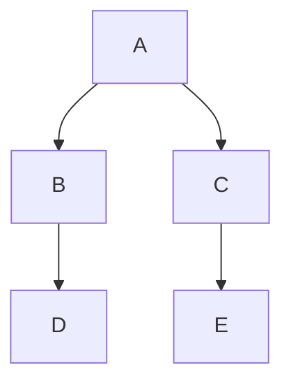

import { Quiz } from "@/components/quiz";

La **búsqueda en anchura**, o BFS, y la **búsqueda en profundidad**, o DFS, son las dos formas básicas de recorrer un [grafo](/articulos/grafos/). La de anchura visita primero todos los vecinos del punto de partida, después los vecinos de estos, y así **por niveles**. La de profundidad sigue un camino **todo lo que puede**, y solo al llegar al final retrocede y prueba otra rama.

## El mismo grafo, dos órdenes



```js
const grafo = { A: ["B", "C"], B: ["D"], C: ["E"], D: [], E: [] };

function anchura(inicio) {
	const visitados = [inicio];
	const vistos = new Set([inicio]);
	const cola = [inicio];
	let cabeza = 0;

	while (cabeza < cola.length) {
		const actual = cola[cabeza++];
		for (const vecino of grafo[actual]) {
			if (!vistos.has(vecino)) {
				vistos.add(vecino);
				visitados.push(vecino);
				cola.push(vecino);
			}
		}
	}

	return visitados;
}

function profundidad(actual, visitados = [], vistos = new Set()) {
	vistos.add(actual);
	visitados.push(actual);
	for (const vecino of grafo[actual]) {
		if (!vistos.has(vecino)) profundidad(vecino, visitados, vistos);
	}
	return visitados;
}

console.log(anchura("A").join(" ")); // "A B C D E"
console.log(profundidad("A").join(" ")); // "A B D C E"
```

La de anchura visita B y C, los vecinos de A, antes de bajar a D. La de profundidad baja de A a B y de B a D antes de volver a probar C.

La diferencia está en la estructura que guarda lo pendiente: una **[cola](/articulos/pilas-y-colas/)** en anchura, lo primero que entra es lo primero que sale; una **pila** en profundidad, que aquí es la propia pila de llamadas de la [recursión](/articulos/recursividad/).

## Comparación

| | Anchura | Profundidad |
| --- | --- | --- |
| Orden | Por niveles | Rama a rama |
| Estructura | Cola | Pila o recursión |
| Camino más corto, sin pesos | Lo encuentra | No lo garantiza |
| Memoria auxiliar en este grafo general | O(V): visitados, cola y resultado | O(V): visitados, resultado y pila de hasta V llamadas |
| Detectar ciclos | Posible | Natural |
| Ordenación topológica | Con el algoritmo de Kahn | Natural |

## Cuándo usar cada una

**Anchura** cuando importa la **distancia**:

- El camino con menos pasos entre dos puntos, en un grafo sin pesos.
- Los amigos de tus amigos en una red social, nivel a nivel.
- Explorar primero lo cercano.

**Profundidad** cuando hay que **explorar todo** o seguir estructuras:

- Detectar ciclos y hacer la [ordenación topológica](/articulos/ordenacion-topologica/).
- Encontrar componentes conectados.
- Resolver laberintos y problemas de [vuelta atrás](/articulos/vuelta-atras/).

Si todas las aristas cuestan lo mismo, minimizar pasos también minimiza coste. Con pesos distintos, BFS y DFS no garantizan el coste mínimo. [Dijkstra](/articulos/algoritmo-de-dijkstra/) sirve cuando los pesos son no negativos; los negativos requieren otro tratamiento.

## Confusiones frecuentes

- **Usar BFS para minimizar cualquier peso.** Garantiza menos aristas, que no equivale a menor coste cuando sus pesos son distintos.
- **Olvidar qué vértices se han visitado.** Los ciclos pueden causar recorridos repetidos o que la búsqueda no termine.
- **Dar por hecho que DFS usa menos memoria.** Una rama larga acumula llamadas; ambos ejemplos guardan además todos los vértices visitados.

## Lo esencial

- La búsqueda en anchura recorre por niveles con una cola.
- La búsqueda en profundidad sigue cada rama hasta el final con una pila o recursión.
- La de anchura encuentra el camino con menos pasos; la de profundidad no.
- La memoria depende del grafo y de qué guardes; DFS también puede necesitar una pila lineal.
