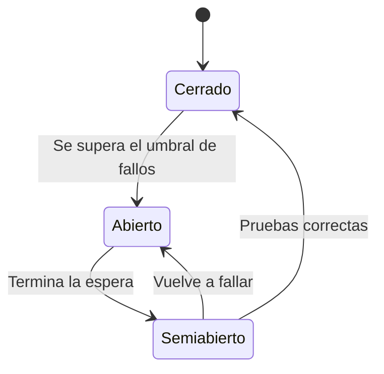

import { Quiz } from "@/components/quiz";

Un **disyuntor**, o *circuit breaker*, es un mecanismo que observa fallos en las llamadas a una dependencia y suspende temporalmente nuevos intentos cuando detecta un problema persistente. Después permite una cantidad controlada de llamadas para comprobar si se ha recuperado.

## Qué problema resuelve

Una tienda consulta un servicio de recomendaciones. Si cada consulta espera varios segundos hasta fallar, las peticiones de la tienda acumulan conexiones y tareas bloqueadas. El fallo de un servicio opcional puede acabar agotando los recursos del principal.

Un timeout acota cada espera. Un [reintento](/articulos/reintentos-de-peticiones/) intenta recuperarse de un fallo transitorio. El disyuntor añade memoria entre llamadas: si la dependencia lleva fallando, evita repetir durante un tiempo un intento con pocas posibilidades de ayudar.

## Tres estados

**Cerrado** significa que las llamadas pasan. El mecanismo registra resultados y evalúa una política: por ejemplo, una proporción de fallos dentro de una ventana, con un mínimo de observaciones para no concluir demasiado a partir de una muestra diminuta.

**Abierto** significa que las nuevas llamadas se rechazan rápidamente sin llegar a la dependencia. Esto reduce presión y libera recursos. No garantiza que la dependencia se repare; solo cambia cómo se comporta quien la utiliza.

**Semiabierto** permite algunas llamadas de prueba después del periodo de espera. Si funcionan según la política, vuelve a cerrado. Si fallan, vuelve a abierto.

## Seguir una recuperación

Imagina que el servicio de recomendaciones empieza a fallar. Durante la ventana inicial, algunas solicitudes experimentan timeouts. Al superar el umbral, el circuito abre. Las siguientes solicitudes de la tienda pueden mostrar una lista general en lugar de esperar recomendaciones personalizadas.

Cuando transcurre la espera, no conviene enviar de golpe toda la carga acumulada. Pasan unas pruebas controladas. Si tienen éxito, se restablece el acceso. El umbral y el número de pruebas deben ajustarse a la carga y al coste real del servicio.

<Quiz
	client:visible
	question="¿Qué hace un circuito cerrado?"
	options={[
		"Permite pasar llamadas y registra sus resultados",
		"Rechaza todas las llamadas",
		"Solo permite una prueba de recuperación",
	]}
	answer={0}
/>

## Una política con números

Supón esta política didáctica:

| Decisión | Valor del ejemplo |
| --- | --- |
| Ventana de observación | 20 resultados |
| Umbral de apertura | Al menos 10 fallos de dependencia |
| Espera con circuito abierto | 30 segundos |
| Pruebas simultáneas en semiabierto | 1 |

Un error de validación del cliente no cuenta aquí como fallo de salud; un timeout sí. Los valores son una configuración de ejemplo, no una regla universal del patrón.

El recorrido de esa política es:

1. Se registran doce timeouts entre veinte llamadas: se supera el umbral y el circuito abre.
2. La siguiente petición se rechaza rápidamente o utiliza la alternativa acordada.
3. Tras treinta segundos se admite una prueba.
4. Si falla, vuelve a comenzar la espera. Si tiene éxito, esta política cierra el circuito.

Otra configuración podría exigir varios éxitos antes de recuperar toda la carga.

### Llamadas que ya estaban en curso

Durante la apertura aún pueden terminar llamadas iniciadas antes. Su resultado no debe provocar transiciones accidentales: una implementación necesita coordinar el estado y distinguir esas observaciones de las pruebas de recuperación. Por esa razón un booleano global que se activa ante cualquier excepción no implementa todo el patrón.

Mide por separado llamadas reales fallidas y llamadas rechazadas por el circuito. Si mezclas ambas, parecerá que la dependencia sigue fallando miles de veces aunque ya no estés enviándole peticiones. Si no registras rechazos, parecerá que el problema desapareció al dejar de observarla.

## Elegir la degradación

Una **alternativa de respaldo**, o *fallback*, debe respetar el significado del producto. Mostrar recomendaciones genéricas puede servir. Responder «pago completado» cuando no pudiste comprobar el pago sería inventar un resultado.

También puedes devolver un error claro o aceptar un trabajo pendiente si existe un flujo duradero que lo respalde. Una respuesta aparentemente satisfactoria no es automáticamente una recuperación correcta.

## Alcance y limitaciones

Un circuito por cada instancia puede tomar decisiones distintas: una tiene pocos fallos y otra muchos. Un circuito demasiado amplio puede bloquear operaciones sanas porque otra operación del mismo servicio falla. Decide qué dependencia y qué tipos de llamada protege.

No todos los errores cuentan igual. Una petición inválida rechazada de forma correcta no suele indicar que el servidor esté enfermo. En cambio, timeouts sostenidos o conexiones fallidas pueden ser relevantes.

El disyuntor tampoco sustituye límites de concurrencia, colas limitadas ni aislamiento de recursos. Antes de abrir ya ha dejado pasar algunas llamadas; sin límites, podrían ser demasiadas. La [contrapresión](/articulos/contrapresion/) aborda otra parte del control de sobrecarga.

## Errores comunes

- **Contar cualquier rechazo como enfermedad del servicio.** Un dato inválido puede estar recibiendo una respuesta correcta.
- **Inventar un éxito como alternativa de respaldo.** Mostrar recomendaciones genéricas no equivale a confirmar un pago sin comprobarlo.

## Lo esencial

- El circuito cerrado permite, el abierto rechaza y el semiabierto prueba.
- Recuerda fallos entre llamadas para evitar presión inútil sobre una dependencia.
- Los umbrales y el alcance necesitan contexto y medición.
- Una degradación debe conservar significado; no inventar éxito.
