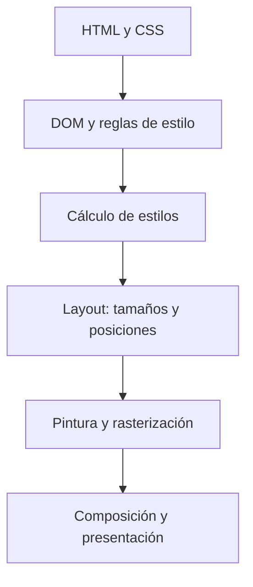

import { Quiz } from "@/components/quiz";

El navegador dibuja una página mediante varias etapas: interpreta documentos y estilos, calcula qué aspecto tiene cada elemento, determina su geometría, genera instrucciones de pintura y combina el resultado para mostrarlo. Modificar una página puede obligarlo a repetir parte de ese trabajo.

## De bytes a estructuras

El HTML recibido se analiza para construir el [DOM](/articulos/el-dom/), una representación de sus elementos y relaciones. Las hojas CSS también se analizan para representar reglas y valores. La descarga y el análisis de recursos pueden solaparse; la página no necesita siempre esperar a que llegue todo para empezar a mostrarse.

JavaScript puede consultar y modificar estas estructuras. Eso introduce dependencias: un script puede necesitar el documento construido, y ciertas consultas pueden exigir que el navegador actualice cálculos pendientes antes de responder.

## Las etapas del renderizado

### Calcular estilos

El **cálculo de estilos** decide los valores aplicables a cada elemento. Intervienen selectores, herencia, cascada y condiciones como el tamaño de pantalla.

Si cambias una clase, no has pintado nuevos píxeles directamente. Has cambiado una entrada de ese cálculo. El navegador determina qué resultados quedan afectados y qué etapas necesita repetir.

Un nodo del DOM tampoco equivale necesariamente a una caja visible. Un elemento oculto con `display: none` no participa en la distribución normal de cajas; otros elementos pueden generar varias cajas o contenido adicional.

### Calcular geometría

La etapa de **layout**, o disposición, determina dimensiones y posiciones. Tiene en cuenta el contenido, el espacio disponible y reglas como flexbox o grid. Si cambia el ancho de una caja, puede cambiar el salto de líneas y la posición de elementos posteriores.

Por ejemplo, un párrafo que pasa de ocupar cuatro líneas a seis desplaza lo que viene después. No es solo repintar su color: la geometría ha cambiado.

<Quiz
	client:visible
	question="¿Qué cambio puede requerir pintura sin modificar por sí solo la geometría?"
	options={[
		"Cambiar el ancho del párrafo",
		"Cambiar el color del texto",
		"Cambiar el tamaño de la fuente",
	]}
	answer={1}
/>

### Pintar no es presentar todavía

La **pintura** establece cómo se dibujan fondos, bordes, texto e imágenes. El resultado se convierte en píxeles mediante rasterización. La **composición** combina las superficies o capas pertinentes para producir la imagen final.

Las capas no son una correspondencia simple de «un elemento HTML, una capa». El navegador decide cómo organizarlas y reutilizar resultados. Demasiadas superficies también consumen memoria y recursos.

El esquema resume responsabilidades; un navegador real utiliza paralelismo, cachés y actualizaciones parciales.

## Qué cambia al actualizar

Cambiar un ancho puede afectar a layout y pintura. Cambiar un color suele afectar a pintura. Algunas transformaciones y cambios de opacidad pueden aprovechar composición sin recalcular toda la geometría, pero no debes prometerlo para cualquier elemento y situación: depende de su estado y del navegador.

La **invalidación** marca qué resultados ya no son utilizables. Una implementación eficiente intenta repetir solo el trabajo necesario, aunque un pequeño cambio en un elemento padre puede tener consecuencias amplias.

## Evitar trabajo forzado

Alternar muchas escrituras de estilos con lecturas que necesitan geometría actual puede forzar cálculos repetidos. Agrupar lecturas y cambios cuando el flujo lo permite ayuda a evitar ese patrón. Eso no significa que leer tamaños sea siempre incorrecto: a veces es necesario para una interacción.

Utiliza las herramientas de rendimiento del navegador para distinguir ejecución de JavaScript, layout y pintura. Un problema visual lento no se arregla necesariamente reduciendo el tiempo de una función: puede estar en el trabajo de renderizado que provoca.

## Seguir una actualización concreta

Una tarjeta contiene una imagen, un título y un párrafo. Al cargar una imagen sin dimensiones reservadas cambia la altura de la tarjeta. El navegador recalcula su geometría y puede desplazar las tarjetas siguientes. Reservar el espacio con dimensiones o una proporción conocida evita ese cambio geométrico cuando llega el recurso; no acelera necesariamente la descarga.

### Cambiar el aspecto sin cambiar el tamaño

Después cambias solo el color del título. El contenido y sus medidas permanecen, así que el cambio puede limitarse a recalcular estilo y repintar lo afectado. Si en lugar del color cambias el tamaño de la fuente, el título puede ocupar dos líneas y obligar a recalcular posiciones.

### Exigir la geometría actual

Por último, un script cambia el ancho y consulta inmediatamente su tamaño renderizado. Para devolver un valor actualizado, el navegador puede tener que completar cálculos pendientes en ese momento. Repetir escritura y lectura para cada tarjeta multiplica las oportunidades de trabajo forzado. Preparar lecturas y agrupar cambios permite al navegador organizar mejor las actualizaciones cuando la interacción lo admite.

Estos tres casos muestran por qué «cambió el DOM» no describe el coste. La propiedad modificada, las dependencias geométricas y cuándo se exige un resultado determinan qué parte del recorrido se repite.

## Errores comunes

- **Atribuir toda lentitud a JavaScript.** El cambio puede provocar trabajo de geometría o pintura.
- **Alternar escrituras y lecturas geométricas por elemento.** Puede forzar cálculos repetidos.

## Lo esencial

- DOM y CSS son entradas para construir la representación visual.
- Estilo, layout, pintura y composición resuelven trabajos diferentes.
- Un cambio puede invalidar solo parte del recorrido.
- Mide la etapa costosa antes de elegir una optimización.
