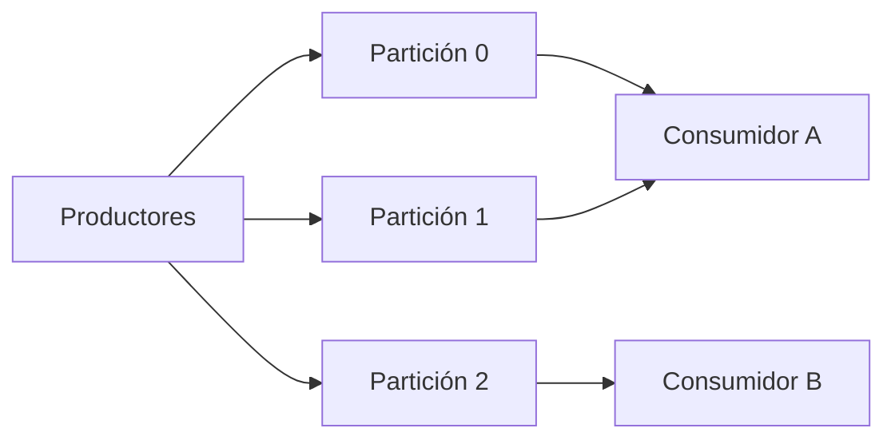

import { Quiz } from "@/components/quiz";

**Apache Kafka** es una plataforma de **flujos de eventos**: un sistema para publicar, guardar y leer secuencias de sucesos, como pagos, clics o lecturas de sensores, a gran escala. Se parece a las [colas de mensajes](/articulos/colas-de-mensajes/) y al patrón [publicador/suscriptor](/articulos/publicador-suscriptor/), pero con una diferencia de fondo: Kafka es un **registro**. Los eventos no desaparecen al leerlos.

## Temas: registros que solo crecen

Los eventos se organizan y se guardan de forma duradera en **temas**. La documentación de Kafka lo simplifica así: un tema es como una carpeta, y los eventos, los archivos que contiene. Un tema puede tener muchos productores y muchos suscriptores.

Cada evento se **añade al final** y no se modifica. Y a diferencia de los sistemas de mensajería tradicionales, según la documentación, los eventos no se borran al consumirse: se conservan el tiempo que se configure para cada tema, y se pueden leer tantas veces como haga falta.

## Particiones: repartir para escalar

Un tema se divide en **particiones**, repartidas entre varios servidores, los *brokers*. Así, muchos clientes pueden leer y escribir a la vez en distintos servidores.



Los eventos con la misma **clave** van siempre a la misma partición, porque la partición se calcula a partir de un hash de la clave:

```js
function particion(clave, total) {
	let hash = 2166136261;
	for (const caracter of clave) {
		hash ^= caracter.charCodeAt(0);
		hash = Math.imul(hash, 16777619) >>> 0;
	}
	return hash % total;
}

console.log(["ana", "luis", "eva", "marta", "ana"].map((c) => `${c}->${particion(c, 3)}`).join(" ")); // "ana->0 luis->0 eva->1 marta->0 ana->0"
```

Es la misma idea que las [tablas hash](/articulos/tablas-hash/). Importa porque **el orden solo está garantizado dentro de una partición**: todos los eventos de "ana" se leerán en el orden en que se escribieron, aunque los de "eva" vayan por otro lado.

## Desplazamientos: cada consumidor sabe por dónde va

Dentro de una partición, cada evento tiene una posición: su **desplazamiento** (*offset*). Un consumidor no borra lo que lee; solo recuerda el desplazamiento por el que va. Eso permite:

- Que varios sistemas lean el mismo tema, cada uno a su ritmo.
- **Volver atrás** y reprocesar eventos, por ejemplo tras corregir un fallo.
- Que un servicio nuevo procese todo el historial desde el principio.

Para repartir el trabajo, los consumidores se agrupan: cada partición la lee un solo consumidor del grupo. Más particiones permiten más consumidores en paralelo.

## Réplicas: no perder nada

Cada tema se puede **replicar**, incluso entre centros de datos, de modo que siempre haya varios brokers con una copia de los datos por si algo falla o hay que hacer mantenimiento. Mantener esas copias coherentes es un problema de [consenso](/articulos/consenso-distribuido/).

## Para qué se usa

- **Unir servicios** en una [arquitectura orientada a eventos](/articulos/arquitectura-orientada-a-eventos/).
- **Mover datos** entre sistemas de forma continua, en lugar de por lotes.
- **Procesar flujos** en tiempo real: detectar fraudes, actualizar paneles.
- Como fuente de verdad en [event sourcing](/articulos/cqrs-y-event-sourcing/), gracias a que guarda el historial.

## Lo esencial

- Kafka guarda los eventos en temas que solo crecen y no se borran al leerlos.
- Los temas se dividen en particiones repartidas entre servidores; la clave decide la partición.
- El orden se garantiza dentro de cada partición.
- Cada consumidor recuerda su desplazamiento, así que puede leer a su ritmo y volver atrás.
