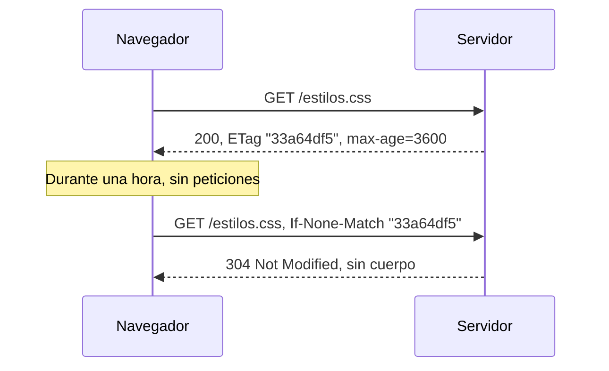

import { Quiz } from "@/components/quiz";

La forma más rápida de descargar algo es no descargarlo. La **caché HTTP** permite que el navegador, o un intermediario como una [CDN](/articulos/que-es-una-cdn/), guarde una respuesta y la reutilice en lugar de volver a pedírsela al servidor. Quien decide si se puede, y durante cuánto tiempo, es el propio servidor, mediante [cabeceras](/articulos/que-es-una-cabecera-http/). Es la aplicación a la web de la idea general de [caché](/articulos/que-es-una-cache/).

## Dónde se guarda

La especificación distingue dos tipos, como resume MDN:

| | Caché privada | Caché compartida |
| --- | --- | --- |
| Dónde | En el navegador de cada usuario | Entre el cliente y el servidor: proxies, CDN |
| Para quién | Solo para ese usuario | Para muchos usuarios a la vez |
| Puede guardar | Respuestas personalizadas | Solo lo que sea igual para todos |

Guardar contenido personalizado en una caché compartida puede filtrar los datos de un usuario a otros. Por eso las respuestas privadas llevan `Cache-Control: private`.

## Fresca o caducada: Cache-Control

La cabecera principal es `Cache-Control`. Con `max-age` se indica cuántos segundos es **fresca** una respuesta:

```http
Cache-Control: max-age=3600
```

Durante una hora, el navegador la reutiliza sin preguntar a nadie: ni siquiera hay petición de red. Después, está **caducada**.

```js
const estado = (edadEnSegundos, maxAge) => (edadEnSegundos < maxAge ? "fresca" : "caducada");

console.log(estado(120, 3600), estado(4000, 3600)); // fresca caducada
```

Otras directivas habituales:

| Directiva | Significa |
| --- | --- |
| `max-age=N` | Fresca durante N segundos |
| `private` | Solo la puede guardar el navegador del usuario |
| `public` | La puede guardar también una caché compartida |
| `no-cache` | Se puede guardar, pero hay que comprobar con el servidor antes de cada uso |
| `no-store` | No se guarda en ningún sitio |
| `immutable` | No cambiará nunca; ni siquiera hace falta comprobarla |

Ojo con la confusión clásica: `no-cache` **no** prohíbe guardar; obliga a revalidar. La que prohíbe guardar es `no-store`.

## Caducada no es inútil: revalidar con ETag

Que una respuesta haya caducado no significa que haya cambiado. En lugar de descargarla entera, el navegador puede **revalidarla**. Para eso, el servidor envía con la respuesta original un `ETag`, un identificador de esa versión del recurso; si el recurso cambia, el identificador también.

```http
HTTP/1.1 200 OK
ETag: "33a64df5"
Cache-Control: max-age=3600
```

Al caducar, el navegador pregunta con una petición condicional:

```http
GET /estilos.css HTTP/1.1
If-None-Match: "33a64df5"
```

Si no ha cambiado, el servidor responde con un [código](/articulos/que-es-un-codigo-de-estado-http/) **304 Not Modified**, sin cuerpo: como explica MDN, al indicar solo "sin cambios", la transferencia es mínima. Si ha cambiado, responde 200 con el contenido nuevo y otro `ETag`.



## La estrategia habitual de una web

- **Archivos con versión en el nombre**, como `app.3f9a2c.js`: si cambia el contenido, cambia el nombre. Se pueden guardar un año con `immutable`. Es lo que hacen las herramientas de construcción, como explica [qué hace un empaquetador](/articulos/que-hace-un-empaquetador/).
- **El HTML**, que enlaza a esos archivos: `no-cache`, para comprobar siempre si hay una versión nueva.
- **Datos personales**: `private`, o `no-store` si son sensibles.

## Lo esencial

- La caché HTTP reutiliza respuestas guardadas en el navegador o en cachés compartidas como las CDN.
- `Cache-Control: max-age` dice cuánto tiempo es fresca una respuesta; mientras lo es, no hay petición.
- Al caducar, se revalida con `ETag`: si no cambió, el servidor responde 304 sin cuerpo.
- `no-cache` obliga a revalidar; `no-store` prohíbe guardar.
