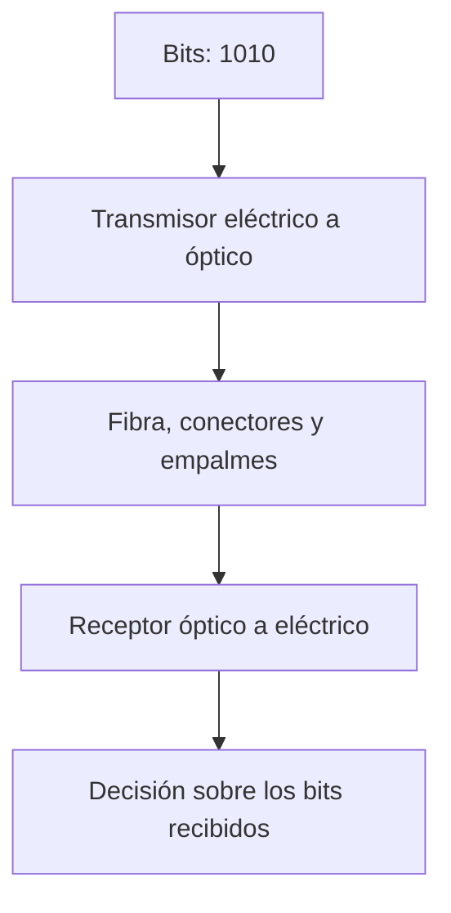

import { Quiz } from "@/components/quiz";

La **fibra óptica** es un hilo de vidrio o plástico que guía luz. Un transmisor modifica esa luz para representar información y un receptor la convierte de nuevo en una señal eléctrica.

Permite llevar grandes cantidades de datos entre edificios, ciudades o continentes sin las interferencias electromagnéticas que afectan a un conductor de cobre. También puede llegar hasta una vivienda. Su alcance no es infinito: depende del enlace completo.

## Núcleo y revestimiento

La fibra tiene un **núcleo** rodeado por un **revestimiento** de menor **índice de refracción**, una medida de cómo se propaga la luz en un material. La diferencia permite guiarla; no es un tubo hueco ni necesita paredes metálicas.

En el modelo de rayos, la **reflexión interna total** ocurre cuando la luz llega desde el material de mayor índice a la frontera con el de menor índice con un ángulo suficientemente grande, medido desde la perpendicular. Para dos índices hipotéticos:

```js
const indiceNucleo = 1.48;
const indiceRevestimiento = 1.46;
const anguloCritico = Math.asin(indiceRevestimiento / indiceNucleo) * 180 / Math.PI;
console.log(anguloCritico.toFixed(1)); // "80.6"
```

Por encima de ese ángulo, el modelo ideal refleja el rayo. No significa que cualquier luz introducida quede atrapada ni que la fibra real carezca de pérdidas. Los índices son ilustrativos, no una especificación universal.

Las fibras **multimodo** admiten varios patrones de propagación; las **monomodo**, un modo espacial en sus condiciones de uso. El modelo de rayos ayuda a empezar, pero una explicación completa de los modos requiere tratar la luz como onda. Encima del vidrio van recubrimientos protectores y la estructura del cable.

## Seguir cuatro bits

Imagina un enlace didáctico que envía `1010` variando la intensidad de la luz. Suponemos que el receptor conoce el ritmo de los símbolos:

1. El transmisor recibe los bits como señal eléctrica.
2. Un láser emite un nivel óptico alto para `1` y bajo para `0`, durante cuatro intervalos sucesivos. Es una forma sencilla de [modulación](/articulos/modulacion/).
3. La luz atraviesa la fibra, los conectores y los empalmes. Puede llegar atenuada y con pulsos ensanchados.
4. Un **fotodetector** convierte la luz en señal eléctrica. El receptor estima los niveles y reconstruye `1010` si todavía puede distinguirlos correctamente.



Otros sistemas usan varios niveles o aprovechan también la fase. Además, **multiplexar por longitud de onda** permite enviar varios canales ópticos, como distintos colores, por una misma fibra. El receptor debe separar e interpretar esos canales; el cable por sí solo no fija la velocidad.

## Qué limita el enlace

La **atenuación** reduce la potencia recibida. La absorción y la desviación de luz por irregularidades microscópicas del material, los conectores y las curvaturas contribuyen a las pérdidas. El transmisor debe entregar potencia suficiente para llegar al rango admitido por el receptor, sin sobrecargarlo.

La **dispersión temporal** ensancha los pulsos: distintas componentes pueden llegar con retardos diferentes. Si se solapan demasiado, cuesta decidir dónde termina un símbolo y empieza el siguiente. Añadir potencia no resuelve por sí solo ese problema.

<Quiz
	client:visible
	question="Llega suficiente potencia, pero los pulsos se solapan y se confunden. ¿Qué hay que estudiar?"
	options={["Solo la intensidad del láser", "La dispersión y la capacidad del receptor para distinguir símbolos", "El nombre del archivo transmitido"]}
	answer={1}
/>

| Criterio | Cobre | Fibra |
| --- | --- | --- |
| Señal | Eléctrica | Óptica |
| Interferencias electromagnéticas en el medio | Pueden afectar; influyen diseño y blindaje | No se acoplan a la señal óptica como en un conductor |
| Alcance y tasa | Dependen del cable y los equipos | Dependen de fibra, pérdidas, dispersión y equipos |
| Instalación | Puede aprovechar cableado compatible | Exige conectores, empalmes y radios de curvatura adecuados |

No hay un multiplicador universal de distancia entre ambos. En enlaces ópticos largos pueden utilizarse amplificadores o regeneradores, según el sistema.

## La luz también tarda

Con una aproximación de índice 1,5, la propagación cuesta unos cinco milisegundos por cada mil kilómetros:

```js
const velocidadLuz = 299792; // km/s en el vacío
const enFibra = velocidadLuz / 1.5;
console.log(((1000 / enFibra) * 1000).toFixed(1)); // "5.0"
```

Un recorrido de 6000 km añade unos 30 ms de ida solo por propagación. Faltan el recorrido de vuelta, equipos, colas y otros tramos. Aumentar la tasa de datos no elimina esta parte de la [latencia](/articulos/ancho-de-banda-latencia-y-rendimiento/).

Charles K. Kao recibió la mitad del Nobel de Física de 2009 por sus avances en la transmisión de luz en fibras para comunicaciones ópticas.

## Errores comunes

- **Doblar mucho el cable porque la luz se refleja.** Una curva demasiado cerrada puede aumentar la pérdida o dañar la fibra.
- **Combinar cualquier fibra y transceptor.** Deben ser compatibles el tipo de fibra, la longitud de onda, la modulación y el rango de potencia.
- **Confundir mucha capacidad con retardo nulo.** Más bits por segundo no hacen instantáneo el recorrido.

## Lo esencial

- La fibra guía luz; los equipos convierten entre señales eléctricas y ópticas.
- Núcleo y revestimiento permiten el guiado, pero siguen existiendo pérdidas.
- Atenuación y dispersión limitan el enlace de formas distintas.
- La propagación añade aproximadamente 5 ms por cada 1000 km de fibra.
