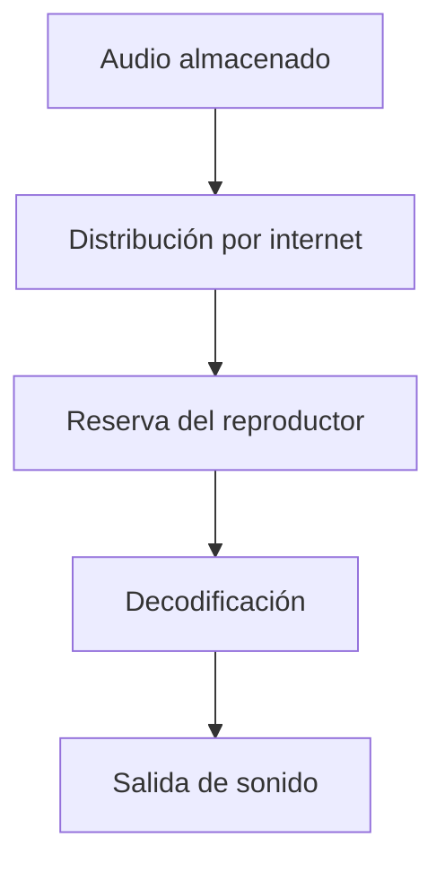

import { Quiz } from "@/components/quiz";

Spotify reproduce música por **streaming**: recibe datos de audio y empieza a convertirlos en sonido antes de tener la canción completa. Una reserva temporal separa el ritmo irregular de internet del ritmo continuo que necesita la reproducción.

## De pulsar un título a recibir audio

El nombre, la portada y el sonido de una canción son datos distintos. Ver el título no demuestra que ya tengas el audio: la aplicación puede mostrar información guardada mientras intenta obtener los datos que faltan.

En una reproducción por internet intervienen dos trabajos: identificar el contenido y comprobar que se puede reproducir, y transferir su audio. Los [servidores](/articulos/que-es-un-servidor/) son programas que atienden esas peticiones. No hace falta que una única máquina realice ambos trabajos.

Spotify documentó en 2020 que distribuía audio mediante varias **[CDN](/articulos/que-es-una-cdn/)**, redes de servidores que acercan copias a los oyentes. Esa publicación permite explicar la distribución, pero no deducir el proveedor, la ubicación o el protocolo exactos de cada reproducción actual.

Este es un recorrido didáctico del audio, omitiendo los servicios de cuenta y catálogo:



## Los bytes todavía no son sonido

El archivo contiene números que representan [sonido](/articulos/como-se-representa-el-sonido/). Un **códec** establece cómo codificar esos datos y recuperarlos para reproducirlos. El reproductor los **decodifica**: obtiene las muestras que el sistema de audio convierte en una señal para los auriculares o altavoces.

La **[compresión](/articulos/compresion-de-datos/)** reduce los datos necesarios. Puede ser con pérdidas, descartando información según un modelo perceptivo, o sin pérdidas, permitiendo recuperar exactamente las muestras codificadas. La documentación de Spotify distingue calidades y formatos; no toda reproducción utiliza el mismo formato ni todo su audio es con pérdidas.

La **tasa de bits** indica cuántos [bits](/articulos/que-es-un-bit/), unidades que toman el valor 0 o 1, ocupa en promedio un segundo de audio codificado. Un kilobit son mil bits; un [byte](/articulos/que-es-un-byte/), ocho. La tasa de la canción no es la velocidad de la conexión. Como ejemplo hipotético, a 160 kilobits por segundo una canción de tres minutos necesita:

- 160 000 bits / 8 = 20 000 bytes por segundo.
- 20 000 × 180 = 3 600 000 bytes, unos 3,6 MB decimales.

Es una cuenta con tasa constante, sin cabeceras ni otros intercambios. Un archivo con tasa variable no tiene por qué distribuir esos bytes uniformemente.

## Por qué sigue sonando al perder cobertura

Un **búfer** es una reserva de datos pendientes de consumir. Si ya hay diez segundos de música preparados, una interrupción de ocho segundos puede pasar inadvertida: quedan dos segundos al volver la conexión.

Durante la reproducción se consume un segundo de audio por cada segundo transcurrido. Si la descarga entrega tres segundos de audio en ese tiempo, la reserva crece dos. En el ejemplo anterior, eso equivale a recibir 60 000 bytes por segundo mientras se consumen 20 000.

Este modelo calcula una interrupción sin entrada de datos. Los valores se expresan en segundos de audio; no simula el algoritmo ni el tamaño real del búfer de Spotify:

```js
function sinConexion(reserva, duracion) {
	const reproducido = Math.min(reserva, duracion);
	return {
		reserva: reserva - reproducido,
		pausa: duracion - reproducido,
	};
}

console.log(sinConexion(10, 8).reserva); // 2
console.log(sinConexion(10, 8).pausa); // 0
console.log(sinConexion(10, 12).pausa); // 2
```

Se suponen cantidades no negativas, suficiente canción restante y consumo continuo. Con doce segundos sin datos, los diez preparados se agotan y quedan dos de espera. Un reproductor real puede esperar a reunir otra reserva antes de reanudar.

<Quiz
	client:visible
	question="La conexión se corta ocho segundos, pero quedan diez segundos de audio preparado. ¿Por qué puede continuar la música?"
	options={[
		"El reproductor consume datos que ya había recibido",
		"Los auriculares reconstruyen la canción que falta",
		"La tasa de bits de la canción se vuelve cero",
	]}
	answer={0}
/>

## Búfer, caché y descarga

Los tres pueden guardar audio, pero tienen propósitos distintos:

| Mecanismo | Para qué se guarda |
| --- | --- |
| Búfer | Tener preparada la parte que se reproducirá próximamente |
| [Caché](/articulos/que-es-una-cache/) | Reutilizar datos recibidos y evitar otra transferencia |
| Descarga sin conexión | Preparar contenido elegido para escucharlo sin red, dentro de las condiciones del servicio |

Spotify documenta almacenamiento de partes de música y pódcasts como caché, además de descargas. Haber escuchado una canción no garantiza conservarla completa ni disponer de ella sin conexión. Para eso hay que comprobar que la descarga admitida por el servicio haya terminado.

## Qué explica una interrupción

Una conexión rápida en promedio puede sufrir pausas que vacíen la reserva. Aumentar el búfer ayuda a absorberlas, a costa de preparar más datos; no corrige una descarga que permanece por debajo del consumo indefinidamente.

También puede fallar una parte distinta: obtener el catálogo, acceder al audio o producir la salida de sonido. Por eso una portada visible o una barra que avanza no prueban que todo el recorrido funcione.

## Lo esencial

- Streaming permite empezar con una parte del audio, mientras llegan las siguientes.
- El códec representa el sonido; la tasa de bits describe datos por segundo de audio.
- El búfer absorbe interrupciones hasta que se agota; no crea datos ausentes.
- Caché y descarga sin conexión tienen objetivos diferentes.
