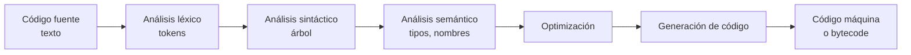
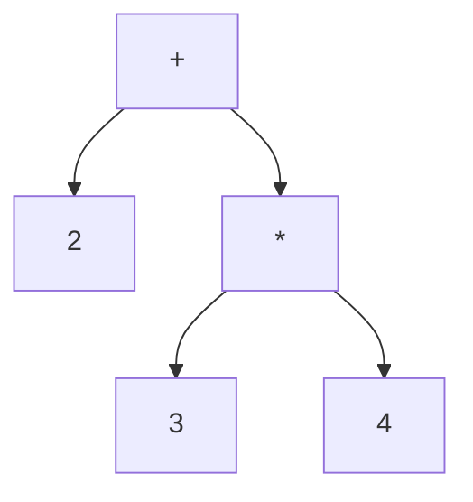

import { Quiz } from "@/components/quiz";

Un [compilador](/articulos/compilador-e-interprete/) convierte un texto, el código fuente, en algo que una máquina puede ejecutar. No lo hace de un salto, sino en una serie de **fases**, cada una con una tarea clara. El libro *Crafting Interpreters*, de Robert Nystrom, las describe como una subida y bajada por una montaña: se sube analizando el texto hasta entender su significado, y se baja generando instrucciones.



Vamos a recorrer las fases con un compilador de juguete para expresiones como `2 + 3 * 4`. Ejecuta los bloques JavaScript **en orden, en un mismo archivo**: cada fase reutiliza las funciones y los datos de la anterior. Admitimos números enteros pequeños sin signo, los cuatro operadores y paréntesis; las operaciones usan la aritmética de `Number`. No implementamos variables, comentarios ni un lenguaje completo.

## 1. Análisis léxico: de caracteres a tokens

La primera fase, el **análisis léxico** o escaneo, recorre el texto carácter a carácter y lo agrupa en **tokens**: las "palabras" del lenguaje. Un número, un operador, un paréntesis. Nuestro lenguaje descarta espacios en blanco. En otros lenguajes la sangría o los saltos de línea pueden afectar a la sintaxis; no se deben descartar por sistema.

```js
function lexico(texto) {
	const tokens = [];
	let i = 0;
	while (i < texto.length) {
		const c = texto[i];
		if (/\s/.test(c)) {
			i++;
		} else if (/[0-9]/.test(c)) {
			let numero = "";
			while (i < texto.length && /[0-9]/.test(texto[i])) numero += texto[i++];
			tokens.push({ tipo: "numero", valor: Number(numero) });
		} else if ("+-*/()".includes(c)) {
			tokens.push({ tipo: c });
			i++;
		} else {
			throw new Error(`Carácter inesperado: ${c}`);
		}
	}
	return tokens;
}

console.log(lexico("2 + 3 * 4").map((t) => t.valor ?? t.tipo).join(" | ")); // "2 | + | 3 | * | 4"
```

Aquí ya se detectan los errores más básicos: un carácter que no pertenece al lenguaje.

## 2. Análisis sintáctico: de tokens a un árbol

Los tokens son una lista plana. El **análisis sintáctico** (*parsing*) descubre su estructura según la **gramática** del lenguaje, y la representa como un [árbol](/articulos/arboles-binarios-de-busqueda/): el **árbol sintáctico abstracto** (AST). La precedencia de los operadores, que la multiplicación va antes que la suma, queda reflejada en la forma del árbol.



Un analizador de **descenso recursivo**, una función por cada regla de la gramática:

```js
function sintactico(tokens) {
	let pos = 0;
	const actual = () => tokens[pos];

	// expresion := termino (("+" | "-") termino)*
	function expresion() {
		let nodo = termino();
		while (actual() && "+-".includes(actual().tipo)) {
			const op = tokens[pos++].tipo;
			nodo = { op, izq: nodo, der: termino() };
		}
		return nodo;
	}
	// termino := factor (("*" | "/") factor)*
	function termino() {
		let nodo = factor();
		while (actual() && "*/".includes(actual().tipo)) {
			const op = tokens[pos++].tipo;
			nodo = { op, izq: nodo, der: factor() };
		}
		return nodo;
	}
	// factor := numero | "(" expresion ")"
	function factor() {
		const t = tokens[pos++];
		if (t?.tipo === "numero") return { numero: t.valor };
		if (t?.tipo === "(") {
			const nodo = expresion();
			if (tokens[pos++]?.tipo !== ")") throw new Error("Falta un paréntesis");
			return nodo;
		}
		throw new Error("Expresión mal formada");
	}

	const resultado = expresion();
	if (pos !== tokens.length) throw new Error("Sobran tokens tras la expresión");
	return resultado;
}

const arbol = sintactico(lexico("2 + 3 * 4"));
console.log(JSON.stringify(arbol)); // {"op":"+","izq":{"numero":2},"der":{"op":"*","izq":{"numero":3},"der":{"numero":4}}}
```

Como `termino` se resuelve dentro de `expresion`, la multiplicación queda más abajo en el árbol y se calcula antes. Aquí se detectan los **errores de sintaxis**: un paréntesis sin cerrar, un operador sin operando. También se exige consumir todos los tokens: `2 3` no es una expresión válida, aunque su primer token sí lo sea. En las reglas, `|` significa alternativa y `*`, repetición de cero o más veces.

## 3. Análisis semántico

Un programa puede estar bien escrito y no tener sentido: usar una variable que no existe, sumar un número a una función. El **análisis semántico** comprueba restricciones como nombres y tipos, según el lenguaje. En uno con [tipado estático](/articulos/tipado-estatico-y-dinamico/), aquí pueden detectarse incompatibilidades. Nuestro ejemplo solo tiene números y operadores numéricos: no implementa una fase de resolución de nombres ni un verificador de tipos.

## 4. Optimización

Con el árbol entendido, el compilador lo **mejora** sin cambiar lo que hace. Un ejemplo clásico, el **plegado de constantes**: si una operación solo tiene constantes, se calcula al compilar.

```js
function plegar(nodo) {
	if ("numero" in nodo) return nodo;
	const izq = plegar(nodo.izq);
	const der = plegar(nodo.der);
	if ("numero" in izq && "numero" in der) {
		const operaciones = { "+": (a, b) => a + b, "-": (a, b) => a - b, "*": (a, b) => a * b, "/": (a, b) => a / b };
		return { numero: operaciones[nodo.op](izq.numero, der.numero) };
	}
	return { op: nodo.op, izq, der };
}

console.log(JSON.stringify(plegar(arbol))); // {"numero":14}
```

Toda la expresión se reduce a `14` al compilar: el programa final no calcula nada. Los compiladores reales encadenan decenas de optimizaciones, a menudo sobre una **representación intermedia** más cómoda que el árbol.

## 5. Generación de código

Por último, el compilador traduce el árbol a instrucciones de la máquina de destino: código máquina para un procesador concreto, como explica [qué es un binario](/articulos/que-es-un-binario/), o **bytecode** para una [máquina virtual](/articulos/que-es-una-maquina-virtual-de-un-lenguaje/). Para una máquina de pila, basta con recorrer el árbol en postorden:

```js
function generar(nodo) {
	if ("numero" in nodo) return [`APILAR ${nodo.numero}`];
	const nombres = { "+": "SUMAR", "-": "RESTAR", "*": "MULTIPLICAR", "/": "DIVIDIR" };
	return [...generar(nodo.izq), ...generar(nodo.der), nombres[nodo.op]];
}

console.log(generar(arbol).join("; ")); // "APILAR 2; APILAR 3; APILAR 4; MULTIPLICAR; SUMAR"
```

Primero se apilan los operandos y después se aplica la operación: la multiplicación ocurre antes que la suma, tal como dictaba el árbol. La pila pasa por `[2]`, `[2, 3]`, `[2, 3, 4]`, `[2, 12]` y `[14]`. Al restar o dividir, se extrae primero el operando derecho y después el izquierdo: invertirlos cambiaría el resultado.

Aquí generamos desde el árbol original para ver las instrucciones. `generar(plegar(arbol))` produciría solo `APILAR 14`. Generar ese texto no lo ejecuta: haría falta un intérprete para estas instrucciones de juguete.

<Quiz
	client:visible
	question="¿Por qué el analizador debe comprobar que ha consumido todos los tokens?"
	options={[
		"Para evitar aceptar solo un prefijo válido de una entrada incorrecta",
		"Para obligar a que todas las expresiones tengan paréntesis",
		"Para calcular la suma antes que la multiplicación",
	]}
	answer={0}
/>

## Delante y detrás

Las fases se agrupan en dos mitades:

- **Parte delantera** (*front end*): léxico, sintáctico y semántico. Depende del **lenguaje** de entrada.
- **Parte trasera** (*back end*): generación y optimizaciones dependientes de la **máquina** de destino. Muchas herramientas separan además una parte intermedia con optimizaciones independientes del destino.

Separarlas permite reutilizar: varios lenguajes pueden compartir la misma parte trasera, y un lenguaje puede generar código para muchos procesadores, como [x86 y ARM](/articulos/arquitecturas-x86-y-arm/). Un **intérprete** comparte las primeras fases, pero en lugar de generar código, recorre el árbol o el bytecode y lo ejecuta directamente.

## Las reglas del lenguaje

Una [gramática formal](/articulos/gramaticas-formales/) especifica qué estructuras sintácticas admite el lenguaje. El análisis sintáctico aplica esas reglas; comprobar que los nombres existen y los tipos encajan requiere fases adicionales.

## Errores comunes

- **Aceptar una expresión y olvidar el resto.** Sin comprobar el final, una entrada como `2 3` se confundiría con `2`.
- **Confundir simplificación y ejecución.** Plegar constantes transforma el programa. Una operación con datos desconocidos al compilar debe conservar su comportamiento para cuando lleguen.
- **Usar reglas aritméticas sin respetar el lenguaje.** Desbordamientos, redondeos y efectos secundarios pueden invalidar una transformación que sería correcta sobre números matemáticos ideales.

## Lo esencial

- Un compilador trabaja por fases: léxico, sintáctico, semántico, optimización y generación.
- El análisis léxico produce tokens; el sintáctico, un árbol que refleja la estructura y la precedencia.
- Las optimizaciones mejoran el programa sin cambiar su resultado, como calcular las constantes al compilar.
- La parte delantera depende del lenguaje; la trasera, de la máquina de destino.
