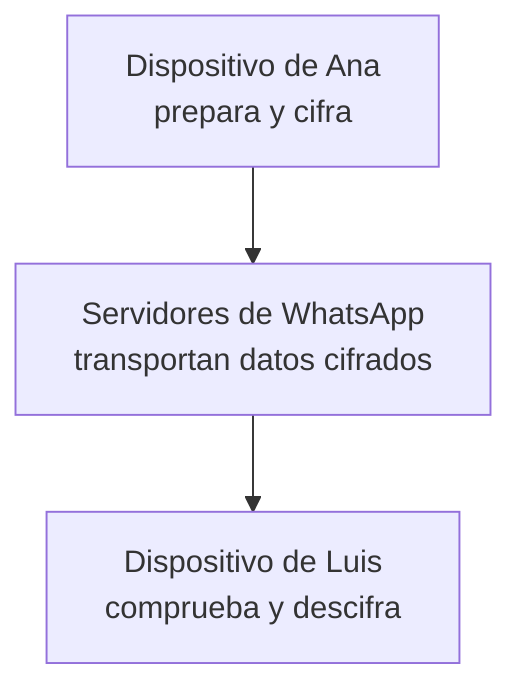

import { Quiz } from "@/components/quiz";

En un chat personal de WhatsApp, **enviar un mensaje** implica preparar su contenido, protegerlo y llevarlo hasta los dispositivos del destinatario. El **cifrado de extremo a extremo** permite que esos dispositivos lo lean sin entregar el contenido en claro a los servidores que lo transportan.

Sigamos un mensaje de texto entre Ana y Luis en un chat individual entre sus dispositivos personales.

## Antes de enviar «llego a las ocho»

**[Cifrar](/articulos/cifrado-simetrico-y-asimetrico/)** transforma datos mediante claves para impedir su lectura a quien no tenga las adecuadas. Una **clave pública** puede distribuirse; su pareja **privada** debe mantenerse protegida. No son la contraseña con la que desbloqueas el teléfono.

El documento de seguridad de WhatsApp, versión 9 de febrero de 2026, describe claves propias de cada dispositivo. El servicio almacena material público que permite iniciar una sesión cifrada; no necesita las claves privadas correspondientes para repartirlo.

El dispositivo de Ana obtiene las claves públicas necesarias y combina ese material con secretos propios. El de Luis puede obtener el secreto correspondiente usando sus claves privadas y la información del inicio de sesión. Así se establecen claves para proteger mensajes sin enviar una clave secreta en claro por la red.

La identidad de las claves también importa. Si Ana aceptara como de Luis la clave de un impostor, cifraría para la persona equivocada. WhatsApp permite comparar un código de seguridad o escanear un QR entre participantes para verificar las claves asociadas a la conversación.

## El recorrido del mensaje

El **protocolo Signal**, un conjunto de reglas criptográficas utilizado por WhatsApp, combina establecimiento de claves, cifrado y comprobaciones de integridad. Estas últimas permiten detectar alteraciones del contenido protegido. Las claves de mensaje evolucionan; no se utiliza una única clave fija para toda la conversación.

El siguiente esquema simplifica el envío a un dispositivo de Luis:

Los **[servidores](/articulos/que-es-un-servidor/)** son programas que coordinan la comunicación. Necesitan saber a qué cuenta y dispositivo dirigir la entrega, pero transportar un contenido cifrado no exige poder leerlo. Pueden guardar la secuencia de datos protegidos y reenviarla; el dispositivo receptor recupera el texto al descifrarla.

Si Luis no tiene conexión, el servicio puede conservar temporalmente el mensaje cifrado mientras intenta entregarlo. La política publicada establece un máximo de treinta días para mensajes no entregados. Que Ana haya enviado el suyo no asegura que Luis vaya a conectarse dentro de ese plazo.

## Enviado, entregado y leído

En este chat individual, las marcas representan estados distintos:

| Marca | Qué indica |
| --- | --- |
| Un tic gris | El mensaje se ha enviado |
| Dos tics grises | Ha llegado al teléfono de Luis o a alguno de sus dispositivos vinculados |
| Dos tics azules | Se ha recibido una confirmación de lectura |

Supón que el teléfono de Luis está apagado, pero su ordenador vinculado tiene conexión. Puede aparecer la confirmación de entrega: no significa necesariamente que haya llegado al teléfono. Tampoco demuestra que Luis haya prestado atención al mensaje.

La ausencia de tics azules no permite concluir que no lo ha leído: las confirmaciones pueden estar desactivadas o no haber llegado todavía. Una confirmación describe un evento de la aplicación; no mide comprensión humana.

<Quiz
	client:visible
	question="El mensaje muestra dos tics grises. ¿Qué permite concluir en un chat individual?"
	options={[
		"Luis ha leído y entendido el mensaje",
		"Lo ha recibido su teléfono o algún dispositivo vinculado",
		"Todos los dispositivos de Luis están conectados",
	]}
	answer={1}
/>

## Una cuenta puede tener varios extremos

En el diseño multidispositivo documentado, el emisor cifra por separado para los dispositivos destinatarios y los otros dispositivos propios que corresponden. Vincular un ordenador incorpora otro extremo autorizado, con sus claves, en lugar de darle al servidor permiso para leer todo el chat.

Esto explica por qué proteger solo el teléfono no basta si también hay una sesión abierta en otro equipo. Los extremos son los lugares donde el contenido puede aparecer descifrado.

## Lo que el cifrado no resuelve

- **Disponibilidad.** Un mensaje cifrado sigue necesitando transporte. Una caída del servicio puede impedir enviarlo o entregarlo, como ocurrió en la [caída de octubre de 2021](/articulos/la-caida-de-facebook-de-2021/).
- **Metadatos.** Ocultar el texto no oculta al servicio todos los datos de funcionamiento, como las cuentas y dispositivos a los que debe dirigirlo.
- **Control del destinatario.** Luis puede copiar el texto que ya ve. Un dispositivo comprometido también puede exponerlo después del descifrado.
- **Copias de seguridad.** Guardar un historial crea otra copia con su propia protección. WhatsApp dispone de una función específica de copia cifrada de extremo a extremo; la protección del envío no basta para describir cualquier respaldo.

El recorrido pasa por servidores: **extremo a extremo no significa [entre pares](/articulos/redes-peer-to-peer/)**. Describe quién puede descifrar, no la ausencia de intermediarios. Tampoco debe trasladarse sin más a conversaciones con empresas que usan servicios alojados por terceros: sus extremos y condiciones son diferentes.

## Lo esencial

- El contenido de un chat personal se protege entre los dispositivos participantes.
- Los servidores coordinan y transportan mensajes sin necesitar su texto en claro.
- Envío, entrega y lectura son eventos distintos.
- El cifrado no garantiza disponibilidad ni protege todas las copias y dispositivos por sí solo.
