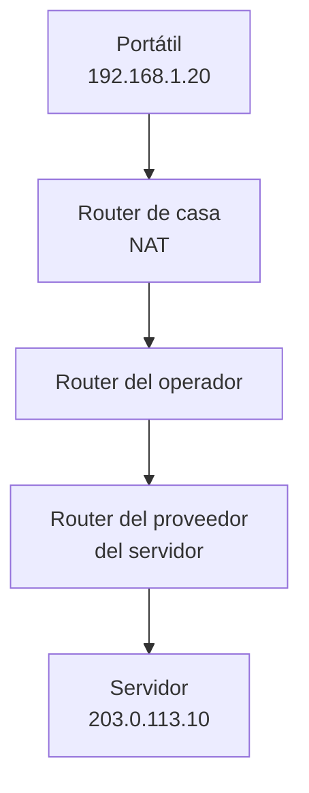

import { Quiz } from "@/components/quiz";

Un **paquete IP** contiene datos y una cabecera con direcciones y otros campos de control. Para cruzar internet se transporta por una sucesión de enlaces; los routers deciden el siguiente salto. Este recorrido une DNS, direccionamiento, transporte y enlace en un caso concreto.

El escenario es inventado: un portátil `192.168.1.20/24` conectado por **Ethernet**, un router local `192.168.1.1` que aplica NAPT y un servidor `203.0.113.10`. La dirección pública del router es `198.51.100.7`; estas direcciones externas están reservadas para documentación. No todas las conexiones reales usan IPv4, Ethernet o NAT.

## 1. Del nombre a la dirección: DNS

El navegador parte de un nombre, `example.com`. Supongamos que [DNS](/articulos/que-es-dns/) devuelve `203.0.113.10` en este escenario didáctico. La respuesta podría proceder de una caché o requerir consultas. Resolver el nombre no transporta todavía la página.

Después se establece el transporte. Seguiremos un paquete con datos de una conexión **TCP y TLS ya establecida** hacia el puerto 443: [TLS](/articulos/https-y-tls/) protege el intercambio HTTPS mediante cifrado y autenticación. Los mensajes de establecimiento también atraviesan la red, pero los omitimos para observar un paquete de datos.

## 2. Elegir el siguiente salto

La tabla local tiene una ruta a `192.168.1.0/24` y una predeterminada por `192.168.1.1`. El destino `203.0.113.10` no coincide con la [subred](/articulos/subredes-y-cidr/) local, así que se elige la [puerta de enlace predeterminada](/articulos/puerta-de-enlace-predeterminada/). Si hubiera una ruta más específica, esa podría ganar: no todo destino remoto utiliza siempre la ruta predeterminada.

## 3. Obtener la MAC del router: ARP

En este enlace Ethernet, la trama necesita una [dirección MAC](/articulos/que-es-una-direccion-mac/) de destino. El portátil consulta su tabla [ARP](/articulos/que-es-arp/) y, si no conoce la MAC de `192.168.1.1`, envía una pregunta por difusión local.

El router responde con la MAC de su interfaz local. Esa dirección identifica al siguiente destinatario de la trama, no al servidor remoto.

## 4. Preparar el envío

Los [modelos OSI y TCP/IP](/articulos/modelos-osi-y-tcp-ip/) ayudan a separar las piezas. El sistema forma un segmento TCP, lo incluye en un paquete IPv4 y prepara una trama Ethernet:

| Capa | Información relevante | En el ejemplo |
| --- | --- | --- |
| Transporte | Puertos de origen y destino | 51000 hacia 443, sobre [TCP](/articulos/tcp-y-udp/) |
| Red | IP de origen y destino, TTL | `192.168.1.20` hacia `203.0.113.10`, TTL 64 |
| Enlace | MAC del tramo | Del portátil al router local |

La IP de destino es la del servidor; la MAC de destino, la del router local. Esa diferencia permite entregar el paquete al primer salto sin cambiar su destino remoto.

<Quiz
	client:visible
	question="Al salir del portátil, ¿qué pareja de destinos lleva este envío?"
	options={[
		"IP del servidor y MAC del router local",
		"IP y MAC del servidor lejano",
		"IP y MAC del router local",
	]}
	answer={0}
/>

## 5. El router doméstico aplica NAT

El router procesa la trama y consulta la ruta hacia el servidor. En este caso lo reenvía al operador y aplica [NAPT](/articulos/que-es-nat/): convierte `192.168.1.20:51000` en `198.51.100.7:40001` y conserva esa correspondencia para las respuestas. También actualiza los campos de comprobación afectados. El TTL pasa de 64 a 63.

No está actuando como servidor web: el puerto 443 de destino sigue siendo el del servidor remoto. Tampoco necesita descifrar HTTPS para realizar esta traducción.

## 6. Avanzar salto a salto

Cada router realiza decisiones de reenvío. Resumimos sus responsabilidades sin imponer este orden a todas las implementaciones:

1. Procesa el paquete y comprueba su cabecera.
2. Reduce el [**TTL**](/articulos/ttl-en-ip/), normalmente en uno. Si se agota, descarta el paquete y normalmente genera un aviso ICMP, que puede filtrarse o limitarse.
3. Consulta la tabla de [enrutamiento](/articulos/enrutamiento/) y elige una ruta coincidente, dando prioridad al prefijo más largo.
4. Prepara el envío por el enlace elegido. Si es Ethernet, utiliza la MAC del siguiente salto, desde caché o mediante ARP; otra tecnología puede tener otro mecanismo.

Aquí no hay traducción de destino: `203.0.113.10` se conserva. Otras configuraciones pueden traducir también el destino. El envoltorio de enlace se prepara para cada tramo enrutado.

Con los tres routers del dibujo y una reducción de uno por router:

| Salida | IP de origen | IP de destino | TTL |
| --- | --- | --- | --- |
| Portátil | `192.168.1.20` | `203.0.113.10` | 64 |
| Router doméstico | `198.51.100.7` | `203.0.113.10` | 63 |
| Router del operador | `198.51.100.7` | `203.0.113.10` | 62 |
| Router de la red del servidor | `198.51.100.7` | `203.0.113.10` | 61 |

## 7. Cómo se conocen las rutas entre operadores

Las redes administradas de forma independiente, llamadas **sistemas autónomos**, intercambian anuncios mediante [BGP](/articulos/protocolos-de-enrutamiento/). Esos anuncios y las políticas de cada organización ayudan a construir rutas hacia otras redes.

Dentro de una organización puede haber rutas estáticas o protocolos como OSPF. BGP no negocia una ruta nueva por cada paquete de una página: el reenvío utiliza la información ya instalada.

## 8. Llegada y respuesta

Suponemos que el último enlace también es Ethernet. El router obtiene o reutiliza la MAC del servidor y le entrega la trama. El servidor reconoce su IP y su conexión TCP, recupera el flujo de bytes y procesa TLS antes de interpretar la petición HTTP. Un solo paquete no contiene necesariamente toda la petición.

La respuesta usa como destino `198.51.100.7:40001`, la dirección y puerto observados al recibir. No tiene por qué seguir el mismo camino de vuelta. Al llegar al router doméstico, la tabla NAPT permite traducir ese destino a `192.168.1.20:51000` y devolver los datos al portátil.

## 9. Qué puede impedir completar el recorrido

- **Falta una ruta o falla el siguiente salto.** Tener resuelto DNS no demuestra que exista un camino utilizable.
- **Una cola se llena o se daña una transmisión.** Puede perderse un paquete. TCP intenta recuperar datos y mantener el orden; también puede terminar fallando.
- **Un filtro bloquea el envío o la respuesta.** Llegar en una dirección no demuestra que el retorno funcione.
- **El paquete supera una MTU.** Puede requerir un tamaño menor o fragmentación cuando esté permitida; no basta con que quepa en el primer enlace.
- **Caduca la correspondencia NAT.** La respuesta puede dejar de tener un destinatario interno conocido.

Cada paquete tiene su propio recorrido y estado. Una página suele requerir varios intercambios; las cachés, la versión de HTTP, la conexión reutilizada y el contenido cambian su cantidad y duración.

## Lo esencial

- DNS aporta direcciones; la tabla de rutas elige el siguiente salto.
- En Ethernet, la MAC identifica al destinatario de ese tramo, mientras IP dirige el paquete hacia su destino de red.
- NAT puede cambiar direcciones y puertos; los routers reducen el TTL y preparan nuevos envíos de enlace.
- La respuesta necesita su propio camino; ningún paso aislado garantiza que la aplicación termine correctamente.
