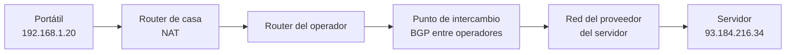

import { Quiz } from "@/components/quiz";

Escribes una dirección en el navegador y, en unos milisegundos, la respuesta llega desde un servidor que puede estar en otro continente. Por el camino, el paquete pasa por una docena de equipos que no se conocen entre sí. Este artículo sigue ese viaje paso a paso y enlaza cada pieza con su explicación detallada.

El escenario: tu portátil, `192.168.1.20`, en la wifi de casa, quiere hablar con un servidor web.

## 1. Del nombre a la dirección: DNS

El navegador tiene un nombre, `ejemplo.com`, pero los paquetes se dirigen a direcciones IP. Primero pregunta al [DNS](/articulos/que-es-dns/), que responde con la IP del servidor, por ejemplo `93.184.216.34`.

## 2. ¿Está en mi red? La máscara

El sistema operativo compara la IP de destino con su propia red usando la máscara de [subred](/articulos/subredes-y-cidr/). `93.184.216.34` no está en `192.168.1.0/24`, así que el paquete no se puede entregar directamente: hay que dárselo a la [puerta de enlace predeterminada](/articulos/puerta-de-enlace-predeterminada/), el router de casa, `192.168.1.1`.

## 3. ¿Cuál es la MAC del router? ARP

Dentro de la red local, los datos viajan en tramas que se entregan por [dirección MAC](/articulos/que-es-una-direccion-mac/). El portátil consulta su tabla [ARP](/articulos/que-es-arp/) y, si no conoce la MAC del router, la pregunta a toda la red.

## 4. El paquete se empaqueta

Cada capa añade su cabecera, como explican los [modelos OSI y TCP/IP](/articulos/modelos-osi-y-tcp-ip/):

| Capa | Qué añade | En el ejemplo |
| --- | --- | --- |
| Transporte | Puertos de origen y destino | 51000 hacia 443, sobre [TCP](/articulos/tcp-y-udp/) |
| Red | IP de origen y destino, y el TTL | De 192.168.1.20 a 93.184.216.34 |
| Enlace | MAC de origen y destino | De la del portátil a la del router |

La IP de destino es la del servidor; la MAC de destino, la del router. Esa diferencia es la clave de todo el enrutamiento.

## 5. El router de casa: NAT

El router recibe la trama, ve que el paquete no es para él y lo reenvía hacia su propia puerta de enlace, en la red del operador. Antes, aplica [NAT](/articulos/que-es-nat/): cambia la IP privada de origen por la IP pública de casa y anota la correspondencia, para saber a quién devolver la respuesta.

## 6. Salto a salto

A partir de aquí, cada router repite lo mismo, según las reglas de los routers IPv4:

1. Recibe el paquete y comprueba que la cabecera es válida.
2. **Resta uno al TTL**. Si llega a cero, lo descarta y avisa al remitente: es lo que aprovecha [traceroute](/articulos/como-funciona-traceroute/).
3. Busca el destino en su **tabla de [enrutamiento](/articulos/enrutamiento/)** y elige la ruta del prefijo más largo que coincide.
4. Averigua la MAC del siguiente router y reenvía el paquete en una trama nueva.

La IP de destino no cambia en todo el viaje. Las MAC cambian en cada salto, porque cada tramo es una red local distinta.

## 7. Entre operadores: BGP

El destino está en la red de otra organización. Las grandes redes de internet, los **sistemas autónomos**, se cuentan entre sí qué direcciones pueden alcanzar mediante [BGP](/articulos/protocolos-de-enrutamiento/). Gracias a esos anuncios, los routers del operador saben hacia qué red vecina mandar el paquete. Dentro de cada sistema autónomo, otros protocolos, como OSPF, deciden el camino interno.

## 8. La llegada y la respuesta

El último router entrega el paquete en la red del servidor, otra vez con ARP. El sistema operativo del servidor ve que la IP es suya, entrega los datos al programa que escucha en el puerto 443 y este responde.

La respuesta hace el viaje al revés, no necesariamente por el mismo camino. Al llegar al router de casa, NAT consulta su tabla, restaura la IP privada del portátil y se la entrega.

## 9. Lo que puede salir mal

- Un paquete puede **perderse** en un router saturado, llegar **desordenado** o **duplicado**: el enrutamiento no garantiza nada, y [TCP](/articulos/tcp-y-udp/) lo corrige reenviando y ordenando.
- Cada salto añade **latencia**, y la distancia física añade más, como recuerda [ancho de banda, latencia y rendimiento](/articulos/ancho-de-banda-latencia-y-rendimiento/).
- Un [cortafuegos](/articulos/cortafuegos/) en el camino puede bloquearlo.

Todo eso ocurre para cada paquete, y una sola página web necesita cientos.

## Lo esencial

- El DNS da la IP; la máscara decide si el destino es local o hay que pasar por la puerta de enlace.
- ARP da la MAC del siguiente equipo; la IP de destino se mantiene, la MAC cambia en cada salto.
- El router de casa aplica NAT; cada router resta uno al TTL y consulta su tabla de rutas.
- Entre las redes de internet, BGP decide hacia dónde seguir.
