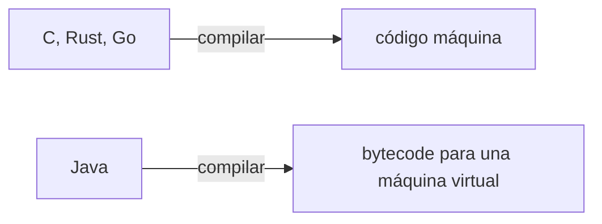
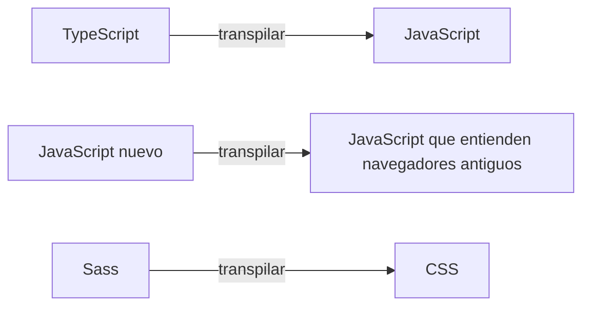

import { Quiz } from "@/components/quiz";

**Transpilar** es una forma de **compilar**: traducir de código fuente a otro código fuente, normalmente de nivel parecido. Compilar es el término general y también incluye producir código máquina o bytecode. No son categorías excluyentes.

## Compilar

Un [compilador](/articulos/compilador-e-interprete/) traduce un programa escrito para personas en instrucciones que una máquina ejecuta directamente, o en un código intermedio cercano a ellas.



Esos ejemplos producen código máquina o bytecode, pero el resultado de una compilación también puede ser un archivo objeto o código fuente. No tiene que ser un ejecutable autónomo.

## Transpilar

Un transpilador, o compilador de fuente a fuente, traduce a otro lenguaje de alto nivel, que sigue siendo legible.



[TypeScript](/articulos/que-es-typescript/), por ejemplo, quita las anotaciones de tipos y deja JavaScript. Herramientas como Babel convierten sintaxis moderna en una equivalente más antigua:

```js
const usuario = {};

console.log(usuario.direccion?.ciudad); // undefined
const direccion = usuario.direccion;
console.log(direccion === null || direccion === undefined ? undefined : direccion.ciudad); // undefined
```

El encadenamiento opcional comprueba `null` o `undefined`, no cualquier valor falsy. Una transformación debe preservar también que `direccion` solo se evalúe una vez: podría ser un getter con efectos. El ejemplo enseña esa condición; el código exacto emitido depende del transpilador y del destino.

## Comparación

| | Compilar | Transpilar |
| --- | --- | --- |
| Destino | Otra representación, incluido código fuente | Código fuente |
| Resultado legible | Depende del destino | Es texto fuente, aunque puede resultar difícil de leer |
| Ejemplos | C a código máquina, Java a bytecode | TypeScript a JavaScript, Sass a CSS |
| Para qué | Ejecutar el programa | Usar un lenguaje o una sintaxis que el destino no entiende |

## Una frontera borrosa

Técnicamente, transpilar es un caso de compilar: traducir de un lenguaje a otro. Por eso el compilador de TypeScript se llama así, compilador, aunque produzca JavaScript.

"Transpilar" es un término práctico, muy usado en desarrollo web, que subraya que el resultado sigue siendo código fuente. Muchas herramientas de construcción, como los [empaquetadores](/articulos/que-hace-un-empaquetador/), transpilan como uno de sus pasos.

## Límites y confusiones

- **Cambiar sintaxis no añade APIs al entorno.** Traducir una función flecha no instala `fetch` en un entorno que carece de ella; puede hacer falta una biblioteca o un polyfill.
- **El destino no garantiza rendimiento.** Elegir código fuente o bytecode responde a una cadena de herramientas y a sus entornos de ejecución.
- **La transformación debe conservar el comportamiento.** Sustituir `?.` por `&&` sin más cambia el resultado para valores como cero.

## Lo esencial

- Compilar y transpilar son formas de traducir código.
- Compilar suele producir código máquina o intermedio, no pensado para leerse.
- Transpilar produce otro lenguaje de alto nivel, legible.
- Transpilar es un caso particular de compilar; el término se usa sobre todo en la web.
