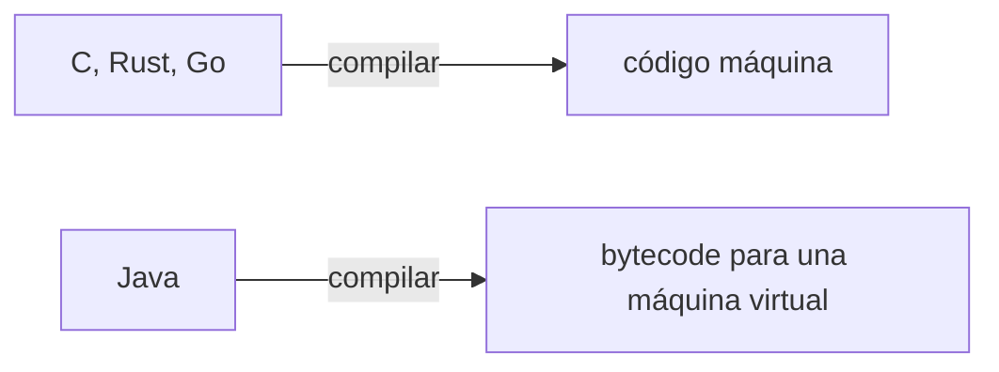
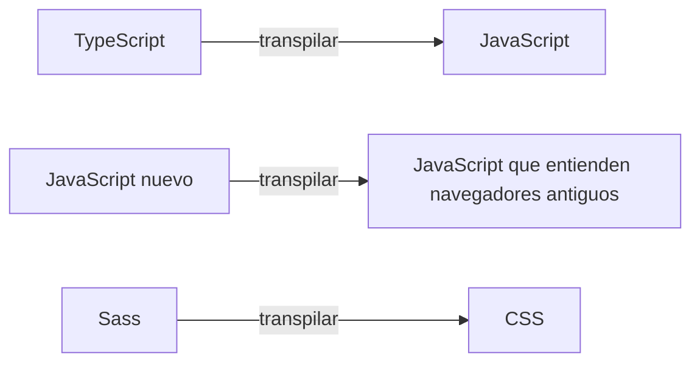

import { Quiz } from "@/components/quiz";

**Compilar** y **transpilar** son dos formas de traducir código de un lenguaje a otro. La diferencia está en el **nivel** de los lenguajes. Compilar suele llevar de un lenguaje de alto nivel a uno de bajo nivel, como el código máquina. Transpilar traduce entre lenguajes de un nivel parecido, por ejemplo de TypeScript a JavaScript.

## Compilar

Un [compilador](/articulos/compilador-e-interprete/) traduce un programa escrito para personas en instrucciones que una máquina ejecuta directamente, o en un código intermedio cercano a ellas.



El resultado no está pensado para que nadie lo lea. Es un archivo ejecutable.

## Transpilar

Un transpilador, o compilador de fuente a fuente, traduce a otro lenguaje de alto nivel, que sigue siendo legible.



[TypeScript](/articulos/que-es-typescript/), por ejemplo, quita las anotaciones de tipos y deja JavaScript. Herramientas como Babel convierten sintaxis moderna en una equivalente más antigua:

```js
const usuario = {};

console.log(usuario.direccion?.ciudad); // undefined
console.log(usuario.direccion && usuario.direccion.ciudad); // undefined
```

La primera línea usa el encadenamiento opcional, una sintaxis reciente. Un transpilador puede convertirla en algo parecido a la segunda, que entiende cualquier navegador.

## Comparación

| | Compilar | Transpilar |
| --- | --- | --- |
| Destino | Más bajo nivel: código máquina o intermedio | Nivel parecido: otro lenguaje de alto nivel |
| Resultado legible | No | Sí, más o menos |
| Ejemplos | C a código máquina, Java a bytecode | TypeScript a JavaScript, Sass a CSS |
| Para qué | Ejecutar el programa | Usar un lenguaje o una sintaxis que el destino no entiende |

## Una frontera borrosa

Técnicamente, transpilar es un caso de compilar: traducir de un lenguaje a otro. Por eso el compilador de TypeScript se llama así, compilador, aunque produzca JavaScript.

"Transpilar" es un término práctico, muy usado en desarrollo web, que subraya que el resultado sigue siendo código fuente. Muchas herramientas de construcción, como los [empaquetadores](/articulos/que-hace-un-empaquetador/), transpilan como uno de sus pasos.

## Lo esencial

- Compilar y transpilar son formas de traducir código.
- Compilar suele producir código máquina o intermedio, no pensado para leerse.
- Transpilar produce otro lenguaje de alto nivel, legible.
- Transpilar es un caso particular de compilar; el término se usa sobre todo en la web.
