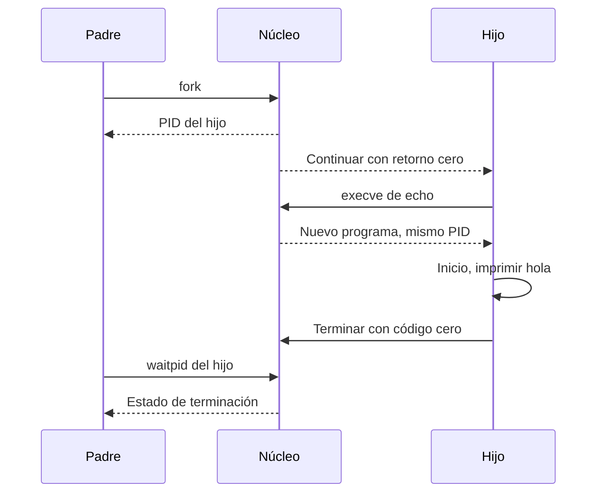

import { Quiz } from "@/components/quiz";

Ejecutar un **[binario](/articulos/que-es-un-binario/)** requiere preparar su entorno de memoria y transferirle el control. En Linux, **crear un proceso** y **sustituir el programa de un proceso existente** son operaciones distintas. El recorrido clásico de una shell combina `fork`, `execve` y una espera para recoger el resultado.

## 1. Elegir qué ejecutar

Al escribir una orden, la [shell](/articulos/terminal-y-shell/) interpreta la línea y resuelve qué significa. Puede ser una función, una orden interna o un ejecutable externo. Para muchos nombres externos busca en [PATH](/articulos/variable-de-entorno-path/); una ruta explícita no necesita esa búsqueda.

Seguiremos un programa externo, `/bin/echo`, al que pasamos `hola`. No todo comando de una shell sigue este recorrido exacto: una orden interna puede ejecutarse en la propia shell y existen otras interfaces para lanzar programas.

## 2. Crear el hijo con fork

`fork` crea un hijo con un identificador distinto. Ambos continúan desde la llamada: en el hijo devuelve cero; en el padre, el identificador del hijo. Si falla, devuelve -1 y no existe ese hijo.

La memoria privada comienza con contenido equivalente, pero son espacios de direcciones separados. Linux utiliza **copia en escritura**: puede compartir físicamente páginas mientras no se modifiquen y separarlas cuando hace falta. Hay atributos distintos, como los identificadores, y recursos compartidos: los [descriptores](/articulos/descriptores-de-archivo/) heredados pueden referirse a la misma apertura de archivo.

## 3. Sustituir el programa con execve

El hijo llama a `execve` con la ruta, los argumentos y el entorno. Si tiene éxito, **conserva su PID, pero sustituye su programa**. No regresa a la instrucción siguiente de quien llamó. Si devuelve un error, el código anterior continúa y debe tratarlo.

Este programa completo es para Linux, con un compilador C y `/bin/echo` disponibles. Guárdalo como `ejecutar.c`, compílalo con `cc -Wall -Wextra ejecutar.c -o ejecutar` y ejecútalo con `./ejecutar`:

```c
#include <errno.h>
#include <stdio.h>
#include <sys/types.h>
#include <sys/wait.h>
#include <unistd.h>

int main(int argc, char *argv[]) {
	if (argc > 2) return 2;
	char *programa = argc == 2 ? argv[1] : "/bin/echo";
	pid_t pid = fork();
	if (pid < 0) {
		perror("fork");
		return 1;
	}
	if (pid == 0) {
		char *argumentos[] = {programa, "hola", NULL};
		char *entorno[] = {"LANG=C", NULL};
		execve(programa, argumentos, entorno);
		perror("execve");
		_exit(127);
	}

	int estado;
	pid_t esperado;
	do {
		esperado = waitpid(pid, &estado, 0);
	} while (esperado == -1 && errno == EINTR);
	if (esperado == -1) {
		perror("waitpid");
		return 1;
	}
	if (WIFEXITED(estado)) {
		int codigo = WEXITSTATUS(estado);
		printf("Salida del hijo: %d\n", codigo);
		return codigo;
	}
	if (WIFSIGNALED(estado)) {
		printf("Senal del hijo: %d\n", WTERMSIG(estado));
	}
	return 1;
}
```

En el caso correcto imprime `hola` y después `Salida del hijo: 0`. Si pasas una ruta que no existe, `execve` falla: el hijo muestra el error y termina con 127, que recoge el padre. El programa acepta solo esa ruta opcional, no una línea de órdenes completa.

`EINTR` indica que la espera fue interrumpida; aquí volvemos a esperar al mismo hijo. `WIFEXITED` permite interpretar el estado como salida normal; no debemos aplicar `WEXITSTATUS` a una terminación por señal. `_exit` termina el hijo tras el fallo sin continuar por el código del padre. El ejemplo es de un solo hilo; lanzar desde procesos con varios hilos exige precauciones adicionales entre `fork` y `exec`.

<Quiz
	client:visible
	question="execve tiene éxito en el hijo. ¿Qué cambia?"
	options={["Aparece necesariamente otro proceso con un tercer PID", "Se sustituye el programa del hijo conservando su PID", "El padre pasa a ejecutar el programa del hijo"]}
	answer={1}
/>

## 4. Preparar la memoria

Para un ejecutable ELF, el núcleo interpreta sus cabeceras y prepara regiones del [espacio virtual](/articulos/memoria-virtual/) con los permisos correspondientes. Una organización habitual de un programa C incluye:

| Región | Contenido o función |
| --- | --- |
| Código | Instrucciones, normalmente ejecutables y no escribibles |
| Datos | Objetos estáticos con valores iniciales almacenados |
| BSS | Objetos estáticos inicializados a cero, sin guardar cada cero en el archivo |
| Montículo | Memoria que gestionan los mecanismos de asignación dinámica |
| Pila | Estado de llamadas y datos según la convención de ejecución |

No es una disposición universal ni implica direcciones o sentidos de crecimiento fijos. La carga bajo demanda permite incorporar páginas cuando hacen falta. Un fallo de página puede resolverse con datos ya en memoria, inicializando ceros o leyendo almacenamiento; no significa siempre una lectura física del disco.

## 5. Enlazar e iniciar el programa

En un ELF dinámico con `PT_INTERP`, esa entrada identifica el intérprete de arranque, normalmente el **cargador dinámico**. Prepara bibliotecas compartidas y resuelve referencias; algunas resoluciones pueden aplazarse hasta su uso según la configuración.

Después se llega al código de entrada del ejecutable. En un programa C habitual, código de inicio prepara el entorno antes de llamar a `main`. Un ejecutable estático no necesita necesariamente ese cargador dinámico.

El [planificador](/articulos/planificador-de-procesos/) ya interviene durante el recorrido; no empieza a repartir CPU solo al llegar a `main`.



El diagrama muestra el caso correcto. El padre puede entrar en `waitpid` antes de que el hijo termine; entonces espera. El código contempla también los errores que el diagrama omite.

## 6. Terminar y recoger el estado

Al terminar se liberan recursos, pero puede conservarse una entrada con el estado de salida hasta que el padre lo recoja. Ese hijo terminado es un **zombi**; no sigue ejecutando instrucciones. Algunas configuraciones permiten recogida automática.

Cero se usa convencionalmente para éxito. Una terminación por señal tiene otra representación en el estado de espera. La shell interpreta esos resultados y ofrece su estado de salida; no es simplemente el entero bruto que devolvió `waitpid`.

## Errores comunes

- **Confundir exec con creación.** Sustituye un programa; `fork` creó el hijo del ejemplo.
- **Continuar como si exec hubiera funcionado.** Si devuelve un error, sigue activo el programa anterior.
- **Confundir memoria virtual con copia completa desde disco.** Preparar regiones y materializar páginas son operaciones diferentes.

## Lo esencial

- `fork` crea un hijo; `execve` sustituye su programa conservando su PID.
- Argumentos, entorno, memoria y bibliotecas forman parte del inicio.
- Cada llamada puede fallar y necesita tratar su resultado.
- Terminar y recoger el estado del hijo son pasos distintos.
