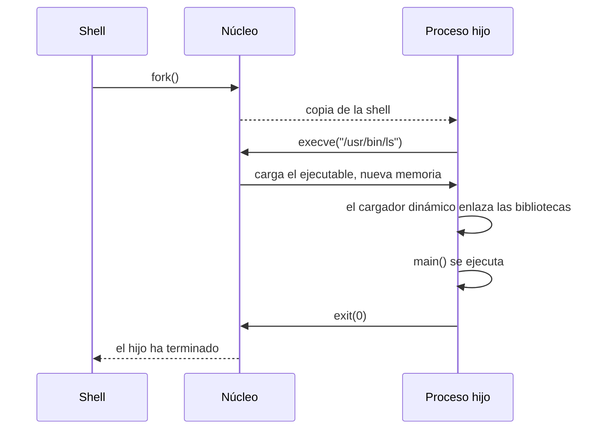

import { Quiz } from "@/components/quiz";

Escribes `ls` en la terminal y pulsas Intro. En unos milisegundos, un archivo del disco se ha convertido en un programa en ejecución. Por el camino, el sistema operativo hace bastante trabajo. Este artículo lo recorre en Linux, aunque la idea es parecida en otros sistemas.



## 1. Buscar el programa

La [shell](/articulos/terminal-y-shell/) busca `ls` en los directorios de la variable [PATH](/articulos/variable-de-entorno-path/) y encuentra `/usr/bin/ls`.

## 2. Duplicarse: fork

En Linux, un proceso nuevo nace como **copia** de otro. La shell hace la [llamada al sistema](/articulos/llamadas-al-sistema/) `fork`, y el núcleo crea un proceso **hijo**: según su página de manual, un duplicado exacto del padre, con su propio identificador, que se ejecuta en un espacio de memoria separado. Copiar toda la memoria sería caro: según la página de manual, Linux implementa `fork` con páginas de **copia en escritura**, que se comparten hasta que alguno de los dos procesos las modifica.

## 3. Cambiar de programa: execve

El hijo, que todavía es una copia de la shell, hace `execve` con la ruta del programa, sus argumentos y sus variables de entorno. Según su página de manual, esa llamada **sustituye** el programa del proceso por el nuevo, con la pila, el montículo y los segmentos de datos recién inicializados. Si tiene éxito, no vuelve nunca: el código que la llamó ya no existe en ese proceso.

```c
pid_t pid = fork();
if (pid == 0) {
    char *argumentos[] = {"ls", "-l", NULL};
    execve("/usr/bin/ls", argumentos, environ); // solo vuelve si falla
}
waitpid(pid, NULL, 0); // la shell espera a que termine
```

## 4. Cargar el ejecutable

El núcleo lee la cabecera del [binario](/articulos/que-es-un-binario/), un ELF en Linux, y prepara el **espacio de direcciones** del proceso: la visión que tiene el programa de la memoria. Como explica el libro OSTEP, contiene todo el estado de memoria del programa:

| Zona | Qué contiene |
| --- | --- |
| Código | Las instrucciones del programa, de solo lectura |
| Datos | Variables globales con valor inicial |
| BSS | Variables globales sin valor inicial, a cero |
| Montículo | Memoria pedida durante la ejecución; crece hacia arriba |
| Pila | Llamadas a funciones y variables locales; crece hacia abajo |

Gracias a la [memoria virtual](/articulos/memoria-virtual/), cada proceso cree tener toda la memoria para él. Además, no se lee el archivo entero del disco: las páginas se cargan cuando se usan por primera vez.

## 5. Enlazar las bibliotecas

Casi ningún programa es autónomo: usa bibliotecas compartidas, como la biblioteca estándar de C. Si el ejecutable está **enlazado dinámicamente**, el núcleo no salta directamente a él, sino al **cargador dinámico**, `ld.so`, que busca y carga las bibliotecas compartidas y resuelve las referencias a sus funciones.

## 6. Ejecutar

Por fin, se salta a la primera instrucción del programa. Un pequeño código de arranque prepara los argumentos y llama a `main`. A partir de aquí, el [planificador](/articulos/planificador-de-procesos/) reparte el procesador entre este proceso y los demás.

## 7. Terminar

Al acabar, el programa llama a `exit` con un **código de salida**: 0 si todo fue bien. El núcleo libera su memoria y avisa al padre, que recoge el código con `wait`. Es el número que la shell guarda en `$?`. Un hijo que ha terminado pero cuyo padre aún no ha recogido su código queda como proceso **zombi**.

## Lo esencial

- La shell crea un proceso hijo con fork y le cambia el programa con execve.
- El núcleo carga el ejecutable en un espacio de direcciones propio: código, datos, montículo y pila.
- El cargador dinámico enlaza las bibliotecas compartidas antes de llamar a main.
- Al terminar, el código de salida vuelve al padre.
