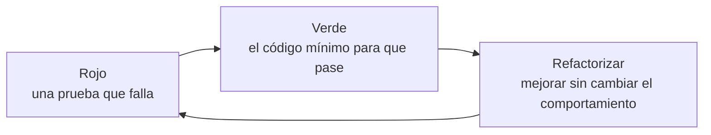

import { Quiz } from "@/components/quiz";

El **desarrollo guiado por pruebas**, o **TDD** por sus siglas en inglés, es una forma de programar en la que **la prueba se escribe antes que el código**. Se avanza en ciclos muy cortos: una prueba que falla, el código justo para que pase y una mejora del código. Lo popularizó Kent Beck a finales de los años noventa, como parte de la programación extrema.

Es una técnica de diseño tanto como de [pruebas](/articulos/pruebas-de-software/): obliga a decidir cómo se usará el código antes de escribirlo.

## El ciclo: rojo, verde, refactorizar



1. **Rojo**: se escribe una prueba para el siguiente comportamiento que se quiere. Se ejecuta y **falla**, porque el código aún no existe. Si no falla, la prueba no comprueba nada nuevo, o el comportamiento ya existía.
2. **Verde**: se escribe el código **más sencillo** que hace pasar la prueba. Sin adelantarse a casos que todavía no tienen prueba.
3. **Refactorizar**: con todas las pruebas en verde, se mejora el código, quitando duplicados y aclarando nombres, como explica [refactorización](/articulos/que-es-la-refactorizacion/). Las pruebas avisan si algo se rompe.

Martin Fowler añade un paso previo: escribir una **lista de casos** que se quieren cubrir, e ir tomándolos de uno en uno.

## Un ciclo completo

Una función que calcula el precio con IVA. Primero, las pruebas, con una función mínima para comprobar:

```js
const resultados = [];
function prueba(nombre, fn) {
	try {
		fn();
		resultados.push(`✓ ${nombre}`);
	} catch (error) {
		resultados.push(`✗ ${nombre}: ${error.message}`);
	}
}
function igual(obtenido, esperado) {
	if (obtenido !== esperado) throw new Error(`esperaba ${esperado}, obtuve ${obtenido}`);
}

// Rojo: la función aún no hace nada.
let precioConIva = () => 0;
prueba("aplica el 21 %", () => igual(precioConIva(100), 121));
console.log(resultados.pop()); // "✗ aplica el 21 %: esperaba 121, obtuve 0"

// Verde: el código mínimo.
precioConIva = (precio) => precio * 1.21;
prueba("aplica el 21 %", () => igual(precioConIva(100), 121));
console.log(resultados.pop()); // "✓ aplica el 21 %"

// Siguiente caso de la lista, otra vez en rojo.
prueba("redondea a céntimos", () => igual(precioConIva(9.99), 12.09));
console.log(resultados.pop()); // "✗ redondea a céntimos: esperaba 12.09, obtuve 12.0879"

// Verde de nuevo.
precioConIva = (precio) => Math.round(precio * 1.21 * 100) / 100;
prueba("aplica el 21 %", () => igual(precioConIva(100), 121));
prueba("redondea a céntimos", () => igual(precioConIva(9.99), 12.09));
console.log(resultados.join(" | ")); // "✓ aplica el 21 % | ✓ redondea a céntimos"
```

El segundo caso descubre un problema que la primera versión no tenía en cuenta: los decimales. Y la primera prueba sigue ahí, comprobando que el arreglo no rompe lo que ya funcionaba. En un proyecto real, las funciones `prueba` e `igual` las da una biblioteca de pruebas.

## Qué aporta

- **Todo el código tiene pruebas**, porque ninguna línea se escribe sin una prueba que la pida.
- **Diseño desde fuera**: escribir la prueba primero obliga a pensar en la interfaz del código, en cómo se va a usar, antes que en cómo se implementa.
- **Pasos pequeños**: si algo falla, el error está en las pocas líneas que se acaban de escribir.
- **Confianza para cambiar**: con una red de pruebas, refactorizar deja de dar miedo.
- **Documentación viva**: las pruebas muestran, con ejemplos que funcionan, qué hace el código.

## Sus límites

- **Cuesta al principio**: es una disciplina que se aprende con práctica.
- **No todo encaja igual**: interfaces visuales, prototipos que se van a tirar o código que explora una idea se prestan menos.
- **Pruebas atadas a la implementación**: si se prueban detalles internos en lugar del comportamiento, cada refactorización rompe pruebas y el método se vuelve una carga.
- **No sustituye a otras pruebas**: TDD produce sobre todo pruebas unitarias; siguen haciendo falta las de [integración y de extremo a extremo](/articulos/pruebas-unitarias-de-integracion-y-de-extremo-a-extremo/).

En 2014, Kent Beck, Martin Fowler y David Heinemeier Hansson mantuvieron una serie de conversaciones públicas titulada «¿Ha muerto TDD?». En ellas distinguen TDD de su objetivo de fondo, tener código que se comprueba a sí mismo con pruebas fiables, y discuten en qué contextos ayuda escribir la prueba primero y en cuáles no.

<Quiz
	client:visible
	question="¿Qué se hace en el paso «verde» de TDD?"
	options={[
		"Escribir todas las pruebas del programa",
		"Escribir el código más sencillo que hace pasar la prueba que falla",
		"Mejorar el diseño del código existente",
	]}
	answer={1}
/>

## Lo esencial

- En TDD la prueba se escribe antes que el código.
- El ciclo es rojo (prueba que falla), verde (código mínimo) y refactorizar.
- Garantiza pruebas para todo el código y obliga a pensar primero en cómo se usa.
- Funciona mejor probando comportamiento, no detalles internos, y no sustituye a otros tipos de pruebas.
