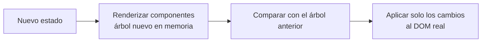

import { Quiz } from "@/components/quiz";

En [React](/articulos/que-es-react/) no modificas la página directamente. Describes cómo debe verse la interfaz para un estado dado, y cuando el estado cambia, React se encarga de actualizar el [DOM](/articulos/el-dom/) real. Para hacerlo de forma eficiente, compara la descripción nueva con la anterior y aplica **solo las diferencias**. Ese proceso se llama **reconciliación**, y la descripción en memoria se conoce popularmente como **DOM virtual**.

## Por qué no repintar todo

Tocar el DOM es caro: cada cambio puede obligar al navegador a recalcular estilos y la colocación de los elementos. Rehacer la página entera en cada pulsación de tecla sería lento y, además, perdería el estado del navegador: el foco de un campo, la posición de desplazamiento, el texto seleccionado.



## Un problema difícil, resuelto con atajos

Comparar dos árboles cualesquiera para encontrar el mínimo de cambios es caro. La documentación de React explica que los mejores algoritmos generales tienen una complejidad del orden de O(n³), inaceptable para una interfaz con miles de elementos. React usa en cambio un algoritmo **heurístico de complejidad O(n)**, basado en dos suposiciones:

1. **Dos elementos de tipos distintos producen árboles distintos.** Si un `<div>` pasa a ser un `<section>`, o un componente pasa a ser otro, React no intenta compararlos: desmonta el árbol viejo, con todo su estado, y monta el nuevo.
2. **Las claves indican qué hijos se mantienen.** En una lista, la propiedad `key` dice qué elemento nuevo corresponde a cuál de antes.

## Una reconciliación en miniatura

```js
function diferencias(antes, despues, ruta = "raíz") {
	const ops = [];
	if (!antes) return [`crear ${despues.tipo} en ${ruta}`];
	if (antes.tipo !== despues.tipo) return [`reemplazar ${antes.tipo} por ${despues.tipo} en ${ruta}`];

	const propsAntes = antes.props ?? {};
	const propsDespues = despues.props ?? {};
	for (const nombre of new Set([...Object.keys(propsAntes), ...Object.keys(propsDespues)])) {
		if (propsAntes[nombre] !== propsDespues[nombre]) ops.push(`cambiar ${nombre} de ${ruta} a ${propsDespues[nombre]}`);
	}

	const hijosAntes = new Map((antes.hijos ?? []).map((h) => [h.clave, h]));
	const clavesDespues = new Set((despues.hijos ?? []).map((h) => h.clave));
	for (const hijo of despues.hijos ?? []) ops.push(...diferencias(hijosAntes.get(hijo.clave), hijo, `${ruta}/${hijo.clave}`));
	for (const [clave, hijo] of hijosAntes) if (!clavesDespues.has(clave)) ops.push(`eliminar ${hijo.tipo} en ${ruta}/${clave}`);
	return ops;
}

const antes = { tipo: "ul", hijos: [
	{ tipo: "li", clave: "ana", props: { texto: "Ana" } },
	{ tipo: "li", clave: "luis", props: { texto: "Luis" } },
] };
const despues = { tipo: "ul", hijos: [
	{ tipo: "li", clave: "eva", props: { texto: "Eva" } },
	{ tipo: "li", clave: "ana", props: { texto: "Ana" } },
	{ tipo: "li", clave: "luis", props: { texto: "Luis G." } },
] };

console.log(diferencias(antes, despues).join("; ")); // "crear li en raíz/eva; cambiar texto de raíz/luis a Luis G."
```

Se añade una persona al principio de la lista y cambia un nombre. Gracias a las claves, el resultado son solo dos operaciones: crear un elemento y cambiar un texto. "Ana" no se toca, aunque haya cambiado de posición.

## Por qué importan las claves

Sin claves, React compararía los hijos **por posición**: el primero con el primero, el segundo con el segundo. Al insertar a Eva al principio, creería que el primer elemento ha cambiado de "Ana" a "Eva", el segundo de "Luis" a "Ana", y que hay uno nuevo al final. Todo se reescribiría, y si cada elemento tuviera estado propio, como un campo de texto a medio rellenar, ese estado acabaría en el elemento equivocado.

Por eso la documentación de React pide una clave en cada elemento de una lista, **única entre sus hermanos** y **estable**: el identificador del dato, no su posición en el array. Usar el índice como clave reproduce el problema en cuanto la lista se reordena.

## Lo que no es

- **El DOM virtual no es más rápido que el DOM** por sí mismo: añade trabajo. Su ventaja es poder describir la interfaz entera en cada cambio y que solo se apliquen las diferencias.
- **No es exclusivo de React**: otras bibliotecas usan ideas parecidas, y algunas evitan el DOM virtual compilando de antemano qué partes cambian con cada dato.

## Lo esencial

- React compara la descripción nueva de la interfaz con la anterior y aplica solo las diferencias al DOM.
- Lo hace en tiempo lineal gracias a dos atajos: tipos distintos se reemplazan enteros, y las claves identifican a los hijos.
- Las claves deben ser únicas y estables; el índice del array falla al reordenar.
- La ventaja es poder pensar la interfaz como función del estado sin pagar por repintarlo todo.
