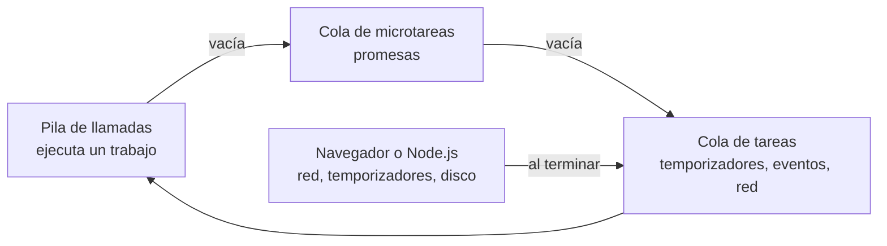

import { Quiz } from "@/components/quiz";

JavaScript ejecuta el código de tu programa en **un solo hilo**: hace una cosa cada vez. Y aun así, una página puede pedir datos a un servidor, animar un botón y responder a clics a la vez. Lo consigue el **bucle de eventos**: un mecanismo que va sacando **trabajos** de una cola y ejecutándolos uno tras otro, sin quedarse nunca esperando.

## El modelo

MDN lo explica así: cuando una acción asíncrona termina, por ejemplo una petición con `fetch`, el código que debe ejecutarse después se define como un [callback](/articulos/que-es-un-callback/). Ese callback se convierte en un **trabajo** que se añade a una cola. El motor saca trabajos de la cola y los ejecuta de uno en uno.



Las esperas, la red, los temporizadores o el disco, no ocurren en el hilo de JavaScript: las gestiona el entorno, el navegador o Node.js. Cuando terminan, encolan su callback.

## Dos reglas

**Cada trabajo se ejecuta hasta el final.** Mientras un trabajo se ejecuta, nada lo interrumpe. Eso simplifica mucho razonar sobre el código: no hay [condiciones de carrera](/articulos/condiciones-de-carrera-y-bloqueos/) entre dos callbacks. Pero tiene un precio: un trabajo largo **bloquea** todo, y la página deja de responder.

**Las microtareas van primero.** El navegador distingue dos colas: **tareas** (temporizadores, eventos, respuestas de red) y **microtareas** (sobre todo, las continuaciones de las [promesas](/articulos/promesas-y-async-await/)). Según MDN, la cola de microtareas tiene más prioridad y se vacía entera antes de sacar la siguiente tarea.

```js
const orden = [];

orden.push("síncrono 1");
setTimeout(() => {
	orden.push("tarea");
	console.log(orden.join(" -> ")); // "síncrono 1 -> síncrono 2 -> microtarea -> tarea"
}, 0);
Promise.resolve().then(() => orden.push("microtarea"));
orden.push("síncrono 2");
```

Aunque el temporizador tiene 0 milisegundos, se ejecuta el último: primero termina el código síncrono, después se vacían las microtareas y solo entonces se saca la tarea del temporizador. Un `setTimeout(fn, 0)` no significa "ahora", sino "en cuanto se pueda".

## Por qué nunca se bloquea

MDN subraya la otra gran garantía del modelo: la ejecución de JavaScript **nunca se bloquea** esperando. Mientras una consulta a la base de datos o un `fetch` están en curso, el hilo atiende otros trabajos, como la escritura del usuario. Cuando llega la respuesta, su callback se pone a la cola.

`await` encaja en este modelo: no detiene el hilo, sino que **pausa la función** y deja que el bucle siga con otros trabajos. La función continúa como una microtarea cuando la promesa se resuelve.

## Lo que lo estropea

Un cálculo largo dentro de un trabajo bloquea el bucle:

```javascript
boton.addEventListener("click", () => {
	// Durante este bucle, la página no responde ni se repinta.
	for (let i = 0; i < 5e9; i++) {}
});
```

Las soluciones: dividir el trabajo en trozos que se encolan por separado, o sacarlo del hilo principal a un **Web Worker**, que tiene su propio hilo y su propio bucle. El navegador avisa con un mensaje de "este script tarda demasiado" cuando un trabajo se alarga.

## En Node.js

[Node.js](/articulos/que-es-nodejs/) usa la misma idea, con un bucle dividido en **fases**: temporizadores, callbacks de entrada y salida pendientes, espera de nuevos eventos, `setImmediate` y cierres. Cuando el sistema operativo avisa de que una operación terminó, su callback se añade a la cola de la fase correspondiente. Por eso un único proceso de Node.js atiende miles de conexiones a la vez, siempre que nadie bloquee el bucle.

## Lo esencial

- JavaScript ejecuta el código en un solo hilo y saca trabajos de una cola, uno tras otro.
- Cada trabajo se ejecuta hasta el final; uno largo bloquea la página.
- Las microtareas, como las continuaciones de promesas, se vacían antes de la siguiente tarea.
- Las esperas ocurren fuera del hilo, así que JavaScript nunca se bloquea esperando.
