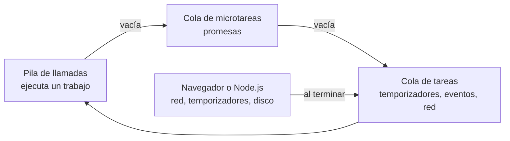

import { Quiz } from "@/components/quiz";

El **bucle de eventos** coordina cuándo se ejecutan las tareas pendientes de un entorno JavaScript. En el hilo principal de una página, el código se ejecuta de una tarea en una tarea; una espera asíncrona permite atender otras, pero un cálculo largo puede impedir que avancen.

## Qué problema resuelve

Una página necesita responder a clics mientras espera datos de la red. No puede ejecutar un bucle que pregunte sin parar si han llegado: ocuparía el hilo que necesita para reaccionar. El entorno gestiona la espera y programa la continuación cuando corresponde. Los Web Workers tienen otros hilos; aquí seguimos lo que ocurre en uno de ellos.

## El modelo

MDN lo explica así: cuando una acción asíncrona termina, por ejemplo una petición con `fetch`, el código que debe ejecutarse después se define como un [callback](/articulos/que-es-un-callback/). Ese callback se convierte en un **trabajo** que se añade a una cola. El motor saca trabajos de la cola y los ejecuta de uno en uno.



El diagrama simplifica la coordinación: las operaciones asíncronas delegan la espera al entorno. Las continuaciones de promesas se procesan como microtareas; no todo callback de red pertenece directamente a una misma cola de tareas. El navegador puede tener varias fuentes de tareas y oportunidades de renderizado.

## Dos reglas

**Cada trabajo se ejecuta hasta el final.** Otro callback de ese hilo no se intercala dentro de su ejecución síncrona. Esto no elimina las [condiciones de carrera](/articulos/condiciones-de-carrera-y-bloqueos/): dos operaciones repartidas entre varios callbacks pueden terminar en distinto orden. Además, un trabajo largo bloquea la atención de otras tareas del hilo.

**Las microtareas van primero.** El navegador distingue dos colas: **tareas** (temporizadores, eventos, respuestas de red) y **microtareas** (sobre todo, las continuaciones de las [promesas](/articulos/promesas-y-async-await/)). Según MDN, la cola de microtareas tiene más prioridad y se vacía entera antes de sacar la siguiente tarea.

```js
const orden = [];

orden.push("síncrono 1");
setTimeout(() => {
	orden.push("tarea");
	console.log(orden.join(" -> ")); // "síncrono 1 -> síncrono 2 -> microtarea -> tarea"
}, 0);
Promise.resolve().then(() => orden.push("microtarea"));
orden.push("síncrono 2");
```

Aunque el temporizador tiene 0 milisegundos, se ejecuta el último: primero termina el código síncrono, después se vacían las microtareas y solo entonces se saca la tarea del temporizador. Un `setTimeout(fn, 0)` no significa "ahora", sino "en cuanto se pueda".

## Esperar sin ocupar el hilo

Mientras un `fetch` está en curso, el hilo puede atender otros trabajos. La espera se ha delegado al entorno; no hay una instrucción de JavaScript consumiendo continuamente ese tiempo. Esto depende de utilizar una interfaz asíncrona: una API síncrona que espere o un cálculo prolongado sí pueden bloquear el hilo.

`await` encaja en este modelo: no detiene el hilo, sino que **pausa la función** y deja que el bucle siga con otros trabajos. La función continúa como una microtarea cuando la promesa se resuelve.

## Lo que lo estropea

Un cálculo largo dentro de un trabajo bloquea el bucle:

Por ejemplo, si un manejador de clic realiza un cálculo síncrono que tarda dos segundos, ningún otro callback del hilo principal podrá ejecutarse durante esos dos segundos. Declararlo `async` no traslada el cálculo a otro hilo.

Puedes dividirlo en tareas pequeñas o llevarlo a un **Web Worker**, que tiene su propio hilo. Encadenar microtareas sin límite no soluciona el problema: las nuevas microtareas también deben procesarse antes de pasar a la siguiente tarea y pueden impedir atender eventos o repintar.

<Quiz
	client:visible
	question="Una microtarea añade otra microtarea, y esto se repite sin terminar. ¿Qué puede ocurrir?"
	options={["El navegador alterna obligatoriamente una microtarea y un clic", "Las tareas y el repintado pueden quedarse esperando", "Cada microtarea crea otro hilo"]}
	answer={1}
/>

## Errores comunes

- **Interpretar cero milisegundos como ejecución inmediata.** El temporizador debe esperar a que termine el trabajo actual y se procesen las microtareas correspondientes.
- **Creer que un solo hilo evita todo problema de orden.** Una respuesta antigua puede llegar después de una nueva y sobrescribirla si no se controla qué resultado sigue siendo pertinente.
- **Confundir una función asíncrona con cálculo en paralelo.** El trabajo síncrono que hace antes de ceder el control sigue ocupando el hilo.

## En Node.js

[Node.js](/articulos/que-es-nodejs/) usa la misma idea, con un bucle dividido en **fases**: temporizadores, callbacks de entrada y salida pendientes, espera de nuevos eventos, `setImmediate` y cierres. Cuando el sistema operativo avisa de que una operación terminó, su callback se añade a la cola de la fase correspondiente. Por eso un único proceso de Node.js atiende miles de conexiones a la vez, siempre que nadie bloquee el bucle.

## Lo esencial

- En cada hilo, los trabajos de JavaScript se ejecutan uno tras otro.
- Cada trabajo se ejecuta hasta el final; uno largo bloquea la página.
- Las microtareas, como las continuaciones de promesas, se vacían antes de la siguiente tarea.
- Las interfaces asíncronas permiten ceder el hilo durante la espera; no impiden bloquearlo con otro trabajo.
