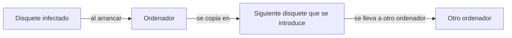

import { Quiz } from "@/components/quiz";

En 1982, un estudiante de noveno curso llamado **Rich Skrenta** escribió **Elk Cloner**, un programa para los ordenadores Apple II que pasaba de un disquete al ordenador y del ordenador a cualquier otro disquete que se introdujera después. Es uno de los primeros [virus](/articulos/que-es-el-malware/) conocidos que se propagaron fuera de un laboratorio, y la radio pública estadounidense lo presentó en 2007 como posiblemente el primero.

## Cómo se propagaba

No había internet en las casas. Los programas, y los juegos, se compartían en disquetes. Elk Cloner aprovechaba eso:

1. Al arrancar el ordenador desde un disquete infectado, el programa se quedaba en la memoria.
2. Cuando se introducía otro disquete, se copiaba en él.
3. Ese disquete, prestado a un amigo, infectaba el ordenador del amigo.

Es exactamente la definición de virus: un programa que se replica adjuntándose a otros soportes o programas, y que necesita que alguien lo traslade. Un gusano, como el [gusano Morris](/articulos/el-gusano-morris/), en cambio, se propaga solo por la red.

## Una broma

Skrenta no pretendía destruir nada. Cada cierto número de arranques, el virus mostraba un poema burlón en pantalla. Años después lo describía como una broma tonta. Pero demostró algo que nadie había previsto: un programa podía extenderse por sí mismo entre ordenadores de personas que no se conocían.

## Lo que vino después

Los virus de disquete fueron la forma dominante de malware durante los ochenta. Con las redes y el correo electrónico llegaron los gusanos y, más tarde, el [ransomware](/articulos/que-es-el-ransomware/). La defensa básica sigue siendo la misma idea: no ejecutar lo que no viene de una fuente de confianza.

## Lo esencial

- Elk Cloner, de 1982, se copiaba de disquete en disquete en los Apple II.
- Lo escribió como broma un estudiante de 15 años, Rich Skrenta.
- Es uno de los primeros virus conocidos que se propagaron fuera de un laboratorio.
- Un virus necesita que alguien lo traslade; un gusano se propaga solo por la red.
