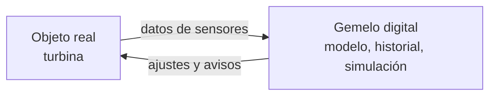

import { Quiz } from "@/components/quiz";

Un **gemelo digital** es una **representación virtual** de un objeto, una máquina, un edificio o un proceso del mundo real, que se mantiene **sincronizada** con él gracias a los datos que recibe. Si la pieza real se calienta, su gemelo lo refleja. Y como es software, sobre el gemelo se pueden hacer pruebas que serían caras o peligrosas con el original.

El instituto de normas de Estados Unidos, NIST, lo define en su informe sobre esta tecnología como una representación virtual de entidades y procesos reales, sincronizada con una frecuencia y una fidelidad determinadas.

## Qué no es

- **No es un simple modelo en 3D.** Un plano o un modelo de diseño describe cómo debería ser algo. El gemelo digital refleja **cómo está ahora**, con datos reales.
- **No es solo una simulación.** Una simulación estudia qué pasaría en general; el gemelo representa un objeto concreto, con su historia y su estado actual.

## Cómo funciona



1. **Sensores** en el objeto real miden temperatura, vibración, consumo o posición, como en el [internet de las cosas](/articulos/internet-de-las-cosas/).
2. Los datos llegan al gemelo, que actualiza su estado.
3. El gemelo combina esos datos con un **modelo**: física, reglas o [aprendizaje automático](/articulos/que-es-el-aprendizaje-automatico/).
4. Se usa para vigilar, simular y decidir. A veces el resultado vuelve al objeto real como un ajuste.

## Un ejemplo sencillo

```js
const gemelo = { temperatura: 60, horas: 0 };

function actualizar(lectura) {
	gemelo.temperatura = lectura.temperatura;
	gemelo.horas += lectura.horas;
}

function preverTemperatura(horasFuturas, subidaPorHora) {
	return gemelo.temperatura + horasFuturas * subidaPorHora;
}

actualizar({ temperatura: 72, horas: 8 });
console.log(gemelo.horas); // 8
console.log(preverTemperatura(10, 1.5)); // 87
```

El gemelo de una máquina recibe lecturas reales y, con un modelo muy simple, prevé que en diez horas llegará a 87 grados. Si el límite es 85, se puede parar antes de que se estropee. Un gemelo real usa modelos mucho más ricos, y técnicas como el [método de Monte Carlo](/articulos/metodo-de-monte-carlo/) para estudiar muchos escenarios posibles.

## Para qué se usa

- **Mantenimiento predictivo**: reparar una máquina antes de que falle, no cuando falla ni por calendario.
- **Probar cambios** en una fábrica, una red eléctrica o el tráfico de una ciudad sin tocar la real.
- **Diseño**: comparar cómo se comportan de verdad los productos ya fabricados con lo previsto.
- **Formación**: practicar con el gemelo de una instalación peligrosa.

## Sus riesgos

El informe del NIST subraya que un gemelo digital concentra mucha información sobre el objeto que representa. Si un atacante lo compromete, tiene acceso a todos esos datos, y si el gemelo puede enviar órdenes al objeto real, también puede manipularlo. Por eso necesita la misma [seguridad](/articulos/que-es-la-ciberseguridad/) que el sistema físico.

Además, un gemelo es tan bueno como sus datos: sensores mal calibrados o un modelo poco fiel dan una copia que no se parece al original, como recuerda la [calidad de datos](/articulos/calidad-de-datos/).

## Lo esencial

- Un gemelo digital es una réplica virtual de algo real, sincronizada con datos.
- A diferencia de un modelo o una simulación, refleja el estado actual de un objeto concreto.
- Se usa para vigilar, prever fallos y probar cambios sin tocar lo real.
- Concentra datos y a veces control, por lo que necesita protegerse como el sistema físico.
