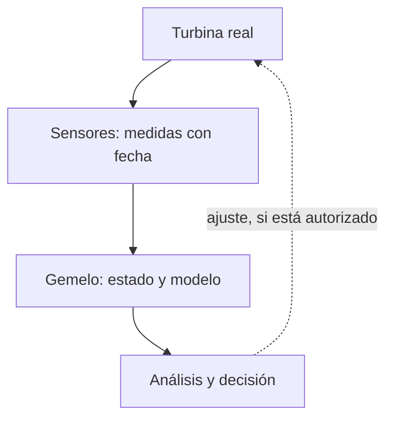

import { Quiz } from "@/components/quiz";

Un **gemelo digital** es una representación digital de un objeto o proceso real que se actualiza con datos de ese objeto o proceso. Combina su estado observado con modelos para vigilarlo, analizarlo o ensayar cambios. No es una copia perfecta: refleja lo que se mide, con una frecuencia, un retraso y una fidelidad determinados.

Por ejemplo, el gemelo de una turbina puede reunir su temperatura, sus horas de funcionamiento y un modelo de calentamiento. Permite estudiar un cambio antes de aplicarlo, siempre que el modelo represente suficientemente ese comportamiento.

## Modelo, simulación y gemelo

Un modelo 3D puede mostrar la forma de una turbina sin conocer cómo funciona hoy. Una simulación calcula la evolución de un modelo bajo unas condiciones. Puede representar una máquina genérica o una concreta.

El gemelo conecta la representación con el objeto real y sus actualizaciones. Puede incluir una simulación y una vista 3D, pero ninguna de ellas por separado garantiza esa conexión. Tampoco necesita gráficos para ser útil: valores, relaciones y ecuaciones pueden representar el comportamiento relevante.

## Cómo funciona



1. Los sensores miden temperatura, vibración o posición, como en el [internet de las cosas](/articulos/internet-de-las-cosas/).
2. El sistema comprueba el origen y la calidad de las medidas y actualiza la representación. Debe tratar duplicados, datos atrasados y periodos sin comunicación.
3. Un modelo relaciona variables: puede usar física, reglas o [aprendizaje automático](/articulos/que-es-el-aprendizaje-automatico/).
4. Una persona o un programa interpreta el resultado. Si se permite actuar sobre la máquina, hacen falta controles y confirmación de esa acción; no todo gemelo envía órdenes.

## De una medida a una previsión

En esta simulación, una máquina envía temperatura y horas acumuladas de funcionamiento. `instante` expresa segundos desde un origen común del ejemplo. Suponemos un único emisor con tiempos crecientes; no resolvemos aquí la sincronización de relojes ni reinicios del dispositivo.

```js
const gemelo = { temperatura: 60, horas: 0, instante: 0 };

function actualizar(lectura) {
	if (lectura.instante <= gemelo.instante) return false;
	Object.assign(gemelo, lectura);
	return true;
}

function preverTemperatura(horasFuturas, subidaPorHora) {
	return gemelo.temperatura + horasFuturas * subidaPorHora;
}

console.log(actualizar({ temperatura: 72, horas: 8, instante: 60 })); // true
console.log(actualizar({ temperatura: 68, horas: 7, instante: 30 })); // false
console.log(actualizar({ temperatura: 72, horas: 8, instante: 60 })); // false
console.log(gemelo.horas); // 8
console.log(preverTemperatura(10, 1.5)); // 87
```

La primera lectura sustituye el estado anterior. La segunda es más antigua y la tercera repite el mismo instante: no deben hacer retroceder el estado actual ni sumar horas otra vez. Un sistema puede conservar ambas en un historial sin usarlas como estado más reciente. Las horas son un contador acumulado del emisor, no un incremento que debamos sumar por cada mensaje recibido.

El modelo calcula `72 + 10 × 1,5 = 87 °C`. Es una previsión **si la temperatura aumenta constantemente 1,5 °C por hora durante diez horas**, no una medición del futuro. Si cambia la carga, la refrigeración o la temperatura ambiente, esa hipótesis puede dejar de servir.

Supongamos un umbral de alerta de 85 °C. El resultado justifica investigar o simular otros escenarios; no demuestra que la máquina vaya a fallar ni que detenerla en cierto momento sea seguro. Las decisiones necesitan un modelo validado para su propósito.

<Quiz
	client:visible
	question="El gemelo conserva una medida de 72 °C, pero lleva dos horas sin recibir datos. ¿Qué puede afirmar el panel?"
	options={[
		"Que la máquina sigue exactamente a 72 °C",
		"Que 72 °C es la última medida conocida, con dos horas de antigüedad",
		"Que la máquina está apagada",
	]}
	answer={1}
/>

## Comprobar que el modelo sirve

No basta con conectar sensores. Hay que comparar previsiones con medidas posteriores en condiciones representativas. Si el modelo prevé 87 °C y se observan 78 °C, la diferencia obliga a revisar parámetros, condiciones o sensores; cambiar el dibujo del panel no mejora la explicación.

También hay que mostrar cuándo se midió cada dato y cuándo se recibió. Una medida recién recibida puede ser antigua porque estuvo esperando en una pasarela. Si falta información, el gemelo debe expresar esa incertidumbre en vez de presentar el último valor como actual.

Cuando interesa explorar muchas combinaciones de condiciones inciertas, se puede usar el [método de Monte Carlo](/articulos/metodo-de-monte-carlo/). Es una herramienta posible, no un requisito de todo gemelo digital.

## Para qué se usa y qué cuesta

- **Mantenimiento:** detectar cambios compatibles con desgaste y decidir qué inspeccionar; no elimina fallos imprevistos.
- **Ensayo de cambios:** comparar condiciones de operación sin aplicarlas primero al objeto. Las conclusiones valen dentro del alcance del modelo.
- **Diseño y formación:** contrastar comportamiento observado con el previsto o practicar situaciones en una representación.

El coste incluye sensores, transmisión, almacenamiento, calibración y actualización del modelo cuando cambia el objeto. Un modelo detallado de una máquina antigua puede dejar de representar una pieza sustituida.

## Errores comunes y riesgos

- **Confundir sincronización con simultaneidad perfecta.** La captura y la transmisión tienen retrasos; hay que declarar la antigüedad tolerable.
- **Tratar el modelo como verdad.** Datos mal calibrados y supuestos incorrectos producen resultados engañosos, como en cualquier problema de [calidad de datos](/articulos/calidad-de-datos/).
- **Confiar en cualquier lectura recibida.** Hay que verificar origen, formato y coherencia; un atacante podría alterar la representación mediante datos falsos.
- **Dar al gemelo control ilimitado.** Si puede enviar órdenes, comprometerlo puede afectar al objeto real. El NIST destaca la necesidad de analizar esa confianza y proteger datos, modelos y comunicaciones.

## Lo esencial

- El gemelo conecta una representación con datos de un objeto o proceso real.
- Estado observado y previsión son cosas distintas; ambos tienen límites de calidad y actualidad.
- Duplicados y datos atrasados requieren reglas de actualización.
- Sirve para analizar y ensayar decisiones si el modelo está validado para ese uso.
- Su acceso a información y, a veces, a controles físicos exige protección adecuada.
