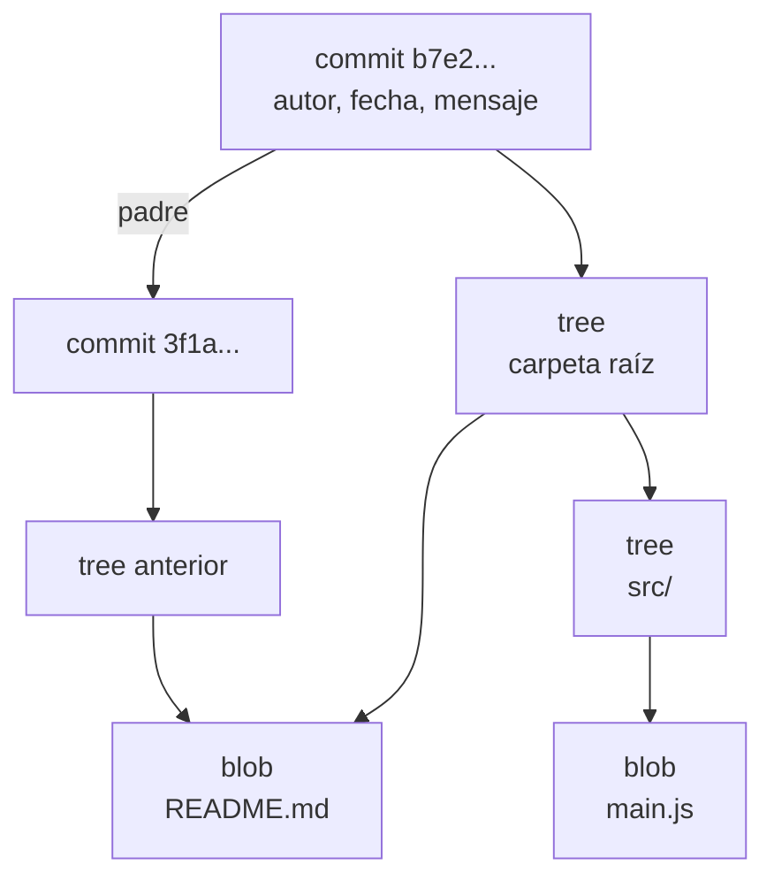

import { Quiz } from "@/components/quiz";

Usar Git con `add`, `commit` y `merge` no exige saber cómo funciona por dentro. Pero entenderlo explica casi todo lo que hace: por qué las ramas son baratas, por qué un commit no se puede modificar sin cambiar su identificador o qué significa realmente "perder" un commit.

El libro *Pro Git* lo resume en una frase: en el núcleo de Git hay un simple **almacén clave-valor**.

## Cada contenido, su hash

Cuando Git guarda algo, calcula su **hash SHA-1**: una [función hash](/articulos/funciones-hash/) que convierte el contenido en un identificador de 40 caracteres hexadecimales. Ese hash es la **clave**, y el contenido, comprimido, es el **valor**. Se guarda en `.git/objects`, en una carpeta con los dos primeros caracteres del hash y un archivo con los 38 restantes.

```js
import { createHash } from "node:crypto";

function hashDeGit(contenido) {
	const objeto = `blob ${Buffer.byteLength(contenido)}\0${contenido}`;
	return createHash("sha1").update(objeto).digest("hex");
}

console.log(hashDeGit("what is up, doc?")); // "bd9dbf5aae1a3862dd1526723246b20206e5fc37"
```

Git no calcula el hash del contenido solo, sino de una **cabecera** con el tipo y el tamaño, seguida del contenido. El resultado coincide con el que da `git hash-object` y con el del ejemplo del libro *Pro Git*.

Al guardarse por su contenido, el mismo archivo en cien confirmaciones distintas se almacena **una sola vez**. Y si un solo bit cambia, el hash cambia: Git detecta cualquier corrupción.

## Tres tipos de objeto



- **blob**: el contenido de un archivo. Solo el contenido, sin nombre.
- **tree** (árbol): una carpeta. Según *Pro Git*, cada entrada lleva el hash de un blob o de otro árbol, con su modo, tipo y nombre. Es el equivalente a un directorio de Unix.
- **commit** (confirmación): apunta al árbol de la carpeta raíz en ese momento, a su commit **padre** (o padres, en una fusión), y guarda el autor, la fecha y el mensaje.

Cada confirmación es una **foto completa** del proyecto, no una lista de cambios. Pero como los archivos que no cambian conservan su hash, la foto nueva reutiliza casi todos los objetos de la anterior. En la figura, `README.md` no cambió y los dos árboles apuntan al mismo blob.

Se pueden inspeccionar con `git cat-file -p` seguido de un hash.

## Inmutable por construcción

El hash de un commit depende de su árbol y de su padre, y el del padre, del suyo. Cambiar algo en un commit antiguo cambia su hash, y con él el de todos los posteriores. Por eso:

- La historia **no se puede alterar sin que se note**.
- `git commit --amend` o un `rebase` no modifican commits: crean **otros nuevos**, con hashes distintos, como explica [merge y rebase](/articulos/merge-y-rebase/).

## Las ramas son etiquetas

Una **rama** no es una copia del código: es un pequeño archivo, en `.git/refs/heads/`, que contiene el hash de un commit. Crear una rama es escribir 40 caracteres. Al confirmar, Git crea el commit nuevo y mueve la etiqueta de la rama actual hacia él. `HEAD` es otra referencia, que indica en qué rama estás.

## ¿Se pierden los commits?

Un commit al que no apunta ninguna rama sigue en `.git/objects` durante un tiempo. `git reflog` muestra a qué commits ha apuntado `HEAD` recientemente, y con eso se recupera casi cualquier cosa que parecía perdida. Solo cuando ninguna referencia lo alcanza durante bastante tiempo, la limpieza automática lo elimina. Es una [recolección de basura](/articulos/recoleccion-de-basura/), con la misma idea de alcanzabilidad.

## Lo esencial

- Git es un almacén clave-valor: cada objeto se guarda con el hash de su contenido.
- Hay tres tipos de objeto: blob (contenido), tree (carpeta) y commit (foto con su padre).
- Cambiar un commit cambia su hash y el de todos los siguientes, así que la historia es inmutable.
- Una rama es solo un archivo con el hash de un commit.
