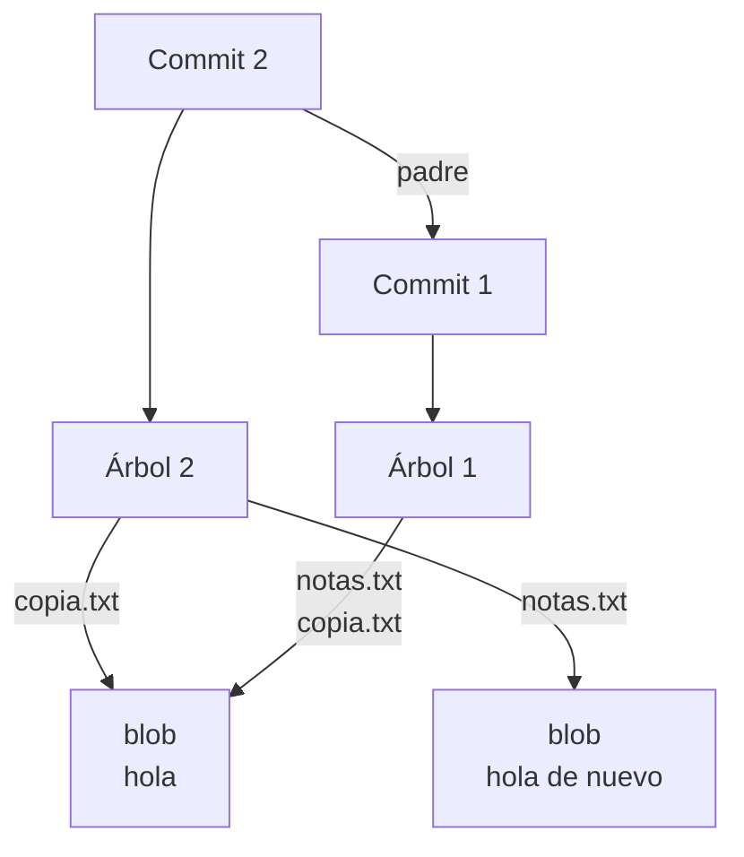

import { Quiz } from "@/components/quiz";

[Git](/articulos/control-de-versiones-con-git/) guarda la historia como **objetos** identificados por su contenido y enlazados entre sí. Las **referencias** son nombres, como el de una rama, que indican dónde encontrar una versión dentro de esa historia.

## Por qué importa separar objetos y nombres

Crear una rama no copia todos los archivos del proyecto: crea otro nombre que apunta a un commit existente. Y registrar una versión nueva no exige duplicar el contenido de todos los archivos que siguen iguales.

La separación también explica por qué una rama puede moverse sin modificar los commits anteriores y por qué cambiar el mensaje de un commit puede cambiar su identificador aunque los archivos sean idénticos.

## Identificar contenido

Una [**función hash**](/articulos/funciones-hash/) calcula un resumen de los datos. Con el mismo algoritmo y los mismos datos produce el mismo valor. Git usa ese resumen como identificador para buscar un objeto.

El cálculo incluye una cabecera con el tipo y el tamaño del objeto, además de sus datos. Para el contenido de un archivo no incluye su nombre: dos archivos con los mismos datos pueden compartir un objeto aunque se llamen de manera distinta.

Los repositorios con **SHA-1** muestran identificadores completos de 40 caracteres; los de **SHA-256**, de 64. Son nombres de dos algoritmos de hash. Git puede manejar ambos formatos de repositorio, según la versión y la compilación. No hay que asumir que todo identificador de Git tiene siempre 40 caracteres ni que distintos formatos se puedan intercambiar sin condiciones.

## Cuatro tipos de objeto

| Tipo | Qué representa |
| --- | --- |
| **blob** | El contenido de un archivo, sin su nombre |
| **tree**, o árbol | Entradas con nombre, modo e identificador: organizan archivos y subcarpetas |
| **commit**, o confirmación | Un árbol raíz, sus padres y datos como autor, fecha y mensaje |
| **tag**, o etiqueta anotada | Información sobre un objeto señalado, con autor de la etiqueta y mensaje |

El **modo** de una entrada indica qué clase de entrada es y propiedades como si un archivo es ejecutable. Una etiqueta ligera, en cambio, es solo una referencia: no necesita un objeto `tag`.

Un commit inicial no tiene padres; uno habitual tiene uno; una fusión puede tener varios. El árbol al que apunta representa el estado de los archivos registrados. Los cambios que ves en un diff se calculan comparando estados.

## Inspeccionar un repositorio pequeño

Usa una versión reciente de Git, PowerShell o Bash y un editor de texto. Abre una terminal en una carpeta de prácticas donde no exista `practica-objetos`:

```bash
mkdir practica-objetos
cd practica-objetos
git init --object-format=sha1 -b main
git config --local user.name "Persona de prueba"
git config --local user.email "practica@example.com"
```

Elegimos SHA-1 explícitamente para que el formato del ejemplo sea conocido. Crea `notas.txt` como texto UTF-8 con una línea `hola`. Duplica el archivo con el explorador de archivos y llama a la copia `copia.txt`, manteniendo exactamente el mismo contenido.

```bash
git add notas.txt copia.txt
git commit -m "Guarda dos nombres con el mismo contenido"
git cat-file -t HEAD
git cat-file -p HEAD
git ls-tree HEAD
git cat-file -p HEAD:notas.txt
```

**HEAD** señala aquí el commit de la rama actual. `cat-file -t` consulta su tipo: `commit`. `cat-file -p` muestra sus datos: una línea `tree` con el identificador del árbol, datos de autor y de quien registra la confirmación, y el mensaje. No aparece ninguna línea `parent` porque es el primer commit.

`ls-tree` muestra dos entradas, `copia.txt` y `notas.txt`, con el mismo identificador de blob. Los nombres están en el árbol; el texto compartido está en el blob. La última orden recupera ese texto y muestra `hola`.

<Quiz
	client:visible
	question="En el ejemplo, copia.txt y notas.txt contienen los mismos datos. ¿Dónde guarda Git sus dos nombres?"
	options={[
		"En dos blobs distintos por obligación",
		"En las entradas del árbol que apuntan al blob compartido",
		"Solo en el mensaje del commit",
	]}
	answer={1}
/>

### Cambiar un archivo

Sustituye la línea de `notas.txt` por `hola de nuevo`, conservando `copia.txt` tal como estaba:

```bash
git add notas.txt
git commit -m "Amplia solo una nota"
git cat-file -p HEAD
git ls-tree HEAD
git show HEAD:copia.txt
git show HEAD:notas.txt
```

Ahora el commit contiene una línea `parent` con el identificador de la primera confirmación. El árbol es distinto: `copia.txt` conserva el blob anterior y `notas.txt` apunta a uno nuevo. Las dos consultas muestran `hola` y `hola de nuevo`.

El siguiente esquema muestra los enlaces que guarda Git; aquí las flechas apuntan hacia el objeto referenciado:



La nueva instantánea reutiliza contenido que no cambió. Eso describe el modelo lógico; no exige que cada objeto tenga siempre un archivo físico separado.

## Referencias, ramas y HEAD

Una rama es una referencia que avanza al crear commits en ella. **HEAD** suele indicar la rama actual; en el estado llamado **HEAD separado** apunta directamente a un commit, sin situarte en una rama.

Puedes comprobar los nombres del ejemplo:

```bash
git symbolic-ref HEAD
git rev-parse main
git rev-parse HEAD
```

La primera orden muestra `refs/heads/main`. Las dos siguientes imprimen el mismo identificador. `rev-parse` convierte el nombre de una versión en su identificador.

En algunos repositorios las referencias están en archivos bajo `.git/refs`; también pueden guardarse juntas, por ejemplo en `packed-refs`. Es mejor consultarlas con órdenes de Git que depender de una ubicación física concreta.

### Otro mensaje, otro commit

En este repositorio de práctica, que no has compartido, conserva el commit actual bajo otro nombre y cambia su mensaje:

```bash
git branch conserva
git commit --amend -m "Describe la segunda version"
git rev-parse conserva
git rev-parse HEAD
git diff conserva HEAD
git reflog -3 --oneline
```

`--amend` crea un commit nuevo que sustituye al anterior en la punta de `main`. Los dos identificadores difieren, pero `git diff` no muestra cambios de archivos: ambos commits señalan el mismo árbol. La rama `conserva` permite seguir encontrando el commit anterior.

El mensaje forma parte de los datos del commit. Su identidad también depende de sus padres y de otros metadatos, no únicamente del contenido de los archivos. Esa es parte de la explicación de lo que ocurre al hacer [rebase](/articulos/merge-y-rebase/).

## Cómo se guarda en disco

Un **objeto suelto** se almacena individualmente y comprimido. Git también agrupa objetos en archivos **pack**, donde puede representar uno mediante diferencias respecto a otro para ahorrar espacio.

Por eso no es correcto describir Git como «siempre guarda copias completas en archivos separados» ni como «solo guarda diferencias». El modelo permite recuperar instantáneas; la representación física puede comprimir y compartir datos. Un mismo objeto lógico tampoco implica una única copia física en todas las circunstancias.

## Qué puede recuperar reflog

El **reflog** registra movimientos recientes de referencias en el repositorio local. En la práctica anterior permite ver la confirmación previa y el cambio producido por `--amend`.

Su utilidad tiene límites: sus entradas pueden caducar y no se comparten como los commits mediante un push normal. Los objetos que dejan de estar protegidos por referencias, el índice, reflogs u otras raíces de conservación pueden eliminarse durante el mantenimiento, según la configuración y los plazos.

Por tanto, reflog puede ayudar a localizar trabajo registrado que dejó de verse en una rama; no recupera cualquier edición nunca guardada en Git ni garantiza conservar objetos indefinidamente.

## Errores comunes

- **Identificar un commit solo con sus archivos.** Dos commits pueden tener el mismo árbol y distintos padres o mensajes.
- **Suponer que una rama contiene copias de todos sus archivos.** Es un nombre que permite llegar a objetos compartidos.
- **Editar archivos internos para «arreglar» la historia.** Usa las operaciones de Git; la representación física no es el contrato de uso.
- **Confundir un hash con una garantía absoluta.** Ayuda a comprobar integridad, pero no sustituye las copias de seguridad ni demuestra por sí solo quién creó los datos.

## Lo esencial

- Blobs, árboles y commits separan contenido, nombres e historia.
- Las referencias apuntan a objetos; los objetos existentes no se editan al mover una rama.
- Archivos iguales no implican commits iguales.
- El almacenamiento físico y la recuperación tienen condiciones: no todo es un archivo suelto ni reflog conserva todo para siempre.
