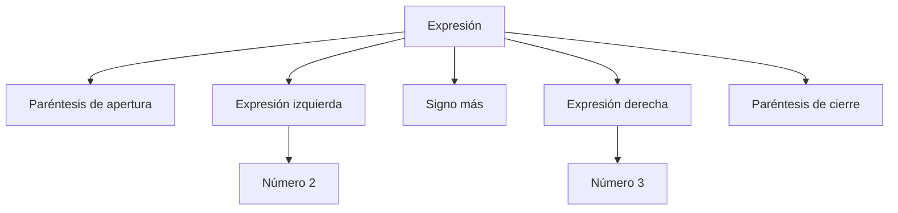

import { Quiz } from "@/components/quiz";

Una **gramática formal** es un conjunto de reglas que especifica cómo construir cadenas de símbolos. Define la **sintaxis** de un lenguaje: qué formas son válidas, sin determinar necesariamente qué significan.

## Qué problema resuelve

Para construir una calculadora no basta con una lista de caracteres permitidos. `2 + 3` y `+ 2 3` contienen los mismos símbolos, pero quizá solo la primera expresión es válida. Además, quieres permitir paréntesis: `2 + (3 + 4)`.

Enumerar todas las expresiones posibles sería imposible. Una gramática da reglas finitas que generan un conjunto potencialmente infinito. El [analizador sintáctico de un compilador](/articulos/como-funciona-un-compilador-por-dentro/) comprueba la estructura y construye una representación que las siguientes fases podrán interpretar.

## Terminales y no terminales

Un **terminal** es un símbolo que aparecerá en la cadena final: una cifra, un signo o un paréntesis. Un **no terminal** representa una categoría por desarrollar, como `Expresion` o `Numero`.

La gramática incluye un **símbolo inicial** y **producciones**, reglas que sustituyen no terminales por secuencias de símbolos. En esta notación, `->` significa «puede convertirse en» y `|` separa alternativas:

```text
Expresion -> Numero | ( Expresion + Expresion )
Numero -> 0 | 1 | 2 | 3
```

Hemos limitado los números para centrarnos en la estructura. La gramática acepta `2` y `(2+3)`, ignorando aquí los espacios de presentación. No acepta `2+3` sin los paréntesis exigidos por sus reglas. Una gramática describe las decisiones concretas de un lenguaje, no una idea universal de «expresión correcta».

## Una derivación

Una **derivación** aplica producciones hasta que solo quedan terminales. Para construir `(2+3)`:

1. Partes de `Expresion`.
2. Eliges la producción con suma: `(Expresion+Expresion)`.
3. Sustituyes cada `Expresion` por `Numero`.
4. Eliges `2` para el primer `Numero` y `3` para el segundo.

Puedes repetir la regla dentro de los paréntesis para generar `(2+(1+3))`. La recursión de las producciones permite expresar anidamiento sin enumerar su profundidad.



Este **árbol de derivación** conserva la estructura, no solo la sucesión de caracteres. Un compilador suele simplificarlo para construir un árbol de sintaxis abstracta, eliminando signos cuya función ya queda representada por las ramas.

<Quiz
	client:visible
	question="¿Qué parte de una gramática representa una categoría todavía por desarrollar?"
	options={["Un terminal", "Un no terminal", "Un espacio en blanco"]}
	answer={1}
/>

## Sintaxis y significado

Que una expresión cumpla la gramática no garantiza que pueda ejecutarse. Una división entre cero puede estar bien formada. También puede haber una variable con nombre válido que nadie haya declarado.

La **semántica** establece el significado y las condiciones adicionales. Por eso un compilador separa reconocer la forma, comprobar tipos y nombres, y generar instrucciones. Una gramática no sustituye esas fases.

## Ambigüedad

Considera la regla `E -> E + E | E * E | Numero`. La cadena `2+3*2` admite dos agrupaciones: sumar primero o multiplicar primero. Una gramática es **ambigua** si alguna cadena tiene más de un árbol de derivación.

El lenguaje debe resolverlo, por ejemplo dando prioridad a la multiplicación mediante categorías separadas para expresiones y términos. No basta con que quien programa «sepa» qué resultado quería: las herramientas necesitan reglas precisas.

## Escribir la precedencia en las reglas

Para evitar aquella ambigüedad, podemos separar los niveles:

```text
E -> E + T | T
T -> T * F | F
F -> Numero | ( E )
```

`E` representa una expresión completa, `T` un término multiplicativo y `F` un factor. Para construir `2+3*2`, la suma separa una expresión izquierda y un término derecho. Dentro de ese término puede aparecer la multiplicación. No se puede generar con esas reglas un árbol donde la suma de `2+3` sea un factor de la multiplicación sin escribir paréntesis.

Los paréntesis permiten volver desde un factor a una expresión completa: `(2+3)*2` sí tiene la agrupación alternativa. La precedencia deja así de depender de una explicación externa y pasa a estar representada por las categorías de la gramática.

Estas reglas usan recursión por la izquierda. Son una descripción válida del lenguaje, pero un analizador descendente sencillo no puede aplicarlas ingenuamente sin entrar en recursión infinita. Transformar una gramática para un algoritmo concreto no debería cambiar las cadenas que admite ni el significado de sus agrupaciones. Esa separación entre especificación y procedimiento de análisis es parte del trabajo de construir un lenguaje.

## Su relación con los autómatas

En una **gramática libre de contexto**, cada producción tiene un único no terminal a la izquierda. Es suficiente para muchas estructuras sintácticas anidadas. Los [autómatas finitos](/articulos/automatas-finitos/) reconocen los lenguajes regulares, una familia más limitada; para reconocer los libres de contexto se estudian autómatas con pila.

No todas las gramáticas sirven directamente para cualquier algoritmo de análisis. Una herramienta puede exigir transformar reglas, eliminar recursión izquierda o declarar precedencias. La gramática describe el lenguaje; el algoritmo determina cómo analizarlo.

## Lo esencial

- Los terminales forman el texto; los no terminales representan categorías.
- Las producciones generan cadenas desde un símbolo inicial.
- La recursión expresa estructuras anidadas.
- Sintaxis válida no implica significado válido, y una gramática ambigua necesita decisiones adicionales.
