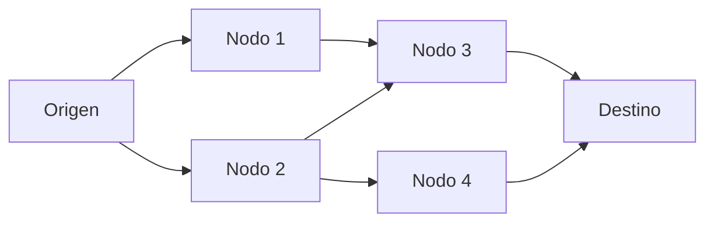

import { Quiz } from "@/components/quiz";

Internet no se inventó de una vez. Es el resultado de varias décadas de investigación, financiada al principio por la agencia de proyectos de investigación avanzada del Departamento de Defensa estadounidense, la actual DARPA, y construida por universidades, empresas y gobiernos.

## La idea: conmutación de paquetes

La red telefónica funcionaba por **conmutación de circuitos**: para una llamada se reserva un camino completo de un extremo al otro. Si un punto de ese camino falla, la llamada se corta.

En 1961, Leonard Kleinrock publicó el primer artículo sobre la teoría de la **conmutación de paquetes**: dividir los datos en trozos que viajan por separado, cada uno por el camino que encuentre, y se reúnen en el destino. Si un nodo cae, los paquetes buscan otra ruta. En el Reino Unido, Donald Davies y Roger Scantlebury llegaron a una idea parecida.

Cada paquete puede tomar un camino distinto. Es el principio que explica [enrutamiento](/articulos/enrutamiento/).

## ARPANET

A finales de 1966, Lawrence Roberts llegó a la agencia para desarrollar una red de ordenadores, y en 1967 publicó el plan de **ARPANET**. En 1969 conectó sus primeros cuatro nodos: la Universidad de California en Los Ángeles, el instituto de investigación de Stanford, la Universidad de California en Santa Bárbara y la Universidad de Utah. El 29 de octubre de 1969 se envió entre los dos primeros el [primer mensaje](/articulos/el-primer-mensaje-de-internet/).

## El correo y TCP/IP

En 1972 llegó la primera aplicación de éxito: el **correo electrónico**, con su [arroba](/articulos/el-origen-de-la-arroba-en-el-correo/). Ese mismo año, Robert Kahn propuso la idea de una red de **arquitectura abierta**: que redes distintas, cada una con su tecnología, pudieran conectarse entre sí.

Para eso hacía falta un protocolo común. Kahn y Vinton Cerf diseñaron el que acabaría llamándose **TCP/IP**, la base de los [modelos de red](/articulos/modelos-osi-y-tcp-ip/) que se usan hoy.

## De ARPANET a internet

En enero de 1983, según DARPA, había ya suficientes redes conectadas entre sí como para decir que ARPANET se había convertido en internet: una **red de redes**. La ARPANET original no se desmanteló formalmente hasta 1990.

Durante los ochenta, internet siguió siendo cosa de universidades y centros de investigación. A finales de esa década se permitió conectar los primeros servicios comerciales, y en 1989 Tim Berners-Lee propuso la [web](/articulos/la-primera-pagina-web/), que hizo internet accesible a cualquiera.

## Lo esencial

- Internet nació de ARPANET, una red de investigación financiada por la actual DARPA.
- Su idea clave, la conmutación de paquetes, permite que la red siga funcionando aunque fallen nodos.
- ARPANET conectó sus cuatro primeros nodos en 1969; el correo electrónico llegó en 1972.
- TCP/IP permitió unir redes distintas, y en 1983 ARPANET ya se había convertido en internet.
