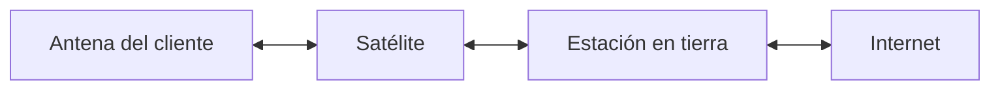

import { Quiz } from "@/components/quiz";

El **internet por satélite** conecta un hogar, un barco o un avión a internet a través de un satélite: una antena en tierra envía los datos al satélite, este los reenvía a una estación conectada a internet, y la respuesta hace el camino contrario. Es la forma de llegar a lugares donde no hay cable ni cobertura móvil.



## Las órbitas

Los satélites se agrupan por la altura de su órbita, que decide casi todo lo demás:

| Órbita | Altura | Ventaja | Inconveniente |
| --- | --- | --- | --- |
| Geoestacionaria (GEO) | Unos 36 000 km | Parece quieto en el cielo: basta una antena fija; pocos satélites cubren mucho | Mucha latencia |
| Media (MEO) | Intermedia | Compromiso entre cobertura y latencia | Se mueve en el cielo |
| Baja (LEO) | Unos pocos cientos de kilómetros | Poca latencia | Se mueve rápido: hacen falta muchos satélites y antenas que los sigan |

A unos 36 000 km de altura, un satélite tarda exactamente un día en dar la vuelta a la Tierra, así que, sobre el ecuador, se queda siempre encima del mismo punto. Por eso los satélites de comunicaciones tradicionales se colocan en esa órbita **geoestacionaria**: las antenas no tienen que moverse.

## El problema: la distancia

La señal viaja a la velocidad de la luz, pero 36 000 km es mucha distancia:

```js
const velocidadLuz = 299792; // km/s
const ms = (km) => (km / velocidadLuz) * 1000;

const geo = 36000;
const idaYVueltaGeo = ms(geo * 4);
console.log(Math.round(idaYVueltaGeo)); // 480

const leo = 550;
const idaYVueltaLeo = ms(leo * 4);
console.log(idaYVueltaLeo.toFixed(1)); // "7.3"
```

Una petición sube al satélite y baja a la estación; la respuesta, igual: cuatro tramos. Con un satélite geoestacionario son casi **medio segundo** solo de recorrido, antes de contar cualquier procesamiento. Se nota en una videollamada o un juego en línea, aunque el [ancho de banda](/articulos/ancho-de-banda-latencia-y-rendimiento/) sea alto.

Con un satélite en órbita baja, a unos cientos de kilómetros (550 en el ejemplo), el recorrido baja a unos pocos milisegundos y la latencia total se parece a la de una conexión de tierra.

## Constelaciones en órbita baja

El precio de la órbita baja es que un satélite pasa por encima en pocos minutos. Para dar cobertura continua hacen falta **constelaciones** de cientos o miles de satélites, y antenas en tierra que cambien de uno a otro, como el traspaso entre celdas de las [redes móviles](/articulos/redes-moviles/). Algunos sistemas enlazan además los satélites entre sí con láser, para llevar los datos por el espacio sin bajar a tierra en cada tramo.

## Cuándo tiene sentido

- **Zonas rurales y remotas**, donde no compensa tender cable.
- **Barcos, aviones y lugares en movimiento**.
- **Emergencias**, cuando la infraestructura de tierra ha caído.

Donde hay fibra, la fibra sigue siendo más rápida, más estable y más barata. Además, las grandes constelaciones plantean un problema nuevo: la cantidad de objetos en órbita y el riesgo de basura espacial.

## Lo esencial

- El internet por satélite sube los datos a un satélite y los baja a una estación conectada a internet.
- Los geoestacionarios, a unos 36 000 km, parecen fijos pero añaden casi medio segundo de recorrido.
- Los satélites en órbita baja reducen la latencia, a cambio de necesitar constelaciones enormes.
- Tiene sentido donde no llega el cable; donde hay fibra, la fibra es mejor.
