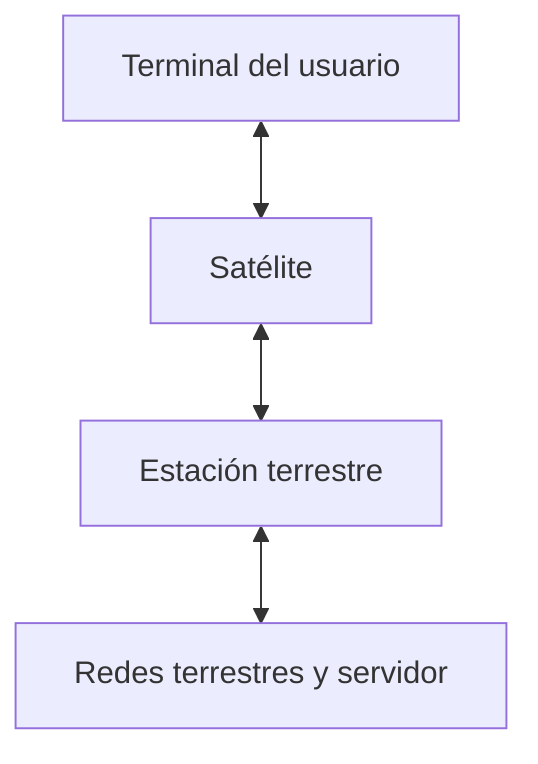

import { Quiz } from "@/components/quiz";

El **internet por satélite** utiliza uno o varios satélites para transportar datos entre un terminal y una red conectada a internet. Permite dar servicio donde resulta difícil desplegar cable o cobertura móvil, y también puede complementar otras conexiones.

El terminal incluye una antena y equipos de comunicación. No se comunica directamente con todos los servidores del mundo: el sistema necesita conectarse con las redes que permiten alcanzarlos.

## Seguir una petición

En una arquitectura sencilla, con un satélite como repetidor:

1. Un ordenador entrega una petición al terminal del usuario, quizá a través de un [router](/articulos/enrutamiento/) y wifi local.
2. El terminal la transmite por radio al satélite.
3. El satélite la retransmite a una **estación terrestre** o *gateway*, conectada a la red del operador.
4. Los datos continúan por redes terrestres hasta el servidor. La respuesta recorre enlaces equivalentes en sentido inverso.



Otros sistemas procesan o encaminan datos a bordo y pueden usar enlaces entre satélites. El dibujo explica un caso; no representa todas las constelaciones.

## Qué cambia con la órbita

| Órbita | Altura aproximada | Consecuencia para comunicar |
| --- | --- | --- |
| Geoestacionaria, GEO | 35 786 km | Parece fija desde tierra; permite antenas orientadas a una posición, con recorrido largo |
| Media, MEO | Entre la región baja y GEO | Compromisos de cobertura y recorrido; el satélite cambia de posición aparente |
| Baja, LEO | Por debajo de unos 2000 km | Menos distancia, menor zona visible por satélite y cambios frecuentes de posición |

Una órbita geoestacionaria es circular, ecuatorial y sigue el sentido de rotación terrestre con el mismo periodo: un **día sideral**, unas 23 horas y 56 minutos. No basta con colocar cualquier órbita a esa altura para que el satélite parezca fijo.

## Calcular solo la propagación

En el esquema anterior, una petición hace dos tramos espaciales: terminal–satélite y satélite–estación. Su respuesta hace otros dos. Aproximemos cada tramo por la altura del satélite:

```js
const velocidadLuz = 299792; // km/s
const milisegundos = (km) => km / velocidadLuz * 1000;

console.log(Math.round(milisegundos(36000 * 4))); // 480
console.log(milisegundos(550 * 4).toFixed(1)); // "7.3"
```

Son cotas geométricas simplificadas para cuatro tramos casi verticales, no RTT de una conexión real. Terminal y estación suelen estar separados: los trayectos inclinados son más largos. Faltan además transmisión, colas, procesamiento y recorrido terrestre, o enlaces adicionales entre satélites.

La comparación sí muestra la causa: a unos 36 000 km, esos cuatro tramos cuestan cerca de medio segundo antes de añadir lo demás; a 550 km, el componente calculado es mucho menor. La altura no permite prometer por sí sola un tiempo total concreto.

<Quiz
	client:visible
	question="El cálculo para 550 km da 7,3 ms. ¿Qué significa?"
	options={["Toda conexión LEO responde en 7,3 ms", "Es la propagación de cuatro alturas idealizadas; faltan otros recorridos y retardos", "Es el tiempo que tarda el satélite en completar su órbita"]}
	answer={1}
/>

Más [capacidad](/articulos/ancho-de-banda-latencia-y-rendimiento/) permite transferir más datos por segundo, pero no elimina el tiempo de propagación. Una descarga grande y una conversación interactiva sufren sus límites de formas distintas.

## Mantener la conexión mientras el satélite se mueve

En LEO un satélite deja de estar visible desde un lugar tras un tiempo limitado. Una **constelación** coordina varios para cubrir zonas y horarios de servicio. El número necesario depende de altura, geometría, cobertura y capacidad buscadas; no existe una cantidad universal.

El terminal sigue la dirección apropiada mediante movimiento de antena o control electrónico, según su diseño. Cuando cambia de satélite, el sistema debe coordinar recursos y rutas. El propósito se parece al [traspaso móvil](/articulos/redes-moviles/), aunque los procedimientos difieren.

Los enlaces entre satélites, por radio o láser según el sistema, permiten transportar datos antes de bajar a una estación adecuada. No hacen innecesaria toda conexión a redes terrestres.

## Límites prácticos

Edificios, árboles o terreno pueden bloquear la dirección de comunicación. La lluvia puede atenuar ciertos enlaces de radio; la importancia depende de frecuencia y margen del sistema. La capacidad se comparte y una zona puede saturarse aunque el terminal tenga buena visibilidad.

En una emergencia también hacen falta energía, terminal operativo y una red de destino disponible. Para comparar con fibra o red móvil deben considerarse cobertura, latencia medida, capacidad, instalación y condiciones del servicio. Ningún medio gana en todo lugar y circunstancia.

## Errores comunes

- **Tomar la altura como distancia completa hasta internet.** Omite geometría, estaciones y redes terrestres.
- **Confundir órbita baja con latencia nula.** Reduce un componente del retardo, no todos.
- **Suponer cobertura continua por ver pasar un satélite.** Hace falta un sistema que mantenga los enlaces y recursos disponibles.

## Lo esencial

- El satélite conecta terminales con otras redes mediante uno o varios enlaces.
- GEO reduce cambios de posición aparente, a costa de un recorrido largo.
- LEO reduce distancia y requiere coordinar satélites en movimiento.
- La órbita no determina por sí sola latencia, capacidad ni disponibilidad.
