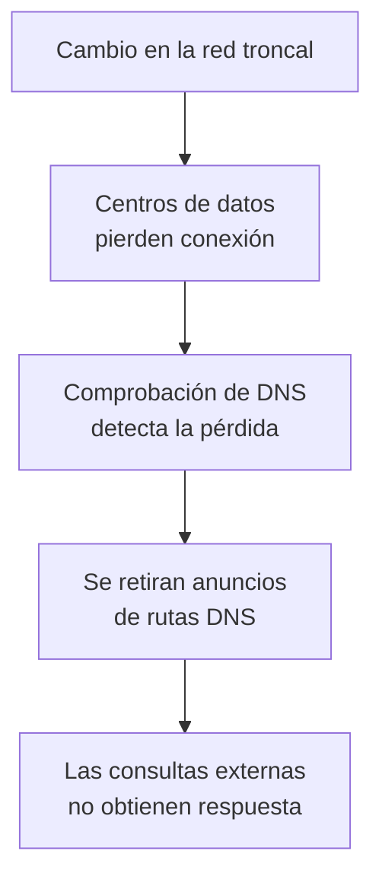

import { Quiz } from "@/components/quiz";

El 4 de octubre de 2021, Facebook, Instagram y WhatsApp sufrieron una interrupción de aproximadamente seis horas. Un cambio en la red que conectaba los centros de datos desencadenó fallos en servicios compartidos; también dificultó las herramientas que necesitaban los ingenieros para repararlos.

Para quien esperaba un mensaje, intentaba abrir su negocio en una de estas plataformas o actualizar una publicación, el resultado era cotidiano: la aplicación no respondía como debía. La causa estaba lejos de su teléfono.

## Un fallo compartido bajo tres aplicaciones

Aunque tienen nombres e interfaces diferentes, varias aplicaciones pueden depender de infraestructura común. Un **centro de datos** reúne equipos que ejecutan servicios; la **red troncal** de una empresa conecta sus grandes ubicaciones y transporta datos entre ellas.

Según el informe de Facebook, durante un mantenimiento se ejecutó una orden destinada a evaluar capacidad disponible. Su efecto no previsto fue desconectar los enlaces de esa red. Una herramienta que debía impedir órdenes peligrosas no detuvo esta por un fallo propio.

Así, no hacía falta que tres aplicaciones se averiaran por separado. Si todas necesitan servicios a los que ya no pueden llegar, un mismo corte puede impedir tareas distintas. Es una **dependencia compartida**: un componente del que dependen varios consumidores.

El informe inicial reconoció el impacto en personas y empresas y la dificultad añadida para comunicarse y coordinar la recuperación. No atribuyó la interrupción a un ataque ni encontró pruebas de que los datos de usuarios se hubieran comprometido por ella.

## Por qué el problema también parecía de DNS

[DNS](/articulos/que-es-dns/) permite obtener información como las direcciones de un servicio a partir de su nombre. Para responder, un servidor DNS no solo debe estar encendido: los paquetes tienen que poder llegar hasta él.

Los grandes operadores intercambian rutas mediante **[BGP](/articulos/protocolos-de-enrutamiento/)**, un protocolo que comunica qué conjuntos de direcciones son alcanzables a través de cada red. Retirar un anuncio de ruta puede hacer que otras redes dejen de tener un camino hacia esas direcciones.

La infraestructura de Facebook tenía una comprobación que retiraba los anuncios de sus servidores DNS cuando estos no podían conectarse con sus centros de datos. Tras el corte de la red troncal, esa condición se cumplió. Los servidores DNS seguían funcionando, pero quedaron inaccesibles desde internet.

No se borró el nombre `facebook.com`. Un error **SERVFAIL** indica que el resolutor no pudo completar la consulta; no equivale a una respuesta que diga que el nombre no existe.

<Quiz
	client:visible
	question="Los procesos DNS siguen activos, pero se retiran sus rutas de internet. ¿Qué puede ocurrir?"
	options={[
		"Seguirán respondiendo a cualquier usuario porque están encendidos",
		"Los dominios se borrarán del registro automáticamente",
		"Las consultas no llegarán a ellos aunque estén funcionando",
	]}
	answer={2}
/>

## Qué se podía observar desde fuera

Cloudflare registró cambios de BGP y fallos de resolución. Su análisis sitúa el comienzo de cambios relevantes alrededor de las 15:40 UTC y la recuperación progresiva de rutas y respuestas DNS hacia las 21:00–21:20 UTC. Esas observaciones describen lo visible desde su red; no son la hora exacta de recuperación de cada función para todos los usuarios.

También observó un fuerte aumento de consultas relacionadas con los servicios afectados: cuando una aplicación reintenta una operación fallida, puede generar más trabajo justo durante el incidente. Y no desaparecieron todas las rutas de direcciones de Facebook: el problema con las rutas de DNS bastaba para romper una dependencia esencial.

Cambiar el resolutor de tu dispositivo no podía restaurar las rutas de los servidores autoritativos, que son los responsables de los datos de esos nombres. Una dirección guardada en caché tampoco garantizaba recuperar el servicio: seguía existiendo el fallo de la red interna.

## Reparar cuando también fallan las herramientas

La recuperación se complicó porque el acceso habitual y el acceso alternativo a la infraestructura también habían quedado afectados. Fue necesario enviar personal a los centros de datos; los controles físicos de acceso añadieron tiempo al procedimiento.

Una vez restablecida la conectividad, encender toda la actividad de golpe planteaba otro problema: trabajo acumulado y demanda simultánea. Facebook describe una restauración controlada y el uso de prácticas ensayadas para evitar sobrecargar la infraestructura al volver.

## Qué permite aprender el caso

Estas son consecuencias del mecanismo explicado, no una lista de cambios que se afirme que la empresa implantó después:

- **Comprobar desde el usuario.** Saber que un proceso está activo no demuestra que una petición pueda alcanzarlo y recibir respuesta.
- **Examinar dependencias comunes.** Dos herramientas de acceso ofrecen poca independencia si ambas necesitan la misma red averiada.
- **Limitar la propagación.** Una comprobación local puede provocar una acción con alcance global; conviene analizar qué ocurre si falla a la vez en muchas ubicaciones.
- **Diseñar la vuelta al servicio.** Restaurar conectividad y absorber toda la demanda pendiente son problemas diferentes.

## Lo esencial

- Un cambio en infraestructura compartida afectó a varias aplicaciones cotidianas.
- La retirada de rutas dejó inaccesibles servidores DNS que seguían funcionando.
- Las herramientas de reparación también dependían de componentes afectados.
- Recuperar un servicio exige restaurar sus dependencias y controlar el retorno de la carga.
