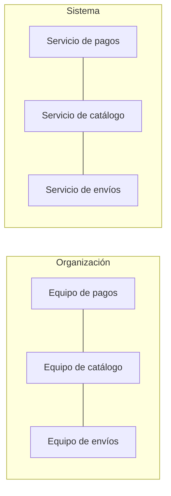

import { Quiz } from "@/components/quiz";

En 1968, el programador Melvin Conway publicó un artículo con una observación que, años después, se convertiría en una de las "leyes" más citadas de la ingeniería del software. En palabras del propio Conway:

> Cualquier organización que diseña un sistema producirá un diseño cuya estructura es una copia de la estructura de comunicación de la organización.

Fred Brooks la bautizó como **ley de Conway** en su influyente libro *The Mythical Man-Month*.

## Qué significa

Martin Fowler cuenta cómo se la explicaron a él: si un solo equipo escribe un compilador, saldrá un compilador de una pasada; si el equipo se divide en dos, saldrá uno de dos pasadas. No porque el problema lo pida, sino porque cada equipo construye su parte y las partes se comunican como se comunican los equipos.

La razón es práctica: para que dos partes de un sistema encajen, las personas que las construyen tienen que hablar. Donde la comunicación es fácil, las piezas quedan muy unidas; donde es difícil, aparece una frontera.

## Por qué sigue importando

Martin Fowler señala que, aunque los expertos discrepan en muchas cosas, casi todos coinciden en la importancia de la ley de Conway. Algunas consecuencias:

- **Los [microservicios](/articulos/monolito-y-microservicios/)** funcionan cuando cada servicio corresponde a un equipo que puede trabajar sin depender de los demás. Repartir un sistema en servicios sin repartir los equipos produce un monolito distribuido, con lo peor de los dos mundos.
- **Las fronteras** de un buen diseño, como los contextos delimitados del [diseño guiado por el dominio](/articulos/diseno-guiado-por-el-dominio/), deberían coincidir con las de los equipos.
- **Reorganizar una empresa** cambia, con el tiempo, la arquitectura de su software.

## La maniobra inversa

Si la organización determina el diseño, se puede usar a favor: organizar primero los equipos según la arquitectura que se quiere obtener. Se conoce como la **maniobra inversa de Conway**, y según Fowler es habitual en el mundo de los microservicios: equipos pequeños y estables, organizados por capacidades del negocio, con todas las habilidades necesarias para entregar valor.

## Lo esencial

- La ley de Conway dice que un sistema copia la estructura de comunicación de quien lo diseña.
- La formuló Melvin Conway en 1968, y Fred Brooks le dio el nombre.
- Explica por qué los microservicios necesitan equipos independientes.
- Se puede aprovechar organizando los equipos según la arquitectura deseada.
