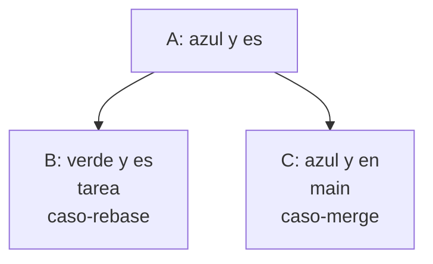
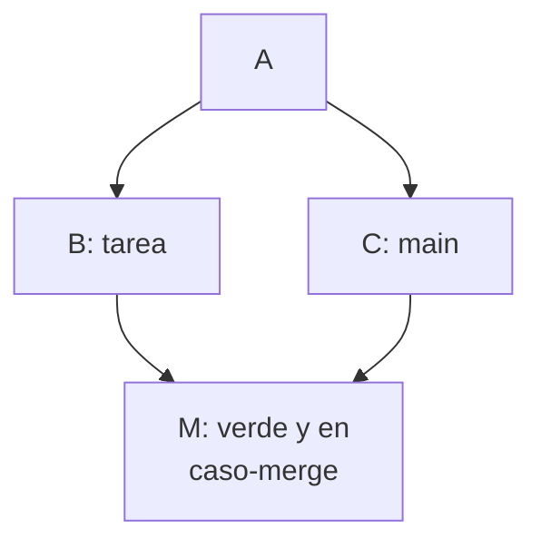
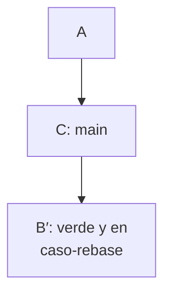

import { Quiz } from "@/components/quiz";

**Merge**, o fusión, integra trabajo conectando historias de [Git](/articulos/control-de-versiones-con-git/) sin sustituir los commits existentes. **Rebase**, o reorganización, vuelve a aplicar una serie de cambios sobre una base diferente y normalmente crea commits nuevos. Las dos operaciones pueden producir los mismos archivos con historias distintas.

## El problema compartido

Has trabajado en una rama mientras `main` avanzaba. Necesitas incorporar ambos trabajos. La decisión no trata solo del contenido final: también determina qué commits conservarán su identidad y cómo se verá la relación entre los cambios.

Una fusión puede resolverlo mediante un commit con varios padres. Si una rama ya contiene toda la historia de la otra, puede bastar un **avance rápido**, que mueve el nombre de la rama sin crear un commit. Rebase intenta construir una secuencia sobre la base elegida; puede detenerse por conflictos o descartar cambios que ya estén presentes.

## Preparar el mismo punto de partida

Esta práctica es independiente de otros ejemplos. Usa Git 2.28 o posterior, PowerShell o Bash y un editor de texto. Abre una terminal fuera de otros repositorios, donde no exista `practica-integracion`:

```bash
mkdir practica-integracion
cd practica-integracion
git init -b main
git config --local user.name "Persona de prueba"
git config --local user.email "practica@example.com"
```

Crea dos archivos de texto UTF-8: `color.txt` con una línea `azul` e `idioma.txt` con una línea `es`.

```bash
git add color.txt idioma.txt
git commit -m "A: establece color e idioma"
git switch -c tarea
```

Sustituye `azul` por `verde` en `color.txt` y guarda:

```bash
git add color.txt
git commit -m "B: cambia el color a verde"
git switch main
```

Ahora `color.txt` vuelve a contener `azul`. Cambia `idioma.txt` de `es` a `en`:

```bash
git add idioma.txt
git commit -m "C: cambia el idioma a en"
git branch caso-merge main
git branch caso-rebase tarea
git status --short
```

El estado queda limpio. `git branch` crea nombres para comparar las dos estrategias sin mover `main` ni `tarea`. A, B y C son etiquetas explicativas de los mensajes; los identificadores reales serán distintos.

En los diagramas, las flechas van de una versión anterior a una posterior:



## Resolverlo con merge

```bash
git switch caso-merge
git merge --no-ff -m "M: combina color e idioma" tarea
git show HEAD:color.txt
git show HEAD:idioma.txt
git log -1 --format="%s | padres: %p"
```

La rama actual, `caso-merge`, recibe el trabajo de `tarea`. Como las historias divergieron, se crea M con dos padres: C y B. `--no-ff` expresa que queremos un commit de fusión; en este caso ya hacía falta por la divergencia.

Las consultas muestran `verde` y `en`. La última línea imprime el mensaje de M y dos identificadores de padres. B y C conservan sus identidades.



## Resolverlo con rebase

Vuelve al otro caso, que aún apunta a B:

```bash
git switch caso-rebase
git rebase main
git show HEAD:color.txt
git show HEAD:idioma.txt
git log -1 --format="%s | padres: %p"
git diff caso-merge caso-rebase
```

Git toma el cambio de color introducido por B y lo aplica encima de C. El resultado B′ tiene un padre, C. Su identificador cambia porque ahora representa otra historia y su instantánea incluye el idioma `en`.

Las consultas vuelven a mostrar `verde` y `en`. `git diff` no imprime diferencias entre las dos ramas: los archivos coinciden. Eso no significa que sus commits coincidan.



La rama `tarea` sigue conservando B para esta comparación. `main` continúa en C: reorganizar `caso-rebase` no incorpora por sí solo sus cambios a `main`.

<Quiz
	client:visible
	question="Después de la práctica, git diff no muestra diferencias entre caso-merge y caso-rebase. ¿Qué puedes concluir?"
	options={[
		"Sus archivos coinciden, aunque sus commits y padres son distintos",
		"Ambas ramas apuntan necesariamente al mismo commit",
		"Rebase creó también el commit M",
	]}
	answer={0}
/>

## Qué cambia cuando hay un conflicto

Los casos anteriores cambiaban archivos distintos. Para producir un conflicto real, crea otra rama desde `main`, que todavía contiene `azul`:

```bash
git switch -c conflicto main
```

Cambia `color.txt` a `rojo` y guarda:

```bash
git add color.txt
git commit -m "D: cambia el color a rojo"
git merge tarea
```

La última orden se detiene con un conflicto: desde el mismo `azul`, una rama pidió `rojo` y la otra `verde`. `git status` identifica el archivo pendiente. Dentro aparecen marcas que separan las dos propuestas.

Para esta práctica, decide que el resultado sea `verde`. Sustituye todo el contenido de `color.txt` por esa única línea, sin dejar las marcas, y ejecuta:

```bash
git add color.txt
git commit -m "Resuelve el color compartido"
git status --short
```

El estado vuelve a quedar limpio. Has elegido un resultado y creado la confirmación que completa la fusión; Git no decidió qué color era correcto.

En un rebase, un conflicto detiene la reaplicación del commit correspondiente. Después de editar y preparar la solución, `git rebase --continue` prosigue. Puede aparecer otro conflicto al aplicar un commit posterior. `git rebase --abort` abandona la operación y recupera el punto de partida de la rama. Para abandonar una fusión en curso existe `git merge --abort`. Conviene iniciar ambas operaciones con el trabajo confirmado o guardado aparte: mezclar ediciones pendientes complica recuperar el estado anterior.

## Comparación y elección

| Criterio | Merge | Rebase |
| --- | --- | --- |
| Commits existentes | Conserva sus identidades | Puede sustituir los reaplicados por otros |
| Commit adicional | De fusión si hace falta o se solicita; ninguno en avance rápido | Normalmente una nueva versión por commit reaplicado |
| Historia | Mantiene las bifurcaciones integradas | Suele reorganizar la serie como una secuencia sobre la nueva base |
| Conflictos | Se resuelven para la integración solicitada | Pueden reaparecer en distintas reaplicaciones |
| Trabajo compartido | Facilita conservar referencias que otros ya usan | Requiere coordinar cualquier historia publicada que se reescriba |

Merge resulta apropiado para integrar ramas compartidas conservando sus relaciones. Rebase puede ayudar a actualizar una rama personal antes de compartirla. La elección también depende de las convenciones del equipo; una historia lineal no demuestra que el código sea mejor.

La opción habitual de rebase no conserva todos los commits de fusión de la serie. Existen opciones específicas para reorganizar historias con fusiones; no conviene extrapolar el ejemplo sencillo a cualquier historial.

## Errores comunes

- **Reorganizar commits sobre los que otras personas ya trabajan sin avisar.** Sus ramas seguirán basadas en los identificadores anteriores y tendrán que reconciliarse con la historia nueva.
- **Confundir ausencia de conflictos con comportamiento correcto.** Una edición puede cambiar un nombre y otra seguir utilizándolo en otro archivo. Git puede integrarlas sin protestar aunque el programa falle.
- **Eliminar marcas sin comprender la decisión.** Resolver un conflicto exige preservar el comportamiento acordado, no solo conseguir que Git continúe.
- **Tratar squash como una fusión normal.** Una integración *squash* reúne cambios en una confirmación sin conservar la misma relación de padres que una fusión ordinaria.

## Lo esencial

- Merge conecta historias; un avance rápido no crea un commit de fusión.
- Rebase reaplica cambios y puede cambiar los identificadores de los commits.
- Dos resultados pueden tener archivos iguales e historias diferentes.
- Tras cualquier integración, revisa y prueba el comportamiento; coordina la reescritura de historia compartida.
