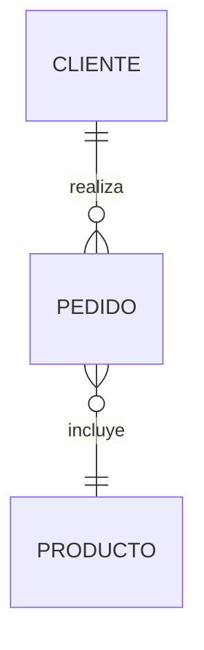

import { Quiz } from "@/components/quiz";

El **modelo entidad-relación** es una forma de describir los datos de un sistema antes de construirlo: **qué cosas** hay que guardar, **qué se sabe** de cada una y **cómo se relacionan** entre sí. Se representa con un diagrama, y a partir de él se diseñan las tablas de una [base de datos](/articulos/que-es-una-base-de-datos/).

Lo propuso Peter Chen en 1976, y sigue siendo la forma habitual de empezar el diseño.

## Qué problema resuelve

Lanzarse a crear tablas directamente lleva a errores difíciles de corregir después: datos duplicados, relaciones que no encajan, información que no hay dónde poner.

El modelo obliga a pensar primero en el **problema**, con el vocabulario de quien lo conoce, y no en la tecnología. Un diagrama se discute con alguien que no programa: "¿un pedido puede tener varios clientes?" es una pregunta de negocio, no de bases de datos.

## Las piezas

### Entidades

Una **entidad** es un tipo de cosa sobre la que se guarda información: Cliente, Producto, Pedido. Cada cliente concreto es una **instancia**.

Suelen ser los sustantivos importantes del problema.

### Atributos

Los **atributos** son lo que se sabe de cada entidad: de un cliente, su nombre, su correo, su fecha de alta.

Uno o varios atributos forman el **identificador**: lo que distingue a cada instancia de las demás. Se convertirá en la clave primaria.

### Relaciones

Una **relación** une entidades: un cliente **hace** pedidos, un pedido **contiene** productos. Suelen ser los verbos.

## Cardinalidad

Es lo más importante del modelo: cuántas instancias de cada lado pueden participar en una relación.

| Tipo | Significado | Ejemplo |
| --- | --- | --- |
| Uno a uno | Cada A con un B, y al revés | Persona y pasaporte |
| Uno a muchos | Cada A con varios B; cada B con un A | Cliente y pedidos |
| Muchos a muchos | Cada A con varios B, y al revés | Pedidos y productos |

Además se indica si la participación es **obligatoria u opcional**: ¿puede haber un cliente sin pedidos? Sí. ¿Un pedido sin cliente? No.

Equivocarse en la cardinalidad es el error de diseño más caro: suponer que una persona tiene un solo teléfono, o que un producto pertenece a una sola categoría, y descubrir después que no.

## Del diagrama a las tablas

El paso al modelo relacional sigue unas reglas casi mecánicas.

**Cada entidad, una tabla**, con sus atributos como columnas y el identificador como clave primaria.

**Uno a muchos**: se añade al lado "muchos" una **clave foránea** que apunta al lado "uno". Cada pedido guarda el identificador de su cliente.

```sql
CREATE TABLE clientes (
	id SERIAL PRIMARY KEY,
	nombre TEXT NOT NULL,
	correo TEXT UNIQUE NOT NULL
);

CREATE TABLE pedidos (
	id SERIAL PRIMARY KEY,
	cliente_id INTEGER NOT NULL REFERENCES clientes (id),
	fecha DATE NOT NULL
);
```

El `NOT NULL` de `cliente_id` expresa que la participación del pedido es obligatoria.

**Muchos a muchos**: no cabe en una columna, porque un pedido tendría que guardar una lista de productos y cada producto una lista de pedidos. Se crea una **tabla intermedia**, con una fila por cada pareja.

```sql
CREATE TABLE lineas_de_pedido (
	pedido_id INTEGER REFERENCES pedidos (id),
	producto_id INTEGER REFERENCES productos (id),
	cantidad INTEGER NOT NULL,
	precio NUMERIC NOT NULL,
	PRIMARY KEY (pedido_id, producto_id)
);
```

A menudo esa relación tiene **sus propios atributos**: la cantidad, y el precio en el momento de la compra, que no es necesariamente el precio actual del producto. No pertenecen ni al pedido ni al producto, sino a la relación.

**Uno a uno**: una clave foránea única en cualquiera de los dos lados, o se fusionan en una sola tabla.

<Quiz
	client:visible
	question="¿Cómo se representa en tablas una relación de muchos a muchos?"
	options={[
		"Con una columna que guarda una lista de identificadores",
		"Con una tabla intermedia que tiene una fila por cada pareja relacionada",
		"Duplicando las dos tablas",
	]}
	answer={1}
/>

## El diagrama

Hay varias notaciones. La original de Chen usa rectángulos para las entidades, rombos para las relaciones y óvalos para los atributos. La más usada hoy, llamada **pata de gallo**, dibuja solo entidades como cajas con sus atributos, y expresa la cardinalidad en los extremos de las líneas: una raya para "uno" y tres rayas abiertas, como una pata de gallo, para "muchos".



Lo importante no es la notación, sino que todos los que lo leen la entiendan igual.

## Decisiones habituales

- **¿Atributo o entidad?** Si de la dirección solo se guarda un texto, es un atributo. Si un cliente tiene varias direcciones, o se consultan por separado, es una entidad.
- **Datos que cambian con el tiempo.** El precio de un producto cambia; el de un pedido pasado, no. Por eso se copia en la línea del pedido. Hay que preguntarse qué historia hay que conservar.
- **Nombres claros**, del negocio. La tabla `clientes`, no `tbl_c1`.

Después, la [normalización](/articulos/normalizacion-de-bases-de-datos/) comprueba que el diseño no tiene redundancias problemáticas. Un buen modelo entidad-relación suele dar ya tablas normalizadas.

## Hacer que la base de datos lo cumpla

Las reglas del modelo se convierten en **restricciones**, que la base de datos impone:

| Regla del modelo | Restricción |
| --- | --- |
| Cada instancia es única | `PRIMARY KEY` |
| Un pedido pertenece a un cliente que existe | `FOREIGN KEY` |
| Un atributo es obligatorio | `NOT NULL` |
| No hay dos clientes con el mismo correo | `UNIQUE` |
| Una cantidad es positiva | `CHECK (cantidad > 0)` |

Así, aunque el código de la aplicación tenga un error, los datos no pueden quedar incoherentes.

## Lo esencial

- El modelo entidad-relación describe las cosas de un sistema, sus datos y sus relaciones.
- Las entidades suelen ser sustantivos; las relaciones, verbos.
- La cardinalidad, uno a uno, uno a muchos o muchos a muchos, es la decisión más importante.
- Uno a muchos se traduce en una clave foránea; muchos a muchos, en una tabla intermedia.
- Las reglas del modelo se imponen en la base de datos con restricciones.
