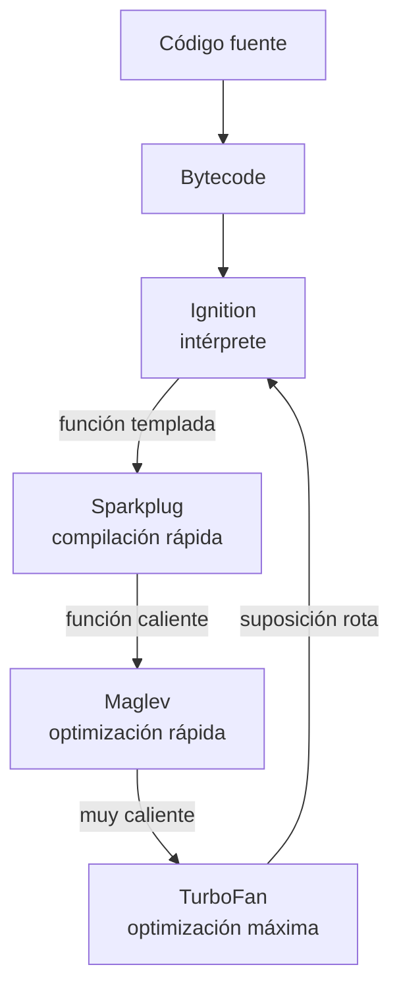

import { Quiz } from "@/components/quiz";

Un **motor de JavaScript** ejecuta programas escritos en ese lenguaje. La **compilación JIT** (*just in time*, justo a tiempo) genera código máquina durante la ejecución; motores como **V8**, usado en Chrome y [Node.js](/articulos/que-es-nodejs/), la combinan con un intérprete.

## Por qué combinar interpretación y compilación

El navegador recibe código fuente y necesita empezar a responder pronto. Compilar y optimizar todo antes de ejecutarlo añade trabajo inicial, incluso para funciones que quizá no se llamen. Interpretar reduce ese trabajo, pero repite durante la ejecución tareas que el código máquina puede evitar. La combinación permite invertir más esfuerzo en las funciones que se usan con frecuencia.

## Por niveles



El esquema resume los niveles descritos por V8 al presentar Maglev en 2023. No es una escalera obligatoria para cada función: las decisiones dependen de la versión, la configuración y el comportamiento observado. El punto de partida es el **bytecode**, instrucciones para una [máquina virtual](/articulos/que-es-una-maquina-virtual-de-un-lenguaje/), que ejecuta **Ignition**:

| Nivel | Qué hace | Compromiso |
| --- | --- | --- |
| Ignition | Interpreta el bytecode | Evita esperar a generar código máquina, con coste por instrucción interpretada |
| Sparkplug | Traduce el bytecode a código máquina sin optimizar | Compila muy rápido, ejecuta algo más rápido |
| Maglev | Optimiza deprisa | Código "suficientemente bueno", generado rápido |
| TurboFan | Optimiza a fondo | Código muy rápido, pero tarda en compilar |

Compilar cuesta tiempo, así que solo compensa con el código que se ejecuta mucho: las funciones **calientes**. Optimizar a fondo una función que se llama una vez sería tirar el esfuerzo.

## Optimizar a base de suposiciones

JavaScript es [dinámico](/articulos/tipado-estatico-y-dinamico/): una variable puede contener un número ahora y un texto después. Un compilador puede generar código que cubra ambos casos, pero especializar una operación necesita información adicional. Mientras ejecuta, el motor observa los tipos y la **forma de los objetos**, la organización de sus propiedades. Optimizar con pocas observaciones puede producir suposiciones que fallen pronto.

Con esa información puede especializar una suma para números, comprobando las condiciones necesarias. La operación sigue obligada a respetar JavaScript: observar números no autoriza a tratar cualquier entrada futura como número.

## Cuando la apuesta falla: desoptimizar

Si un día llega un texto donde siempre hubo números, la comprobación falla. El motor **desoptimiza**: descarta el código optimizado y vuelve al intérprete para esa función, que sigue funcionando correctamente, solo que más despacio.

```js
const traza = [];
let llamadas = 0;
let optimizada = false;

function sumar(a, b) {
	llamadas++;
	if (optimizada && (typeof a !== "number" || typeof b !== "number")) {
		optimizada = false;
		traza.push(`desoptimizada en la llamada ${llamadas}`);
	}
	if (!optimizada && llamadas === 1000) {
		optimizada = true;
		traza.push("optimizada para números");
	}
	return a + b;
}

for (let i = 0; i < 1500; i++) sumar(i, 1);
sumar("hola", "mundo");

console.log(traza.join("; ")); // "optimizada para números; desoptimizada en la llamada 1501"
```

Es una simulación didáctica: `optimizada` es una variable nuestra y no consulta el estado real de V8. El umbral de 1000 llamadas es inventado. La secuencia permite seguir tres estados:

| Llamadas | Estado simulado | Decisión |
| --- | --- | --- |
| 1–999 | Sin especializar | Se aplica `+` normalmente |
| 1000–1500 | Especializado para números | Las entradas siguen cumpliendo la suposición |
| 1501 | Se abandona la especialización | Llegan cadenas y `+` debe concatenarlas |

En un motor real, desoptimizar exige reconstruir el estado de ejecución: valores locales y punto donde continuar. Reiniciar la función desde el principio podría repetir efectos como escribir un archivo. La desoptimización conserva el comportamiento del programa, aunque tenga un coste de rendimiento.

<Quiz
	client:visible
	question="Una suma especializada para números recibe dos cadenas. ¿Qué debe preservar el motor?"
	options={["La suma numérica, porque ya estaba optimizada", "La concatenación que exige JavaScript, aunque deba desoptimizar", "Un error obligatorio por cambiar los tipos"]}
	answer={1}
/>

## Qué significa para quien programa

- **La estabilidad puede facilitar la especialización**: recibir tipos y formas de objetos estables da información útil al optimizador. No garantiza por sí sola que una función sea rápida.
- **No hace falta obsesionarse**: los motores son muy buenos optimizando código normal. Las microoptimizaciones rara vez compensan frente a elegir un buen [algoritmo](/articulos/complejidad-algoritmica/).
- **Medir antes de cambiar**: el rendimiento real depende del motor y de su versión.

## Errores comunes

- **Medir solo una llamada y extrapolar a miles**: el arranque y una ejecución repetida pueden usar niveles distintos. La medición debe representar el uso que quieres mejorar.
- **Tomar 1000 llamadas como una regla de V8**: es el umbral de nuestra simulación. Las decisiones reales no forman parte del contrato del lenguaje.
- **Cambiar un algoritmo por una microoptimización sin medir**: ahorrar una operación no compensa necesariamente recorrer millones de elementos innecesarios. Primero identifica dónde se consume el tiempo.

## Lo esencial

- Un motor como V8 compila el JavaScript a bytecode y empieza interpretándolo.
- El motor decide cuándo compilar y cuánto optimizar según el coste y la información observada.
- El optimizador apuesta por los tipos que ha observado; si la apuesta falla, desoptimiza.
- La estabilidad puede ayudar a especializar; las mejoras de rendimiento se comprueban midiendo casos representativos.
