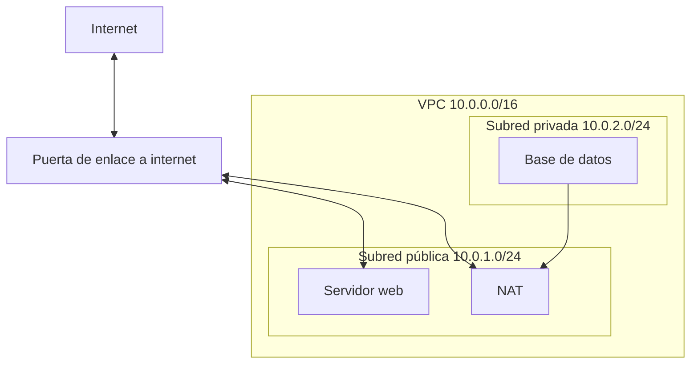

import { Quiz } from "@/components/quiz";

Una **nube privada virtual**, o **VPC**, es una red privada que defines dentro de la infraestructura de un proveedor de [nube](/articulos/computacion-en-la-nube/). Está **lógicamente aislada** de las redes de otros clientes: tus servidores, bases de datos y servicios se comunican dentro de ella, y tú decides qué entra y qué sale.

Es el equivalente en la nube a la red de una oficina: con sus rangos de direcciones, sus divisiones internas, su router y su cortafuegos, pero todo definido por software.

## Las piezas



- **Rango de direcciones**: al crear la VPC se elige un bloque de IP privadas en notación [CIDR](/articulos/subredes-y-cidr/), como `10.0.0.0/16`.
- **Subredes**: trozos de ese rango. En AWS, cada subred vive en una única zona de disponibilidad, un centro de datos o grupo de ellos.
- **Tablas de rutas**: deciden a dónde va el tráfico que sale de cada subred.
- **Puerta de enlace a internet**: conecta la VPC con internet.
- **NAT**: permite que las máquinas de una subred privada salgan a internet, por ejemplo para descargar actualizaciones, sin que nadie desde fuera pueda iniciar una conexión con ellas.
- **Grupos de seguridad**: reglas de [cortafuegos](/articulos/cortafuegos/) asociadas a cada recurso.

## Pública y privada

La diferencia entre una subred **pública** y una **privada** está solo en su tabla de rutas:

- En la pública, el tráfico hacia internet va a la puerta de enlace. Sus máquinas pueden ser accesibles desde fuera.
- En la privada, no hay ruta directa a internet. Como mucho, salen a través del NAT.

El diseño habitual: el servidor web, o mejor un [balanceador](/articulos/balanceador-de-carga/), en la pública; la aplicación y la base de datos, en la privada. Si un atacante no puede llegar a la base de datos por la red, ya tiene una barrera menos.

## Cómo se decide la ruta

```js
const ip = (texto) => texto.split(".").reduce((n, octeto) => n * 256 + Number(octeto), 0);

function enRango(direccion, cidr) {
	const [red, bits] = cidr.split("/");
	const tamano = 2 ** (32 - Number(bits));
	const inicio = ip(red);
	return ip(direccion) >= inicio && ip(direccion) < inicio + tamano;
}

function siguienteSalto(destino, rutas) {
	return rutas.find((ruta) => enRango(destino, ruta.destino))?.salto ?? "descartar";
}

const subredPrivada = [
	{ destino: "10.0.0.0/16", salto: "local" },
	{ destino: "0.0.0.0/0", salto: "NAT" },
];

console.log(siguienteSalto("10.0.1.25", subredPrivada)); // "local"
console.log(siguienteSalto("93.184.216.34", subredPrivada)); // "NAT"
```

El tráfico hacia la propia VPC se queda dentro (`local`); el resto, en la subred privada, va al NAT. Las tablas reales eligen la ruta **más específica** que coincide; aquí basta con ordenarlas de más a menos específica.

## Por qué importa

- **Aislamiento**: lo que no necesita estar en internet, no lo está.
- **Defensa en capas**: subredes, rutas, grupos de seguridad e [identidades y accesos](/articulos/gestion-de-identidades-y-accesos/) son barreras independientes.
- **Conexión con tu red**: una VPC se puede unir a la red de la oficina con una [VPN](/articulos/vpn-y-tuneles/) o a otras VPC.

El error más común es el contrario: poner todo en subredes públicas "para que funcione" y abrir los grupos de seguridad a cualquier dirección.

## Lo esencial

- Una VPC es una red privada y aislada que defines dentro de la nube.
- Se divide en subredes; su tabla de rutas decide si son públicas o privadas.
- La puerta de enlace conecta con internet; el NAT deja salir sin dejar entrar.
- Lo habitual es dejar en la subred pública solo la entrada, y el resto en privadas.
