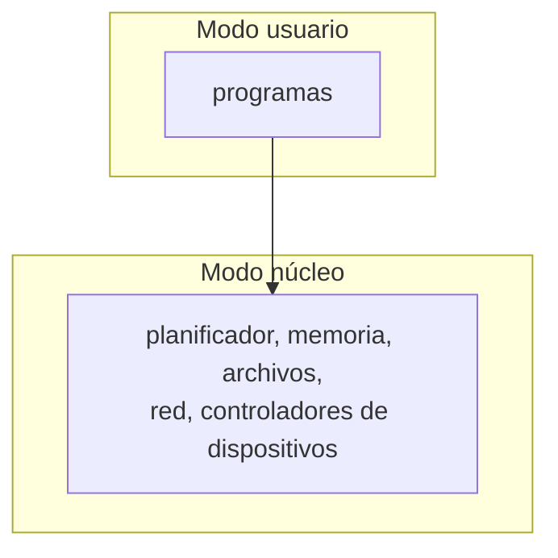
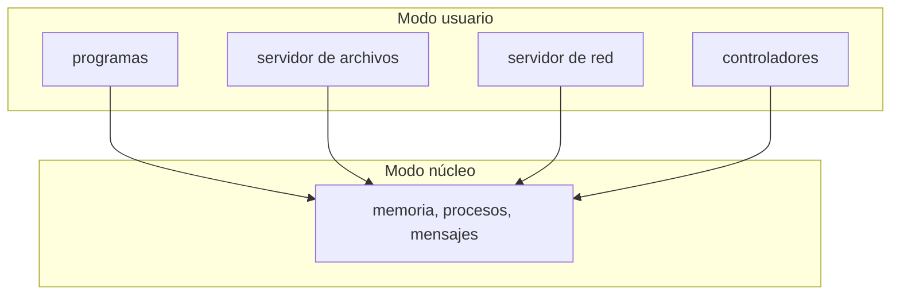

import { Quiz } from "@/components/quiz";

El **núcleo** es la parte del [sistema operativo](/articulos/que-es-un-sistema-operativo/) que se ejecuta con todos los privilegios. Hay dos formas opuestas de diseñarlo. Un **núcleo monolítico** pone en esa zona privilegiada casi todo: los controladores de dispositivos, el sistema de archivos, la red. Un **micronúcleo** deja ahí solo lo imprescindible y ejecuta lo demás como procesos normales.

## Núcleo monolítico

Todo el sistema operativo es un único programa grande, que se ejecuta en modo privilegiado:

Las partes se comunican con simples llamadas a funciones, dentro del mismo espacio de memoria.

- **A favor:** rápido. No hay que cambiar de modo para que el sistema de archivos hable con el controlador del disco.
- **En contra:** un fallo en cualquier parte, por ejemplo en el controlador de una tarjeta de red, puede tumbar el sistema entero o abrir un agujero de seguridad. Y es una enorme cantidad de código privilegiado.

[Linux](/articulos/que-es-linux/) es monolítico, aunque **modular**: los controladores se cargan y descargan mientras funciona. Siguen ejecutándose con todos los privilegios.

## Micronúcleo

El núcleo hace lo mínimo: gestionar la memoria, repartir el procesador entre procesos y permitir que estos se envíen mensajes. Todo lo demás son **servidores**, procesos en modo usuario:

Para leer un archivo, el programa envía un mensaje al servidor de archivos, que envía otro al controlador del disco. Todo pasando por el núcleo.

- **A favor:** si falla un controlador, solo cae ese proceso, y se puede reiniciar. Hay mucho menos código privilegiado en el que confiar.
- **En contra:** cada operación implica varios mensajes y cambios de modo, que cuestan tiempo.

Ejemplos: MINIX 3, diseñado para la fiabilidad, y seL4, un micronúcleo cuya corrección se ha **demostrado matemáticamente**. Esa demostración solo es viable porque es pequeño: unos miles de líneas.

## Comparación

| | Monolítico | Micronúcleo |
| --- | --- | --- |
| En modo núcleo | Casi todo el sistema | Lo mínimo |
| Comunicación interna | Llamadas a funciones | Mensajes |
| Rendimiento | Alto | Menor, por los mensajes |
| Un controlador defectuoso | Puede tumbar el sistema | Cae solo ese servicio |
| Código privilegiado | Millones de líneas | Miles |
| Ejemplos | Linux, los BSD | MINIX 3, seL4, QNX |

## Un debate famoso

En 1992, el profesor Andrew Tanenbaum, autor de MINIX, publicó en un foro que Linux era un diseño anticuado por ser monolítico. Linus Torvalds respondió defendiendo su elección por razones prácticas. El intercambio se cita a menudo como el gran debate entre las dos escuelas.

Con el tiempo, ambas tuvieron parte de razón: Linux triunfó, y los micronúcleos dominan donde la fiabilidad es crítica, en coches, aviones o equipos médicos.

## Híbridos

En la práctica, muchos sistemas mezclan. El núcleo de macOS, XNU, combina un micronúcleo, Mach, con componentes de un núcleo BSD ejecutándose en el mismo espacio privilegiado, por rendimiento. El de Windows también se describe a menudo como híbrido.

Y Linux ha ido sacando cosas a modo usuario cuando conviene, como algunos sistemas de archivos.

<Quiz
	client:visible
	question="En un micronúcleo, ¿qué pasa si falla el controlador de un dispositivo?"
	options={[
		"Cae todo el sistema operativo",
		"Cae solo ese proceso, y se puede reiniciar",
		"El dispositivo se desconecta para siempre",
	]}
	answer={1}
/>

## Lo esencial

- Un núcleo monolítico ejecuta casi todo el sistema operativo en modo privilegiado.
- Un micronúcleo deja ahí lo mínimo y ejecuta el resto como procesos que se envían mensajes.
- El monolítico es más rápido; el micronúcleo, más robusto y con menos código en el que confiar.
- Linux es monolítico y modular; muchos sistemas reales son híbridos.
