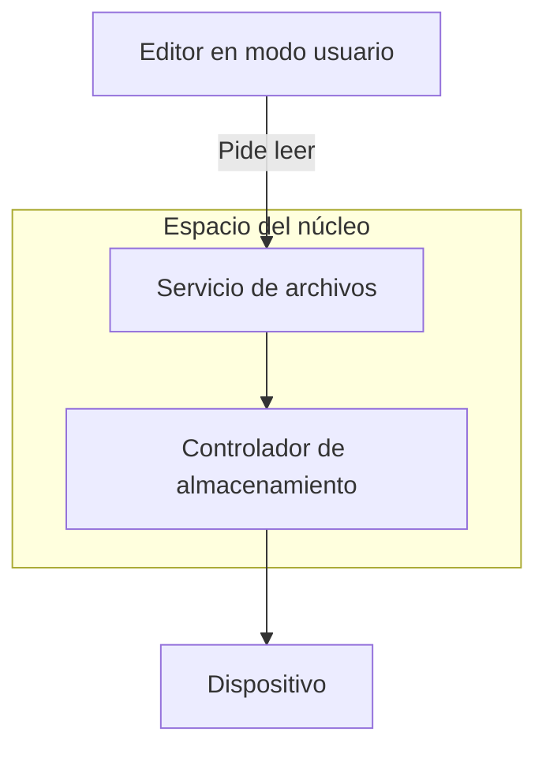
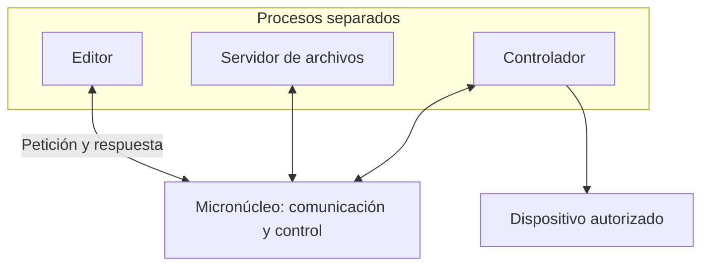

import { Quiz } from "@/components/quiz";

Un **núcleo monolítico** integra muchos servicios, como archivos, red y [controladores](/articulos/que-es-un-driver/), en el espacio privilegiado del núcleo. Un **micronúcleo** mantiene una base más reducida y organiza más servicios como procesos separados. La diferencia central es dónde están las fronteras de ejecución y comunicación.

El **[núcleo](/articulos/que-es-el-kernel/)** es solo una parte del sistema operativo. Un diseño monolítico no mete el escritorio, el navegador y todas las utilidades dentro del núcleo.

## El mismo caso: leer un documento

Un editor pide cien bytes de un archivo que no están disponibles en memoria. Habrá que localizar sus datos y solicitarlos al almacenamiento. Comparamos dos organizaciones didácticas; los recorridos reales dependen del sistema y del dispositivo.

### En un núcleo monolítico

El editor hace una [llamada al sistema](/articulos/llamadas-al-sistema/). El código de archivos y el controlador pueden colaborar mediante llamadas a funciones y estructuras dentro del mismo espacio del núcleo:

Compartir ese espacio permite intercambiar datos sin cruzar una frontera de proceso en cada paso. También amplía lo que puede afectar un fallo de memoria: un controlador defectuoso dentro del núcleo podría corromper estructuras de otros subsistemas.

Linux usa este diseño y admite **módulos**, componentes que pueden incorporarse al núcleo. Poder cargar un módulo no lo convierte en un servicio aislado de usuario. Tampoco implica que cualquier componente pueda descargarse en cualquier momento: puede estar en uso o haberse integrado de otra forma.

### En un diseño con micronúcleo

En nuestro segundo modelo, el editor pide la lectura a un [servidor](/articulos/que-es-un-servidor/) de archivos, que solicita los bloques a un controlador ejecutado como otro proceso. El micronúcleo facilita la comunicación y controla qué recursos puede usar cada participante:

Un **servidor** es aquí un proceso que presta un servicio; no tiene por qué ser otra máquina conectada a internet. La comunicación puede combinar mensajes con regiones compartidas autorizadas. Separar procesos no exige copiar todo el documento en cada intercambio.

Si el controlador falla, la separación puede impedir que su escritura corrupta alcance la memoria privada del servidor. Pero la lectura queda pendiente o falla: reiniciar el controlador no reconstruye automáticamente operaciones, conexiones ni datos que se hayan perdido. Para recuperar el servicio hace falta un protocolo de detección, reinicio y tratamiento de peticiones pendientes. MINIX 3 desarrolla esta idea de recuperación.

## Comparación sobre esa lectura

| Criterio | Monolítico del ejemplo | Micronúcleo del ejemplo |
| --- | --- | --- |
| Archivos y controlador | Dentro del núcleo | En procesos separados |
| Comunicación entre ellos | Funciones y estructuras compartidas | Mensajes y recursos compartidos autorizados |
| Frontera frente a un fallo de memoria del controlador | Comparte espacio con otros subsistemas | Puede quedar contenido por la separación |
| Recuperar una lectura interrumpida | Depende del estado que sobrevivió | También requiere reconstruir o rechazar la operación |
| Coste | Incluye llamadas, trabajo del servicio y espera del dispositivo | Añade comunicación entre componentes, con optimizaciones posibles |
| Código que debe ser fiable | Núcleo y componentes necesarios para la operación | Micronúcleo y servicios de los que depende la operación |

No se deduce una cifra de rendimiento de la etiqueta. Importan el coste de comunicación, las copias, las cachés, el dispositivo y la aplicación. Tampoco basta contar líneas privilegiadas: un servidor de archivos mal diseñado puede filtrar documentos aunque el micronúcleo cumpla perfectamente su contrato.

<Quiz
	client:visible
	question="El controlador separado se reinicia después de fallar durante una lectura. ¿Qué queda por resolver?"
	options={["Nada: todas las lecturas se recuperan solas", "Qué ocurrió con la petición y cómo reanudarla o comunicar el error", "Convertir el editor en parte del núcleo"]}
	answer={1}
/>

## Cuándo interesa cada organización

Integrar servicios puede simplificar ciertos intercambios y aprovechar un conjunto existente de controladores e interfaces. Separarlos puede facilitar limitar permisos, sustituir componentes y analizar qué daños puede propagar cada fallo. La elección depende del sistema completo que se necesita construir y mantener.

Hay diseños que mezclan decisiones. La documentación de XNU, usado por macOS, describe componentes de Mach y BSD dentro del entorno del núcleo. Linux también permite determinados controladores y servicios en modo usuario. Las categorías describen una organización predominante, no prohíben todas las excepciones.

## Qué demuestra la verificación de seL4

seL4 dispone de pruebas formales de propiedades de su núcleo, con alcance por configuración y plataforma. Una **prueba formal** relaciona una implementación y una especificación mediante razonamiento matemático comprobado por herramientas.

Sus garantías tienen supuestos, incluidos aspectos del hardware y del arranque. No convierten cualquier aplicación construida encima en un programa correcto ni certifican automáticamente todos sus plazos. Reducir la base que hay que verificar ayuda al trabajo; no vuelve la verificación una consecuencia automática de tener poco código.

## Confusiones frecuentes

- **Monolítico significa todo el sistema en el núcleo.** Las aplicaciones y muchos servicios siguen fuera.
- **Separado significa recuperable sin trabajo.** Contener un fallo y reconstruir el servicio son problemas diferentes.
- **Micronúcleo significa siempre más lento o invulnerable.** Es necesario evaluar implementación, configuración y carga.

## Lo esencial

- Los diseños colocan distintas fronteras entre los servicios del sistema.
- Compartir espacio facilita ciertos intercambios y amplía el alcance de algunos fallos.
- Separar procesos puede contener fallos, pero exige comunicación y recuperación explícitas.
- Rendimiento y garantías se evalúan sobre un sistema concreto, con sus supuestos.
