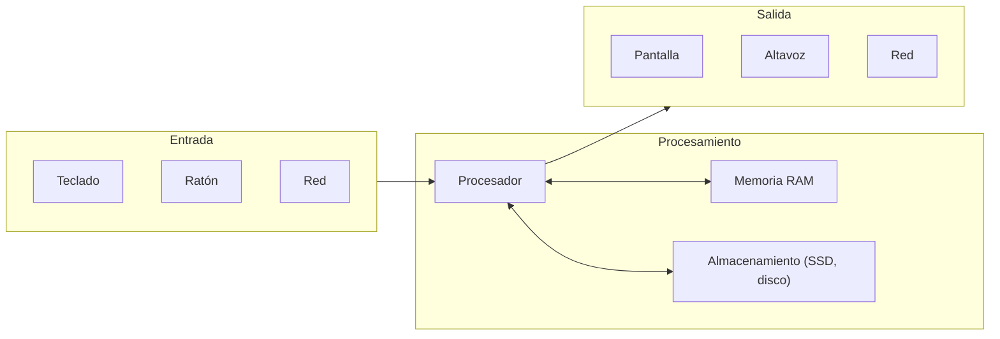

import { Quiz } from "@/components/quiz";

Un ordenador hace cuatro cosas con la información: la **recibe** (entrada), la **guarda** (memoria y almacenamiento), la **procesa** y **devuelve** resultados (salida). Cada pieza física se encarga de una parte de ese trabajo. Este artículo es un mapa: cada componente tiene su propio artículo con más detalle.

## El mapa

## Las piezas

| Componente | Qué hace | Más detalle |
| --- | --- | --- |
| Procesador (CPU) | Ejecuta las instrucciones de los programas | [Cómo funciona un procesador](/articulos/como-funciona-un-procesador/) |
| Memoria RAM | Guarda lo que se está usando ahora; se borra al apagar | [Memoria RAM y almacenamiento](/articulos/memoria-ram-y-almacenamiento/) |
| Almacenamiento | Guarda los datos de forma permanente | [Discos duros y SSD](/articulos/discos-duros-y-ssd/) |
| Tarjeta gráfica (GPU) | Calcula imágenes y muchas operaciones en paralelo | [¿Qué es una GPU?](/articulos/que-es-una-gpu/) |
| Placa base | Conecta todas las piezas entre sí | [La placa base y los buses](/articulos/la-placa-base-y-los-buses/) |
| Firmware (BIOS o UEFI) | Arranca el equipo antes que el sistema operativo | [El arranque de un sistema operativo](/articulos/arranque-de-un-sistema-operativo/) |
| Fuente de alimentación | Convierte la corriente del enchufe en la que usan los componentes | [La fuente de alimentación](/articulos/fuente-de-alimentacion/) |
| Refrigeración | Saca el calor que producen los chips | [Refrigeración de un ordenador](/articulos/refrigeracion-de-un-ordenador/) |
| Tarjeta de red | Conecta el equipo a una red, con cable o sin él | [La tarjeta de red](/articulos/tarjeta-de-red/) |
| Pantalla | Muestra la imagen | [Cómo funciona una pantalla](/articulos/como-funciona-una-pantalla/) |
| Teclado, ratón, pantalla táctil | Llevan las órdenes de la persona al equipo | [Periféricos de entrada](/articulos/perifericos-de-entrada/) |

## Dentro y fuera de la caja

En un ordenador de sobremesa, casi todo está dentro de una caja: placa base, procesador, memoria, almacenamiento, tarjeta gráfica, fuente y ventiladores. Los **periféricos**, como el teclado, el ratón o el monitor, se conectan desde fuera.

En un portátil o un móvil están las mismas funciones, pero muy integradas: el procesador, la gráfica y a veces la memoria van en un mismo chip, y la batería sustituye a la fuente. Un **microcontrolador** lleva la idea al extremo, con todo en un solo chip, como explica [microcontrolador y microprocesador](/articulos/microcontrolador-y-microprocesador/).

## Cómo trabajan juntos

Al abrir un programa:

1. El programa está guardado en el **almacenamiento**.
2. El sistema operativo lo copia a la **RAM**, porque el procesador no puede ejecutarlo directamente desde el disco.
3. El **procesador** lee sus instrucciones de la RAM, una tras otra, y las ejecuta.
4. Los resultados se muestran en la **pantalla**, se guardan o se envían por la **red**.
5. Mientras tanto, la **fuente** alimenta todo y la **refrigeración** evita que se sobrecaliente.

## Lo esencial

- Un ordenador recibe información, la guarda, la procesa y devuelve resultados.
- El procesador ejecuta, la RAM guarda lo inmediato y el almacenamiento lo permanente.
- La placa base conecta las piezas; la fuente las alimenta y la refrigeración las enfría.
- Los periféricos llevan la información dentro y fuera del equipo.
