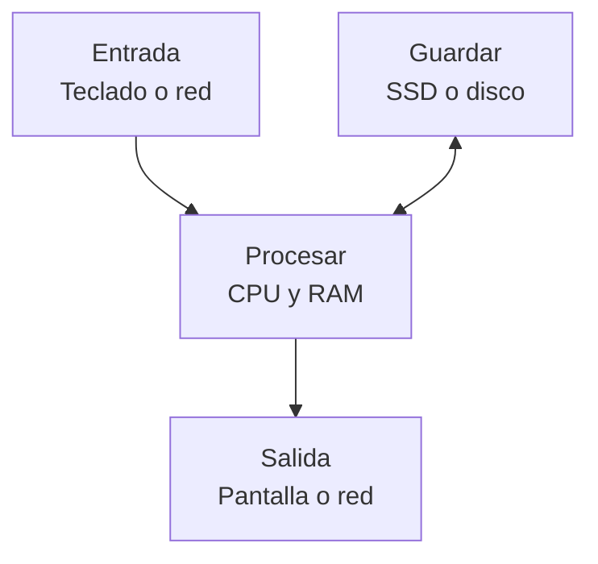

import { Quiz } from "@/components/quiz";

Un ordenador hace cuatro cosas con la información: la **recibe** (entrada), la **guarda** (memoria y almacenamiento), la **procesa** y **devuelve** resultados (salida). Cada pieza física se encarga de una parte de ese trabajo. Este artículo es un mapa: cada componente tiene su propio artículo con más detalle.

## El mapa

Es un mapa de funciones, no del cableado: los datos pasan por conexiones y controladores, circuitos que gestionan la comunicación con cada dispositivo. Una misma pieza puede intervenir en entrada y salida, como la interfaz de red.

## Las piezas

| Componente | Qué hace | Más detalle |
| --- | --- | --- |
| Procesador (CPU) | Ejecuta las instrucciones de los programas | [Cómo funciona un procesador](/articulos/como-funciona-un-procesador/) |
| Memoria RAM | Guarda lo que se está usando ahora; se borra al apagar | [Memoria RAM y almacenamiento](/articulos/memoria-ram-y-almacenamiento/) |
| Almacenamiento | Conserva datos al apagar, aunque puede fallar | [Discos duros y SSD](/articulos/discos-duros-y-ssd/) |
| Procesador gráfico (GPU) | Calcula imágenes y otras operaciones en paralelo | [¿Qué es una GPU?](/articulos/que-es-una-gpu/) |
| Placa base | Conecta todas las piezas entre sí | [La placa base y los buses](/articulos/la-placa-base-y-los-buses/) |
| Fuente de alimentación | Convierte la corriente del enchufe en la que usan los componentes | [La fuente de alimentación](/articulos/fuente-de-alimentacion/) |
| Refrigeración | Saca el calor que producen los chips | [Refrigeración de un ordenador](/articulos/refrigeracion-de-un-ordenador/) |
| Tarjeta de red | Conecta el equipo a una red, con cable o sin él | [La tarjeta de red](/articulos/tarjeta-de-red/) |
| Pantalla | Muestra la imagen | [Cómo funciona una pantalla](/articulos/como-funciona-una-pantalla/) |
| Teclado, ratón, pantalla táctil | Llevan las órdenes de la persona al equipo | [Periféricos de entrada](/articulos/perifericos-de-entrada/) |

## Dentro y fuera de la caja

En un ordenador de sobremesa, casi todo está dentro de una caja: placa base, procesador, memoria, almacenamiento, tarjeta gráfica, fuente y ventiladores. Los **periféricos**, como el teclado, el ratón o el monitor, se conectan desde fuera.

Una GPU puede formar parte del procesador o estar en una tarjeta gráfica con su propia memoria y alimentación. «GPU» y «tarjeta gráfica» no nombran exactamente lo mismo.

En un portátil o móvil varias funciones pueden integrarse en un chip o en un mismo encapsulado, pero siguen existiendo memoria, conexiones y circuitos de alimentación. La batería almacena energía; un adaptador la obtiene de la red eléctrica y los reguladores adaptan las tensiones. No son funciones intercambiables.

Un [microcontrolador](/articulos/microcontrolador-y-microprocesador/) integra CPU, memoria y periféricos para controlar un dispositivo; aún puede necesitar componentes externos. Integrar piezas no elimina sus tareas.

El [firmware](/articulos/que-es-el-firmware/) es software guardado en memoria no volátil, que conserva su contenido al apagar. El de arranque inicializa el equipo antes de cargar el [sistema operativo](/articulos/que-es-un-sistema-operativo/), el programa que administra sus recursos. El chip que lo almacena es hardware; las instrucciones guardadas son software.

## Cómo trabajan juntos

Supón que abres una nota con «Hola», añades «Ana» y la guardas:

1. El programa y la nota están en el **almacenamiento**. El sistema operativo prepara en RAM las partes necesarias; puede cargarlas según se necesitan.
2. Al pulsar el **teclado**, sus señales llegan al equipo. El programa interpreta la entrada y el **procesador** ejecuta instrucciones que actualizan el texto en memoria.
3. El sistema prepara una imagen, con ayuda de la GPU según el caso, y la **pantalla** muestra «Hola Ana». Ver el cambio no demuestra que ya esté guardado.
4. Al guardar, el programa pide escribir el contenido en almacenamiento. Puede haber pasos intermedios en memoria: la persistencia requiere que la escritura llegue al soporte adecuado.
5. La **alimentación** proporciona energía durante todo el recorrido y la **refrigeración** evacua calor dentro de sus límites.

<Quiz
	client:visible
	question="La nota muestra el texto nuevo, pero aún no se ha guardado. ¿Qué puedes concluir?"
	options={[
		"Que el cambio ya existe necesariamente en el disco",
		"Que se ha actualizado lo que ves, pero eso no demuestra persistencia",
		"Que la pantalla almacena el archivo",
	]}
	answer={1}
/>

## Errores comunes

Más RAM permite mantener más trabajo activo, pero no sustituye al almacenamiento de archivos. Una unidad persistente tampoco es una [copia de seguridad](/articulos/copias-de-seguridad/) por sí sola. Y un procesador más rápido no acelera una tarea que está esperando datos de otra pieza: importa qué está ocurriendo en ese recorrido.

## Lo esencial

- Un ordenador recibe información, la guarda, la procesa y devuelve resultados.
- El procesador ejecuta, la RAM mantiene trabajo activo y el almacenamiento conserva datos al apagar.
- La placa base conecta las piezas; la fuente las alimenta y la refrigeración las enfría.
- Los periféricos llevan la información dentro y fuera del equipo.
