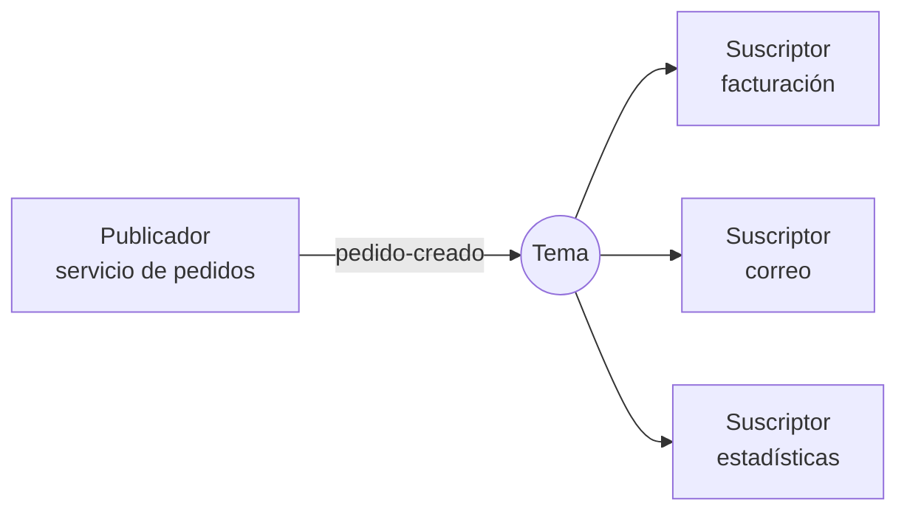

import { Quiz } from "@/components/quiz";

El patrón **publicador/suscriptor**, o **pub/sub**, es una forma de comunicar componentes en la que quien envía un mensaje, el **publicador**, lo publica en un **tema** sin saber quién lo recibirá, y todos los que se han **suscrito** a ese tema reciben una copia. Ni el publicador conoce a los suscriptores ni estos al publicador: solo comparten el nombre del tema.

Google lo resume en su servicio Pub/Sub: un sistema de mensajería asíncrono que desacopla los servicios que producen mensajes de los que los procesan.

## Cómo funciona



Un ejemplo mínimo en memoria:

```js
const temas = new Map();

function suscribir(tema, manejador) {
	if (!temas.has(tema)) temas.set(tema, []);
	temas.get(tema).push(manejador);
}

function publicar(tema, mensaje) {
	const suscriptores = temas.get(tema) ?? [];
	suscriptores.forEach((manejador) => manejador(mensaje));
	return suscriptores.length;
}

const recibidos = [];
suscribir("pedido-creado", (m) => recibidos.push(`factura ${m.id}`));
suscribir("pedido-creado", (m) => recibidos.push(`correo ${m.id}`));

console.log(publicar("pedido-creado", { id: 7 }), recibidos.join(", ")); // 2 factura 7, correo 7
console.log(publicar("pedido-cancelado", { id: 7 })); // 0
```

Publicar en un tema sin suscriptores no es un error: el mensaje, simplemente, no llega a nadie.

## Pub/sub frente a una cola

Las dos se apoyan en un intermediario, como explica [colas de mensajes](/articulos/colas-de-mensajes/), pero reparten distinto:

| | Cola (punto a punto) | Pub/sub |
| --- | --- | --- |
| Cuántos reciben cada mensaje | Uno de los consumidores | Todos los suscriptores |
| Para qué | Repartir trabajo | Avisar de un hecho a quien le interese |
| Ejemplo | Procesar vídeos subidos, cada uno una vez | "Pedido creado": facturación, correo y estadísticas reaccionan |

Muchos sistemas combinan las dos: cada suscriptor tiene su propia cola, y dentro de ella varios trabajadores se reparten los mensajes.

## Frente al patrón observador

El [observador](/articulos/patrones-de-diseno/) es la misma idea dentro de un programa: un objeto avisa a los que se han registrado. En pub/sub hay un **intermediario** entre los dos lados, que pueden estar en máquinas distintas y no conocerse.

## Dónde se usa

- **Arquitecturas orientadas a eventos** entre servicios, como explica [arquitectura orientada a eventos](/articulos/arquitectura-orientada-a-eventos/).
- **Internet de las cosas**: MQTT, el estándar de mensajería del [IoT](/articulos/internet-de-las-cosas/), es un transporte pub/sub muy ligero, pensado para dispositivos pequeños y redes con poco ancho de banda.
- **Tiempo real en la web**: notificaciones y chats, sobre [WebSockets](/articulos/websockets/).
- Servicios de la nube y herramientas como [Redis](/articulos/que-es-redis/) o Kafka.

## Lo que hay que decidir

- **¿Y si un suscriptor está caído?** En los sistemas más simples, se pierde el mensaje; en otros, se guarda hasta que vuelva. Lo explica [como mucho, al menos o exactamente una vez](/articulos/garantias-de-entrega-de-mensajes/).
- **Duplicados y orden**: los suscriptores deben tolerarlos, siendo [idempotentes](/articulos/atomicidad-e-idempotencia/).
- **El formato del mensaje** es un contrato: cambiarlo afecta a suscriptores que el publicador ni conoce.

## Lo esencial

- En pub/sub, el publicador envía a un tema y todos los suscriptores reciben una copia.
- Publicador y suscriptores no se conocen: el tema los desacopla.
- A diferencia de una cola, cada mensaje llega a todos, no a uno.
- Hay que decidir qué pasa con suscriptores caídos, duplicados y cambios de formato.
